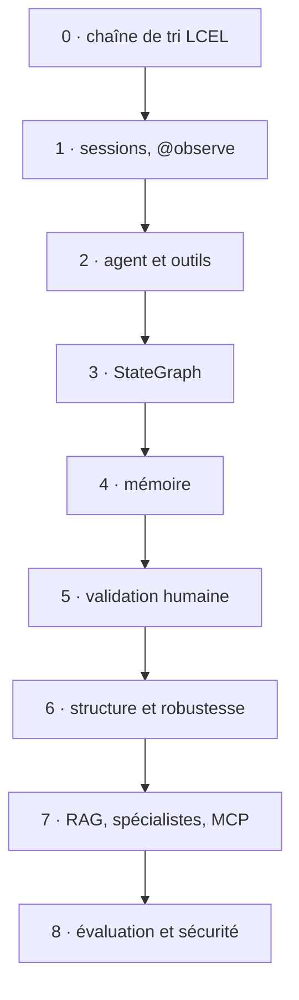
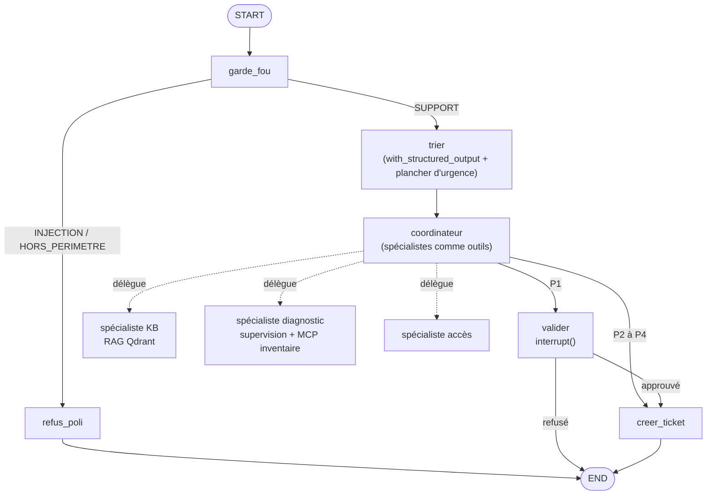

# Introduction · Le fil rouge et la carte du cours

Ce support rassemble **toute la matière** de la formation « Orchestration d'agents IA & Monitoring » : ce qui a
été vu en séance, ce qui a été vu trop vite, et ce qui n'a pas pu l'être (MCP notamment, chapitre 5). Il se lit
dans l'ordre, ou chapitre par chapitre quand vous en avez besoin.

## Le fil rouge : HelpDesk-Ops

NordTech SA, une entreprise fictive, reçoit des demandes de support informatique. HelpDesk-Ops les traite :

1. un **garde-fou** refuse les injections et les demandes hors sujet ;
2. un **tri** qualifie la demande (catégorie, priorité, résumé) dans un format garanti ;
3. un **coordinateur** délègue à des **spécialistes** (procédures, diagnostic, accès) qui ont chacun leurs outils :
   recherche dans la base de connaissances (RAG Qdrant), supervision réseau, inventaire du parc (serveur **MCP**) ;
4. un **humain** valide les tickets urgents (P1) avant leur création ;
5. tout est **tracé, mesuré et évalué** dans Langfuse.

Le système se construit en 9 étapes, une par fichier dans `construction/` :

Et voici le graphe final (étape 8) :

## La carte : où trouver chaque notion

| Notion | Chapitre | Notebook | Étape | Animation |
|---|---|---|---|---|
| Stack locale (Ollama/vLLM, Langfuse, Qdrant) | 1 | J0-01 | (socle) | |
| Chaîne LCEL, traçage Langfuse | 2 | J1-01 | 0, 1 | |
| Agent et outils, boucle ReAct | 2 | J1-02 | 2 | `boucle_react` |
| StateGraph, reducers, routage | 2 | J1-03 | 3, défi 3 | `stategraph_reducers` |
| Persistance, voyage dans le temps, RGPD | 3 | J2-01 | 4 | `persistance_time_travel` |
| Humain dans la boucle | 3 | J2-02 | 5, défi 5 | `interrupt_reprise` |
| Sortie structurée | 3 | J2-03 | 6a | |
| Robustesse | 3 | J2-04 | 6 | `robustesse_retry_timeout` |
| Patterns multi-agents, spécialistes | 4 | J3-01, J3-02 | 7, défi 8a | `coordinateur_specialistes` |
| RAG hybride | 4 | J3-02 | 7 | `rag_hybride` |
| Parallélisme `Send`, Deep Agents | 4 | J3-03, J3-05 | | `send_map_reduce` |
| **MCP** | **5** | J3-04 | 7 | `mcp_client_serveur` |
| Observabilité, RGPD des traces, prompts versionnés | 6 | J4-01 à J4-03 | | |
| Scores, juge LLM, datasets, experiments | 6 | J4-04, J4-05 | 8, défis 8b, 8c | |
| Middleware, garde-fou, red-team | 7 | J5-01, J5-02 | 8 | |
| Conformité, CI, mise en production | 7 | J5-03, J5-04 | | |

## Comment lire chaque chapitre

Chaque notion suit la même forme : **L'idée** (en mots simples), **Le code** (repris du cours, vérifié sur les
versions installées), **Ce qu'on observe** (terminal, dessin du graphe, trace Langfuse), puis les
**✅ bonnes pratiques** et les **⚠️ pièges**, souvent vécus pendant la préparation ou en séance. Chaque chapitre
finit par une **fiche mémo** et une **auto-évaluation** (réponses repliées : cliquez pour les voir).

Versions de référence : Python 3.12, LangChain 1.4, LangGraph 1.2, langgraph-checkpoint-sqlite 3.1, Langfuse SDK
4.15 (serveur 4.46), Qdrant 1.19, Pydantic 2.13 (`infrastructure/pyproject.toml`).

## Les API à utiliser, et celles à fuir

Les tutoriels en ligne mélangent souvent les versions. En cas de doute, cette table fait foi.

| Besoin | ✅ Utiliser (1.x, SDK v4) | ❌ Ancien, à ne pas utiliser |
|---|---|---|
| Agent | `from langchain.agents import create_agent` | `initialize_agent`, `AgentExecutor`, `create_react_agent` de `langgraph.prebuilt` |
| Chaîne | LCEL : `prompt \| llm \| parser` | `LLMChain`, `SequentialChain` |
| Graphe | `from langgraph.graph import StateGraph, START, END, MessagesState` | `MessageGraph` |
| Pause humaine | `from langgraph.types import interrupt, Command` | `interrupt_before` sur un nœud qui a déjà agi |
| Robustesse | `RetryPolicy`, `TimeoutPolicy` (`langgraph.types`) | des `try/except` qui avalent l'erreur |
| Sortie structurée | `llm.with_structured_output(Schema, method="json_schema")` | parser du JSON à la main |
| Traces | `from langfuse.langchain import CallbackHandler` ; `from langfuse import observe, propagate_attributes, get_client` | `langfuse.callback`, `langfuse.decorators` |
| Évaluation | `dataset.run_experiment(...)`, `create_score(...)` | boucles maison sans dataset |
| MCP (client) | `from langchain.mcp import MCPAdapter` (bêta) ; serveur `fastmcp.FastMCP` | |
| Qdrant | `query_points` (utilisé par `QdrantVectorStore`) | `search()`, `recommend()` (dépréciés) |

## Glossaire

| Terme | Définition courte |
|---|---|
| **Agent** | un modèle de langage qui choisit lui-même quand appeler des outils, en boucle, jusqu'à pouvoir répondre |
| **Boucle ReAct** | raisonner, agir (appeler un outil), observer le résultat, recommencer |
| **Outil (tool)** | une fonction Python décrite au modèle par son nom, sa docstring et ses paramètres |
| **LCEL** | LangChain Expression Language : assembler des étapes avec `\|` (prompt, modèle, parseur) |
| **StateGraph** | un graphe dont les nœuds lisent et modifient un état partagé ; les arêtes fixent l'ordre |
| **Reducer** | la règle qui fusionne la mise à jour d'un nœud dans l'état (remplacer, ajouter à une liste…) |
| **Super-step** | un « tour » du graphe : les nœuds prêts s'exécutent, puis l'état est fusionné et sauvegardé |
| **Checkpointer** | ce qui sauvegarde l'état après chaque super-step (SQLite, Postgres, mémoire) |
| **thread_id** | l'identifiant d'une conversation dans le checkpointer |
| **interrupt()** | met le graphe en pause en attendant une décision humaine ; reprise par `Command(resume=…)` |
| **Idempotence** | rejouer une action ne la produit pas deux fois |
| **Sortie structurée** | une réponse du modèle forcée dans un schéma Pydantic |
| **RAG** | Retrieval-Augmented Generation : chercher des passages pertinents et les donner au modèle |
| **Recherche hybride** | combiner recherche par le sens (vecteurs denses) et par les mots (BM25, vecteurs creux) |
| **Spécialiste** | un sous-agent avec ses propres outils et sa consigne, appelé par un coordinateur |
| **Send** | lancer une branche par élément d'une liste, en parallèle (map-reduce) |
| **MCP** | Model Context Protocol : un standard pour qu'un client (votre agent) découvre et appelle les outils d'un serveur |
| **Liste blanche** | la liste des outils autorisés, décidée côté client |
| **Trace, observation, session** | dans Langfuse : une exécution complète, chacune de ses étapes, une conversation |
| **Score** | une note posée sur une trace (par le code, un utilisateur ou un juge LLM) |
| **Dataset, experiment, run** | des cas de test avec la réponse attendue ; leur exécution sur une version du système ; le résultat d'une exécution |
| **Juge LLM** | un modèle qui évalue la réponse d'un autre ; à calibrer sur des cas notés à la main |
| **Garde-fou** | le filtre d'entrée qui refuse injections et demandes hors périmètre |
| **Middleware** | du code qui s'insère avant ou après les appels au modèle ou aux outils d'un agent |
| **Injection de prompt** | un texte qui tente de faire passer des instructions au modèle (directe, ou indirecte via un document) |
