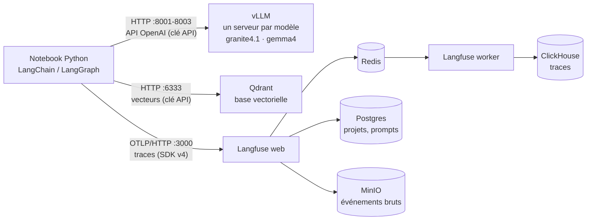
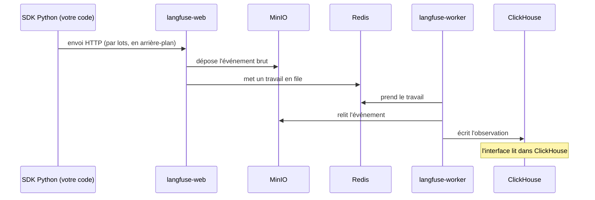

# Chapitre 1 · La stack locale : modèle, Langfuse, Qdrant

> **Ce que vous saurez faire**
>
> - Dire à quoi sert chaque service de la stack (le modèle, Langfuse, Qdrant) et qui parle à qui.
> - Lire et écrire un service Docker Compose : image figée, port publié sur `127.0.0.1`, secret lu dans `.env`, volume, healthcheck.
> - Brancher Python sur chaque service à partir d'un seul fichier `.env`, et choisir entre Ollama et vLLM sans changer le code (`creer_llm`).
> - Expliquer pourquoi on écrit `127.0.0.1` plutôt que `localhost`, et pourquoi `langfuse-web:3000` ne marche pas depuis votre poste.
> - Lancer tout le code du cours avec `uv run --project infrastructure`.
> - Diagnostiquer une panne de branchement avec trois commandes : `ps`, `logs`, `exec … env`.

> **Où le pratiquer**
>
> - Notebook : `notebooks/J0_01_installer_et_brancher.ipynb` (chapitre 0, environ 2h30 en autonomie, hors téléchargements). Début de `notebooks/J1_01_infra_et_tracing.ipynb` (sections 1 à 3).
> - Pack d'installation : `infrastructure/README.md`, `infrastructure/generate_env.py`, `infrastructure/smoke_test.py`.
> - Code du socle : `src/helpdesk_ops/config.py` (`creer_llm`), `src/helpdesk_ops/observabilite.py` (`init_observabilite`).
> - Construction : toutes les étapes `construction/etape_NN_*.py` commencent par ces deux lignes de socle.
> - Exercices : les trois pannes de la section 7 du notebook J0-01 (« Panne 1, 2, 3 »).

Versions figées : Qdrant `v1.19.1`, Langfuse `4.46.0`, Ollama `0.34.4`, vLLM `v0.32.0` ; `langfuse 4.15` (SDK v4), `langchain 1.4`, `langgraph 1.2` (`uv.lock` du 28/09/2026, revérifié le 20/10/2026).

---

## 1. La carte : trois services, une seule machine

**L'idée.** Votre code Python parle à trois services. Le **modèle de langage** (vLLM ou Ollama) génère le texte. **Langfuse** enregistre ce que fait votre application, comme la boîte noire d'un avion. **Qdrant** range des textes sous forme de vecteurs et retrouve ceux qui ont le même sens qu'une question. Tout tourne dans des conteneurs Docker, sur votre poste : aucune donnée ne sort de la machine.

**Le code.** Première cellule utile du lab J0-01 : Docker est-il là, et y a-t-il un GPU NVIDIA ? La réponse décide du moteur du modèle.

```python
import shutil
import subprocess

# Docker et Compose v2 sont-ils là ? Y a-t-il un GPU NVIDIA ?
for commande in (["docker", "--version"], ["docker", "compose", "version"]):
    print(subprocess.run(commande, capture_output=True, text=True).stdout.strip())

# shutil.which cherche un programme dans le PATH : s'il trouve nvidia-smi, il y a un GPU NVIDIA
MOTEUR = "vllm" if shutil.which("nvidia-smi") else "ollama"   # forcez "ollama" si vLLM ne démarre pas
print("Moteur LLM retenu :", MOTEUR)
```

Le pack fait le même choix : sans `nvidia-smi`, `generate_env.py` écrit `LLM_BACKEND=ollama`.

**Ce qu'on observe.** Deux versions (Docker, Compose), puis le moteur retenu. Le schéma de la stack, tiré du notebook J1-01 (ports du pack de la salle) :



Aucune flèche ne sort de la machine. C'est l'argument « souveraineté » à défendre devant un DPO ou un RSSI : pas de clé d'API d'un fournisseur, pas de SaaS, pas de transfert hors UE.

Les adresses à retenir. Dans le lab J0-01, chaque port est celui du pack **plus 10 000**, pour que le lab tourne à côté du pack sans le toucher :

| Service | Pack (salle) | Lab J0-01 | Variables du `.env` |
|---|---|---|---|
| Langfuse (interface + API) | `http://localhost:3000` | `http://127.0.0.1:13000` | `LANGFUSE_BASE_URL`, `LANGFUSE_PUBLIC_KEY`, `LANGFUSE_SECRET_KEY` |
| Qdrant (REST + tableau de bord) | `http://127.0.0.1:6333` | `http://127.0.0.1:16333` | `QDRANT_URL`, `QDRANT_API_KEY` |
| vLLM | `http://127.0.0.1:8001` (agent), `8002` (small), `8003` (juge) | `http://127.0.0.1:18001` | `VLLM_URL_AGENT`, `VLLM_URL_SMALL`… (pack) ou `VLLM_BASE_URL` (lab), `VLLM_API_KEY` |
| Ollama | `http://127.0.0.1:11434` | `http://127.0.0.1:21434` | `OLLAMA_BASE_URL` |

> ✅ **Bonne pratique :** gardez ce tableau sous la main : une panne de branchement, c'est le plus souvent une mauvaise adresse ou une mauvaise clé.

> ⚠️ **Piège :** lab et pack sont deux projets distincts : une clé du `lab0/.env` ne marche pas sur le pack.

---

## 2. Le fichier `.env` : une seule source de vérité

**L'idée.** Toutes les adresses, tous les noms de modèles et tous les secrets vivent dans **un seul fichier** `.env`. Docker Compose le lit pour remplir les `${VAR}` de ses fichiers YAML. Python le lit avec `load_dotenv`. Conteneur et code utilisent donc la même clé. Dans le pack : `infrastructure/.env`, généré une fois par `uv run generate_env.py`. Aucun secret dans un notebook ou un script.

**Le code.** Le socle du cours (`src/helpdesk_ops/config.py`) cherche le fichier puis le charge :

```python
import os
from pathlib import Path

from dotenv import load_dotenv


def trouver_env(depart: Path | None = None, nom_dossier: str = "infrastructure") -> Path:
    """Remonte l'arborescence depuis `depart` (par défaut le dossier courant) jusqu'à trouver infrastructure/.env."""
    depart = depart or Path.cwd()
    for dossier in [depart, *depart.parents]:      # le dossier courant, puis son parent, puis le parent du parent…
        candidat = dossier / nom_dossier / ".env"
        if candidat.exists():
            return candidat
    raise FileNotFoundError("infrastructure/.env introuvable : lance `uv run generate_env.py`")


def charger_env(chemin: Path | None = None) -> Path:
    """Charge .env dans os.environ. override=True : modifier .env puis relancer suffit, sans redémarrer le kernel."""
    chemin = chemin or trouver_env()
    load_dotenv(chemin, override=True)
    return chemin
```

Ce qui n'est pas évident : `[depart, *depart.parents]` est la liste « le dossier de départ, puis tous ses parents » (l'étoile `*` déplie les parents dans la liste). C'est pour cela qu'un notebook rangé dans `notebooks/` trouve `infrastructure/.env`. `load_dotenv` copie chaque ligne `CLE=valeur` dans `os.environ`, où le code la lit ensuite : `os.environ["MODEL_AGENT"]`.

**Ce qu'on observe.** Au début de J1-01, la cellule de configuration affiche cinq lignes : l'emplacement du `.env`, le moteur (`vllm` ou `ollama`), le modèle agent, l'adresse Langfuse et **le début seulement** de la clé publique. Une `KeyError` signifie qu'une variable manque dans `.env`. Une `FileNotFoundError` signifie que `generate_env.py` n'a pas été lancé.

> ✅ **Bonne pratique :** un `.env` ne se commite jamais (il est dans `.gitignore`) ; commitez un `.env.example` sans secrets. Et n'affichez jamais un secret en entier : `os.environ['LANGFUSE_PUBLIC_KEY'][:10]`.

> ⚠️ **Piège :** Compose ne relit le `.env` qu'au moment d'un `docker compose up`. Modifier une clé dans `.env` change tout de suite ce que voit Python (après `load_dotenv`), mais **pas** ce que voit le conteneur déjà lancé. C'est la panne 1 du notebook J0-01 (section 10 ci-dessous).

> ⚠️ **Piège :** sous Windows, écrivez le `.env` avec des fins de ligne LF (`newline="\n"`). Sinon un script bash lit `ollama\r` au lieu de `ollama`.

---

## 3. Docker Compose : les mots-clés essentiels

**L'idée.** Un fichier Compose décrit des **services**. `docker compose up` crée un conteneur par service. Tous les conteneurs d'un même projet sont reliés par un réseau privé, sur lequel chacun se joint **par son nom**. Pensez à un immeuble : chaque service a son appartement (le conteneur), son nom sur la boîte aux lettres (le nom du service), et seuls certains ont une porte sur la rue (un port publié).

**Le code.** Le service Qdrant du lab J0-01 (`lab0/01-qdrant.yml`) :

```yaml
name: lab0                                   # nom du projet : préfixe des conteneurs et des volumes

services:
  qdrant:                                    # nom du service = nom d'hôte sur le réseau du projet
    image: docker.io/qdrant/qdrant:v1.19.1   # version FIGÉE, jamais « latest »
    restart: unless-stopped
    ports:
      - 127.0.0.1:16333:6333                 # poste:conteneur, publié en local seulement
    environment:
      QDRANT__SERVICE__API_KEY: ${QDRANT_API_KEY:?QDRANT_API_KEY absente du .env}
      QDRANT__TELEMETRY_DISABLED: "true"     # rien ne sort du poste
    volumes:
      - qdrant_data:/qdrant/storage          # les données survivent au conteneur
    healthcheck:
      # l'image n'a ni curl ni wget : on teste le port en bash pur
      test: ["CMD-SHELL", "bash -c ':> /dev/tcp/127.0.0.1/6333'"]
      interval: 5s
      retries: 10

volumes:
  qdrant_data:
```

Deux mots-clés de plus, utilisés par Langfuse : `depends_on` avec `condition: service_healthy` (un service attend que ses dépendances soient prêtes) et `${VAR:?message}` (Compose s'arrête avec ce message si la variable manque). Seules les variables citées dans `environment` passent dans le conteneur : le `.env` n'y est pas injecté tel quel.

**Ce qu'on observe.** `docker compose up -d --wait` rend la main quand les healthchecks sont verts. `docker compose ps` affiche chaque service, son état (`healthy`, `unhealthy`, `restarting`) et ses ports.

> ✅ **Bonne pratique :** figez chaque image. Le tag flottant `:4` du fichier officiel de Langfuse tirait la v4.68 le 23/10/2026 ; le pack fige `4.46.0`, la version testée, et ne monte qu'après smoke test.

> ⚠️ **Piège (vécu le 20/10/2026) :** sans `name: helpdesk-ops`, Compose prenait le nom du dossier (`infrastructure`) et réutilisait les volumes d'un autre cours rangé dans un dossier du même nom : mot de passe Postgres refusé, traces et vecteurs mélangés.

> ⚠️ **Piège :** Qdrant utilise un double souligné `__` dans ses variables : `QDRANT__SERVICE__API_KEY` correspond à `service.api_key` dans son fichier de configuration.

---

## 4. Dedans, dehors : `127.0.0.1`, `localhost` et les noms de service

**L'idée.** Un service a **deux adresses**. Celle que voient les autres conteneurs du projet : nom du service et port interne (`langfuse-web:3000`, `qdrant:6333`). Celle que voit votre poste (Python, navigateur) : `127.0.0.1` et le port publié. Dans un conteneur, `localhost` désigne **le conteneur lui-même**, pas votre poste. Et les noms de service n'existent **que** sur le réseau du projet.

**Le code.** Le notebook J0-01 le démontre en appelant les mêmes adresses depuis le worker, puis depuis le poste :

```python
import subprocess

import httpx


def depuis_le_worker(url):
    # docker exec : lance wget DANS le conteneur du worker Langfuse
    r = subprocess.run(["docker", "exec", "lab0-langfuse-worker-1", "wget", "-q", "-T", "3", "-O", "-", url],
                       capture_output=True, text=True)
    print(f"worker → {url:45} :", "✅" if r.returncode == 0 else f"❌ {r.stderr.strip()[:60]}")


depuis_le_worker("http://langfuse-web:3000/api/public/health")   # nom de service + port interne
depuis_le_worker("http://minio:9000/minio/health/live")
depuis_le_worker("http://127.0.0.1:13000/api/public/health")      # le worker se cherche lui-même

url = "http://langfuse-web:3000/api/public/health"
try:
    httpx.get(url, timeout=3)                                      # depuis le poste : ce nom n'existe pas
except httpx.HTTPError as exc:
    print(f"poste  → {url:45} : ❌ {type(exc).__name__}")
```

**Ce qu'on observe.** Les deux premiers appels du worker réussissent. Le troisième échoue : dans le worker, `127.0.0.1` est le worker. Depuis le poste, `langfuse-web` est inconnu.

**Pourquoi `127.0.0.1` et pas `localhost` côté Python ?** D'abord, les ports de vLLM, Ollama et Qdrant sont publiés sur `127.0.0.1` uniquement. Ensuite, sous Windows, `localhost` est d'abord résolu en IPv6 (`::1`) et chaque nouvelle connexion attend environ 2 s avant de se rabattre sur IPv4 : mesuré le 21/10/2026, 2,4 s contre 0,3 s par requête Qdrant. Langfuse, publié sur toutes les interfaces dans le pack, n'est pas concerné : c'est pourquoi le pack garde `LANGFUSE_BASE_URL=http://localhost:3000`.

> ✅ **Bonne pratique :** dans `.env`, écrivez `http://127.0.0.1:<port>` pour vLLM, Ollama et Qdrant. Dans un fichier Compose, utilisez le **nom du service** pour joindre un autre conteneur.

> ⚠️ **Piège :** copier `http://localhost:13000` dans la configuration d'un conteneur. Le conteneur se cherche lui-même et échoue.

> ⚠️ **Piège :** un port publié sans `127.0.0.1:` devant (`3000:3000`) est ouvert à tout le réseau de la salle. Ne publiez jamais ainsi Ollama, qui n'a **aucune** authentification.

---

## 5. Qdrant : la base vectorielle

**L'idée.** Qdrant range des **vecteurs**, c'est-à-dire la traduction numérique du sens d'un texte, et retrouve les plus proches d'une question. Qdrant ne calcule pas les vecteurs : c'est **Python** qui les produit avec un modèle d'embeddings (téléchargé une fois depuis Hugging Face, environ 0,5 Go, puis exécuté sur CPU). Analogie : une bibliothèque rangée par sujet, où l'on cherche « à côté » de sa question.

**Le code.** J0-01, section 2 : on vérifie la clé, puis on range quatre fiches et on cherche.

```python
import os
import warnings

import httpx
from langchain_huggingface import HuggingFaceEmbeddings
from langchain_qdrant import QdrantVectorStore
from qdrant_client import QdrantClient, models

warnings.filterwarnings("ignore", message="Api key is used with an insecure connection")

print("Sans clé :", httpx.get(f"{os.environ['QDRANT_URL']}/collections").status_code)   # attendu : 401
qdrant = QdrantClient(url=os.environ["QDRANT_URL"], api_key=os.environ["QDRANT_API_KEY"])

embeddings = HuggingFaceEmbeddings(model_name=os.environ["EMBEDDING_MODEL"], model_kwargs={"device": "cpu"})

if not qdrant.collection_exists("kb_lab0"):
    # la collection doit connaître la DIMENSION des vecteurs : 384 pour ce modèle
    qdrant.create_collection("kb_lab0", vectors_config=models.VectorParams(
        size=int(os.environ["EMBEDDING_DIM"]), distance=models.Distance.COSINE))

kb = QdrantVectorStore(client=qdrant, collection_name="kb_lab0", embedding=embeddings)
if qdrant.count("kb_lab0").count == 0:
    kb.add_texts(
        ["VPN : en cas d'erreur 809, le réseau bloque le port UDP 4500 ; essayer un partage de connexion mobile.",
         "Mot de passe oublié : le réinitialiser sur le portail self-service, avec validation MFA.",
         "Imprimante bloquée : vider la file d'impression, puis redémarrer le service Spouleur.",
         "Wi-Fi des salles de réunion : se connecter au réseau NordTech-Meeting avec son compte."],
        metadatas=[{"categorie": c} for c in ("reseau", "compte", "materiel", "reseau")])

for doc in kb.similarity_search("Mon VPN affiche l'erreur 809", k=2):
    print(doc.metadata["categorie"], "|", doc.page_content[:60])
```

Ce qui n'est pas évident : `QdrantVectorStore` (LangChain) calcule les vecteurs avec `embeddings`, les envoie à Qdrant avec le texte et les métadonnées, puis cherche les plus proches. `[{"categorie": c} for c in (...)]` est une **liste en compréhension** : un dictionnaire par texte, dans le même ordre. `k=2` demande les deux fiches les plus proches.

**Ce qu'on observe.** « Sans clé : 401 » : Qdrant refuse. Puis la fiche VPN sort en premier. Sur le tableau de bord `http://127.0.0.1:16333/dashboard` (lab), après avoir collé la clé `QDRANT_API_KEY`, la collection `kb_lab0` montre ses 4 points avec texte et métadonnées.

> ✅ **Bonne pratique :** une clé API même en local (Zero Trust). Sans clé, n'importe quel processus du poste lit et efface vos collections. Le smoke test vérifie qu'une requête sans clé reçoit bien 401.

> ✅ **Bonne pratique :** pour les tests unitaires et la CI, `QdrantClient(":memory:")` donne la même API **sans serveur**.

> ⚠️ **Piège :** une dimension fausse (`size`) et l'insertion échoue. La dimension dépend du modèle d'embeddings (`EMBEDDING_DIM=384` pour `paraphrase-multilingual-MiniLM-L12-v2`).

> ⚠️ **Piège :** avec LangChain, les métadonnées sont rangées sous `metadata` : un filtre s'écrit `key="metadata.categorie"`, pas `key="categorie"`. Et côté client, `query_points` est l'API actuelle ; `search()` et `recommend()` sont dépréciés depuis la v1.19, ne les copiez pas d'un vieux tutoriel.

---

## 6. Langfuse : six conteneurs et le trajet d'une trace

**L'idée.** Langfuse v4 n'est pas un conteneur mais six. `langfuse-web` (interface et API, reçoit les traces), `langfuse-worker` (traite les traces en arrière-plan), `postgres` (comptes, projets, **clés API**, prompts, datasets), `clickhouse` (les **traces**, observations et scores), `redis` (la file d'attente entre web et worker), `minio` (stockage objet compatible S3 : chaque événement brut reçu). Seul `langfuse-web` est joint depuis votre poste : dans le lab, les autres n'ont aucun port publié (moins de surface d'attaque).

**Le trajet d'une trace :**



D'où quelques secondes entre l'envoi et l'affichage.

**Le code.** Le SDK lit **tout seul** trois variables : `LANGFUSE_BASE_URL`, `LANGFUSE_PUBLIC_KEY`, `LANGFUSE_SECRET_KEY`. Il n'y a rien à passer en paramètre (J0-01, section 3) :

```python
from langfuse import get_client

langfuse = get_client()                       # le client unique, configuré par les variables d'environnement
print("Clés acceptées :", langfuse.auth_check())

# une observation de test : un « span » (une étape de code) avec une entrée et une sortie
with langfuse.start_as_current_observation(name="premier-branchement", as_type="span") as span:
    span.update(input="ping", output="pong")
    trace_id = langfuse.get_current_trace_id()
langfuse.flush()                              # vide la file d'envoi : sinon les dernières traces sont perdues
print(langfuse.get_trace_url(trace_id=trace_id))
```

Dans le cours, on n'écrit pas ces lignes à chaque fois : `langfuse, handler = init_observabilite()` (`src/helpdesk_ops/observabilite.py`) charge le `.env`, crée le client avec `Langfuse(mask=masquer_pii)` (masquage des données personnelles), vérifie les clés avec `auth_check()` et renvoie aussi le `CallbackHandler` de LangChain (chapitre 2).

**Ce qu'on observe.** `auth_check()` renvoie `True` et l'URL ouvre la trace `premier-branchement`. Le lab interroge ensuite MinIO, ClickHouse et Postgres **de l'intérieur** (`docker compose exec`) : on y retrouve l'événement brut, l'observation, puis la clé publique du projet.

> ✅ **Bonne pratique :** créez le client **une seule fois**, au démarrage, avec son masque. Le SDK v4 garde un client unique par clé publique : la **première** configuration gagne. Pour changer de masque, redémarrez le kernel.

> ⚠️ **Piège :** la variable s'appelle `LANGFUSE_BASE_URL` en SDK v4. `LANGFUSE_HOST` est déprécié. Et le premier démarrage de Langfuse prend **2 à 3 minutes** (migrations) : un `auth_check()` qui échoue tout de suite après `up` n'est pas forcément une mauvaise clé.

> ⚠️ **Piège :** les exemples en ligne utilisent souvent `from langfuse.decorators import observe` ou `from langfuse.callback import CallbackHandler` (SDK v2). Ces imports n'existent pas en v4 : utilisez `from langfuse import observe, propagate_attributes, get_client` et `from langfuse.langchain import CallbackHandler`. Le SDK v5 est sorti en octobre 2026 ; il exige un serveur Langfuse 4.59 ou plus, et le `pyproject.toml` borne `langfuse<5`.

---

## 7. Le modèle : Ollama ou vLLM

**L'idée.** Les deux moteurs font la même chose : une API HTTP devant un modèle. Ils diffèrent par la façon de gérer la mémoire.

| | **vLLM** (la salle) | **Ollama** (poste sans GPU, plan B) |
|---|---|---|
| Matériel | GPU NVIDIA obligatoire | CPU ou GPU |
| Modèles | **un serveur par modèle**, chargé au démarrage | plusieurs, chargés à la demande |
| Sécurité | `VLLM_API_KEY` : sans clé, 401 | **aucune authentification** : jamais hors de `127.0.0.1` |
| Client LangChain | `ChatOpenAI(base_url=…, api_key=…)` | `ChatOllama(base_url=…)` |
| Usage | production : débit, requêtes simultanées | portable, préparation, démonstration |

Analogie : vLLM est une cuisine de restaurant, prête dès le matin pour beaucoup de couverts ; Ollama, la cuisine de la maison, où l'on sort les ustensiles au moment de cuisiner.

En salle (GPU RTX PRO 4000 Blackwell, 24 Go, vLLM choisi le 27/10/2026), trois serveurs : `vllm-agent` sur 8001 (`granite4.1:8b`), `vllm-small` sur 8002 (`granite4.1:3b`), `vllm-juge` sur 8003 (`gemma4:12b`, J4). Chacun réserve une part **fixe** de la VRAM au démarrage : les trois ne tiennent pas ensemble, d'où le script `vllm_mode.sh` (mode « agents » ou mode « juge », 1 à 3 min de bascule).

**Le code.** Une seule fonction choisit le client selon `LLM_BACKEND` : le reste du code ne sait pas quel moteur tourne. Le lab J0-01 l'écrit en dix lignes ; voici la version du socle (`helpdesk_ops.config.creer_llm`), extrait : le code parle de **rôles**, le `.env` choisit les modèles.

```python
import os

from langchain_core.language_models.chat_models import BaseChatModel
# charger_env() (section 2) et moteur() sont définies dans le même fichier :
# moteur() renvoie os.environ.get("LLM_BACKEND", "ollama") en minuscules

ROLES_MODELES = {                                   # rôle -> (variable du modèle, variable de l'URL vLLM)
    "agent": ("MODEL_AGENT", "VLLM_URL_AGENT"),
    "alt": ("MODEL_AGENT_ALT", "VLLM_URL_ALT"),
    "small": ("MODEL_SMALL", "VLLM_URL_SMALL"),
    "judge": ("MODEL_JUDGE", "VLLM_URL_JUDGE"),
}


def creer_llm(role: str = "agent", *, temperature: float = 0, num_ctx: int = 16384,
              reasoning: bool | None = None, **kwargs) -> BaseChatModel:
    var_modele, var_url = ROLES_MODELES[role]       # « déballe » le couple en deux variables
    if var_modele not in os.environ:
        charger_env()

    if moteur() == "ollama":
        from langchain_ollama import ChatOllama
        return ChatOllama(
            model=os.environ[var_modele],
            base_url=os.environ["OLLAMA_BASE_URL"],
            temperature=temperature,
            num_ctx=num_ctx,
            **kwargs,
        )

    from langchain_openai import ChatOpenAI
    # max_retries=0 : le client OpenAI réessaie 2 fois par défaut, en silence. Les nouveaux essais sont
    # l'affaire du graphe (RetryPolicy, J2-04), pas du client.
    kwargs.setdefault("max_retries", 0)
    return ChatOpenAI(
        model=os.environ[var_modele],
        base_url=os.environ[var_url],
        api_key=os.environ["VLLM_API_KEY"],
        temperature=temperature,
        **kwargs,
    )
```

(Extrait : la docstring, la gestion de `reasoning` et le refus d'un rôle inconnu sont omis. `**kwargs` transmet au client tous les autres paramètres nommés reçus.) Dans les notebooks et les étapes de construction, on écrit simplement `llm = creer_llm("agent")` ou `creer_llm("small")`.

> **`creer_llm` ou `get_llm` ?** C'est la même idée. Le cours l'appelle `creer_llm` (`src/helpdesk_ops/config.py`). Le guide `guide_ia/` recommande, pour **votre** projet, « une seule fonction `get_llm()` » : changer de modèle ne touche alors qu'une fonction. Le nom importe peu ; l'unicité, si.

**Ce qu'on observe.** Le modèle répond « OK ». Avant de l'appeler, le notebook liste les modèles servis : `GET /v1/models` (vLLM, avec la clé) ou `GET /api/tags` (Ollama). Dans J1-01, deux appels identiques sont chronométrés : avec vLLM, les deux durent pareil (modèle chargé au démarrage du serveur) ; avec Ollama, le premier est nettement plus lent (chargement à la demande).

Dernier contrôle, celui qui compte pour la formation : `llm.bind_tools([statut_serveur]).invoke(...)` doit renvoyer des `tool_calls` non vides (détaillé au chapitre 2).

> ✅ **Bonne pratique :** `temperature=0` pour un agent : on veut des décisions **reproductibles** (choisir un outil, classer un ticket), pas de la créativité.

> ✅ **Bonne pratique :** les noms servis par vLLM (`--served-model-name`) reprennent ceux d'Ollama (`granite4.1:8b`). Passer d'un moteur à l'autre = changer `LLM_BACKEND` dans `.env`, aucun code ne change.

> ⚠️ **Piège : le contexte.** vLLM fixe la taille de contexte au démarrage (`--max-model-len=16384`) et **refuse** un prompt trop long (erreur 400). Ollama, lui, **tronque le début en silence** : les instructions système disparaissent. D'où `num_ctx=16384` dans `creer_llm`.

> ⚠️ **Piège : le nom du modèle.** Il doit être **exactement** un nom servi par le moteur. Demander `granite4.1:8b` à un lab qui ne sert que `granite4.1:3b` échoue (panne 3 de J0-01). Sous vLLM, servir un autre modèle demande un autre serveur, donc de la VRAM et du disque.

> ⚠️ **Piège : les `tool_calls` vides sous vLLM.** Le serveur doit être lancé avec `--enable-auto-tool-choice` et le bon `--tool-call-parser` (`granite4` pour granite, `gemma4` pour gemma). Sinon les `<tool_call>` restent dans le texte de la réponse. Au 27/10, ce réglage n'était **pas testé sur GPU** : si le smoke test signale « le modèle n'a PAS appelé l'outil », essayer `VLLM_TOOL_PARSER_GRANITE=hermes` dans `.env`.

---

## 8. Tout brancher : une chaîne RAG tracée

**L'idée.** Une seule chaîne : Qdrant retrouve les fiches, le modèle rédige, Langfuse enregistre chaque étape. Trois branchements, trois groupes de variables du `.env` : `QDRANT_*` pour le retriever, `LLM_BACKEND`, `MODEL` et les URL pour le modèle, `LANGFUSE_*` pour le `CallbackHandler`.

**Le code.** J0-01, section 5 (la syntaxe LCEL `|` est détaillée au chapitre 2) :

```python
from langchain_core.output_parsers import StrOutputParser
from langchain_core.prompts import ChatPromptTemplate
from langchain_core.runnables import RunnablePassthrough
from langfuse import propagate_attributes
from langfuse.langchain import CallbackHandler


def formater(documents):
    return "\n".join(f"- {d.page_content}" for d in documents)   # une ligne par fiche retrouvée


prompt = ChatPromptTemplate.from_messages([
    ("system", "Tu es le support N1 de NordTech. Réponds en une phrase, uniquement à partir du contexte.\n"
               "Contexte :\n{contexte}"),
    ("human", "{question}"),
])
# le dictionnaire de départ : "contexte" = recherche Qdrant puis mise en forme ; "question" = la question telle quelle
chaine = ({"contexte": kb.as_retriever(search_kwargs={"k": 2}) | formater, "question": RunnablePassthrough()}
          | prompt | llm | StrOutputParser())

with propagate_attributes(session_id="lab0", tags=["chapitre-0"]):
    with langfuse.start_as_current_observation(name="question-support", as_type="span") as span:
        reponse = chaine.invoke("Mon VPN affiche l'erreur 809, que faire ?",
                                config={"callbacks": [CallbackHandler()]})
        span.update(output=reponse)
        trace_id = langfuse.get_current_trace_id()
langfuse.flush()
```

**Ce qu'on observe.** Dans la trace : la recherche dans Qdrant (les deux fiches retrouvées), le prompt **réellement envoyé** au modèle, sa réponse, la durée de chaque étape. Comparez la durée de la recherche et celle de l'appel au modèle : sur un poste sans GPU, le modèle représente presque tout le temps de réponse.

> ✅ **Bonne pratique :** une étape absente de la trace désigne le branchement à vérifier.

> ⚠️ **Piège :** oublier `langfuse.flush()` à la fin d'un script. L'envoi est asynchrone, par lots : les derniers événements sont perdus. C'est la cause n°1 du « mes traces n'apparaissent pas ».

---

## 9. `uv` et `--project infrastructure`

**L'idée.** `uv` est le seul outil Python à installer (version 0.12 ou plus). Il installe lui-même Python 3.12, crée l'environnement virtuel et installe **exactement** les versions du fichier `uv.lock`. Le projet Python du cours est déclaré dans `infrastructure/pyproject.toml`. Le paquet du fil rouge (`src/helpdesk_ops`) y est installé en mode **éditable** : une modification de `src/` est prise en compte après un redémarrage du kernel, sans réinstaller.

**Le code.** Les commandes de `infrastructure/README.md` et `construction/README.md` :

```bash
cd infrastructure
uv sync                        # crée .venv avec Python 3.12 et installe EXACTEMENT uv.lock
uv run generate_env.py         # secrets aléatoires + clés Langfuse + clé Qdrant (une seule fois)
docker compose up -d           # poste sans GPU (Ollama) ; en salle : -f docker-compose.yml -f docker-compose.vllm.yml
uv run smoke_test.py           # 6 contrôles de bout en bout, code retour 0/1

cd ..                          # retour à la racine du cours (dossier Orchestration)
uv run --project infrastructure jupyter lab
uv run --project infrastructure python construction/etape_03_stategraph.py "srv-erp-02 est-il en ligne ?"
```

**Ce qu'on observe.** Les six contrôles du smoke test au vert, puis JupyterLab ouvert à la racine, qui voit `notebooks/`, `exercices/` et `construction/`.

> ✅ **Bonne pratique :** commitez `uv.lock`. Une mise à jour (`uv lock --upgrade`, puis `uv sync`) devient visible et voulue, et ne passe jamais en salle sans smoke test vert. C'est aussi un garde-fou contre un assistant IA qui « répare » une erreur en changeant une version.

> ⚠️ **Piège :** `--project infrastructure` est **indispensable** depuis la racine. La racine n'a pas de `pyproject.toml` : un simple `uv run` y utilise **en silence** le Python du système, sans les dépendances du cours. À l'inverse, lancé depuis `infrastructure/`, Jupyter ne verrait pas les dossiers `notebooks/` et `exercices/`.

> ⚠️ **Piège :** après une modification dans `src/helpdesk_ops`, faites *Kernel → Restart* : sinon l'ancien code et l'ancien client Langfuse restent en mémoire.

---

## 10. Diagnostiquer une panne : une méthode, trois commandes

**L'idée.** Face à une panne, on ne devine pas : on compare **ce que le conteneur a reçu** et **ce que Python utilise**.

Les commandes : `docker compose ps` (qui va mal ?), `docker compose logs --tail 20 <service>` (que dit-il ?), `docker compose exec -T <service> env` (qu'a-t-il reçu ?), puis `os.environ["…"]` et le `.env` (que croit Python ?). Pour le modèle : `GET /v1/models` (vLLM) ou `GET /api/tags` (Ollama).

**Le code.** La panne 1 de J0-01 : une rotation de clé Qdrant faite à moitié.

```python
# modifier_env(cle, valeur) est une petite fonction du notebook : elle réécrit une ligne de .env puis le recharge
# Provoquer : la nouvelle clé est dans .env, Python l'utilise…
modifier_env("QDRANT_API_KEY", secrets.token_hex(24))
qdrant = QdrantClient(url=os.environ["QDRANT_URL"], api_key=os.environ["QDRANT_API_KEY"])
try:
    qdrant.get_collections()
except Exception as exc:
    print("❌", type(exc).__name__, str(exc)[:80])
```

**Ce qu'on observe.** Une erreur d'authentification. `docker compose exec -T qdrant env` montre que le conteneur a toujours l'**ancienne** clé : Compose ne lit le `.env` qu'au `up`. La réparation, sans revenir à l'ancienne clé ni perdre la collection : relancer `docker compose up -d`, qui recrée le conteneur dont la configuration a changé ; le volume garde les données.

Les deux autres pannes du notebook :

- **Panne 2 : nouveau mot de passe Postgres.** `langfuse-web` ne démarre plus. Le conteneur `postgres` a bien reçu le nouveau mot de passe, mais l'image Postgres ne lit `POSTGRES_PASSWORD` que lorsque son dossier de données est **vide**, et ce dossier vit dans le volume. Le notebook vous demande les deux réparations possibles et leur coût : l'une garde les données, l'autre repart d'un volume vide.
- **Panne 3 : le modèle n'existe pas.** On demande `granite4.1:8b` à un moteur qui ne sert que `granite4.1:3b`. Le diagnostic : lister les modèles servis.

> ✅ **Bonne pratique :** dans l'ordre : `ps`, `logs`, puis comparer `exec … env` et `.env`. Notez le symptôme exact avant de toucher à quoi que ce soit.

> ⚠️ **Piège :** régénérer le `.env` (`generate_env.py --force`) après un premier démarrage casse Postgres, pour la raison de la panne 2. La remise à zéro complète, c'est `docker compose down -v` **puis** `uv run generate_env.py --force`.

> ⚠️ **Piège :** `docker compose down -v` efface aussi les volumes : traces, vecteurs **et** modèles téléchargés. `down` sans `-v` garde tout.

---

## Fiche mémo

| Besoin | Syntaxe | Où revoir |
|---|---|---|
| Charger la configuration | `from helpdesk_ops.config import charger_env` ; `charger_env()` (ou `load_dotenv(chemin, override=True)`) | J1-01 §2, `config.py` |
| Créer le modèle | `from helpdesk_ops.config import creer_llm` ; `llm = creer_llm("agent")` (rôles : agent, alt, small, judge) | J1-02 §1, `config.py` |
| Choisir le moteur | `LLM_BACKEND=vllm` ou `ollama` dans `.env` | J0-01 §4, README infra |
| Client Langfuse + handler | `from helpdesk_ops.observabilite import init_observabilite` ; `langfuse, handler = init_observabilite()` | J1-02 §1 |
| Client Langfuse brut | `from langfuse import get_client` ; `get_client().auth_check()` | J0-01 §3 |
| Envoyer les traces en attente | `langfuse.flush()` (script), `langfuse.shutdown()` (arrêt d'une appli) | J1-01 §11 |
| Client Qdrant | `QdrantClient(url=os.environ["QDRANT_URL"], api_key=os.environ["QDRANT_API_KEY"])` | J0-01 §2 |
| Service Compose sûr | image figée, `127.0.0.1:<poste>:<conteneur>`, `${VAR}`, volume, healthcheck | J0-01 §1 |
| Diagnostiquer | `docker compose ps` · `logs --tail 20 <service>` · `exec -T <service> env` | J0-01 §7 |
| Installer l'environnement | `cd infrastructure && uv sync` | README infra |
| Lancer depuis la racine | `uv run --project infrastructure jupyter lab` / `python construction/…` | README infra, `construction/README.md` |
| Vérifier le poste | `uv run smoke_test.py` (dans `infrastructure/`) | README infra |
| Adresse Python d'un service | `http://127.0.0.1:<port publié>` (Langfuse du pack : `http://localhost:3000`) | README infra |

---

## Auto-évaluation

1. Vous modifiez `QDRANT_API_KEY` dans `.env`, vous relancez votre cellule Python et Qdrant répond 401. Pourquoi, et comment réparer sans perdre la collection ?
2. Un collègue écrit `LANGFUSE_BASE_URL=http://localhost:3000` dans la configuration du **worker** Langfuse. Que se passe-t-il, et quelle adresse fallait-il ?
3. Citez deux différences entre vLLM et Ollama qui changent le comportement de votre agent.
4. Pourquoi lancer `uv run --project infrastructure jupyter lab` depuis la racine, et pas `uv run jupyter lab` ?
5. Quel est le trajet d'une trace, du SDK à l'interface, et pourquoi faut-il appeler `flush()` à la fin d'un script ?

<details><summary>Réponses</summary>

1. Compose ne lit le `.env` qu'au `docker compose up` : le conteneur garde l'ancienne clé, Python envoie la nouvelle. On relance `docker compose up -d`, qui recrée le conteneur avec la nouvelle clé ; le volume `qdrant_data` conserve la collection.
2. Dans un conteneur, `localhost` désigne le conteneur lui-même : le worker se cherche lui-même et échoue. Entre conteneurs, on utilise le nom du service et le port interne : `http://langfuse-web:3000`.
3. Au choix : vLLM charge le modèle au démarrage (pas de premier appel lent), Ollama à la demande ; vLLM refuse un prompt trop long (erreur 400), Ollama le tronque en silence et perd les instructions système ; vLLM exige une clé, Ollama n'a aucune authentification.
4. La racine n'a pas de `pyproject.toml` : sans `--project infrastructure`, `uv run` utilise en silence le Python du système, sans les dépendances du cours. Lancé depuis `infrastructure/`, Jupyter ne verrait pas `notebooks/` ni `exercices/`.
5. SDK → `langfuse-web` (HTTP) → l'événement brut est déposé dans MinIO et un travail est mis dans Redis → `langfuse-worker` prend le travail, relit MinIO, écrit dans ClickHouse → l'interface lit ClickHouse. Le SDK envoie par lots en arrière-plan : à la fin d'un script, sans `flush()`, les derniers événements sont perdus.

</details>
