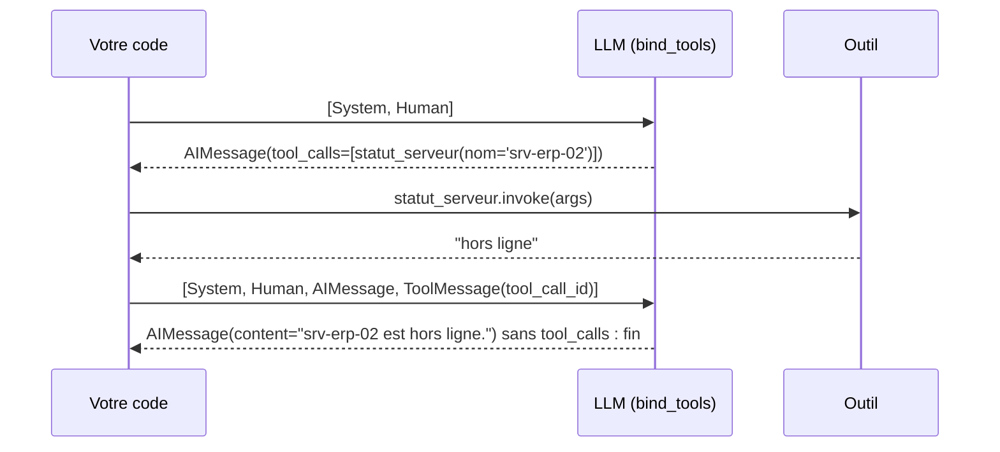
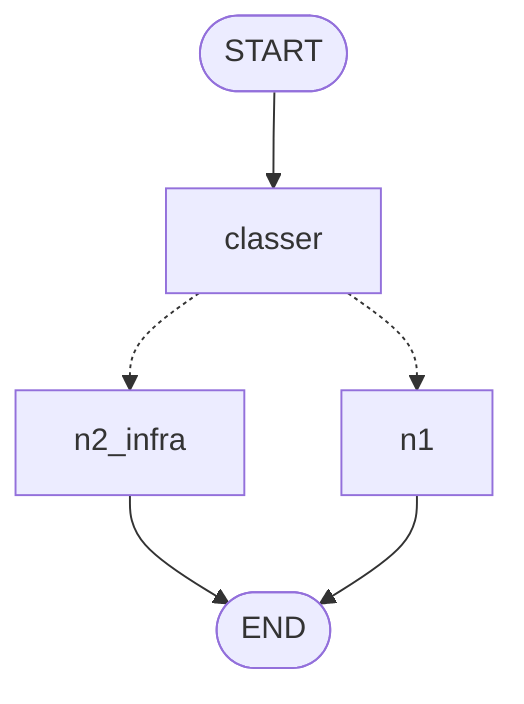
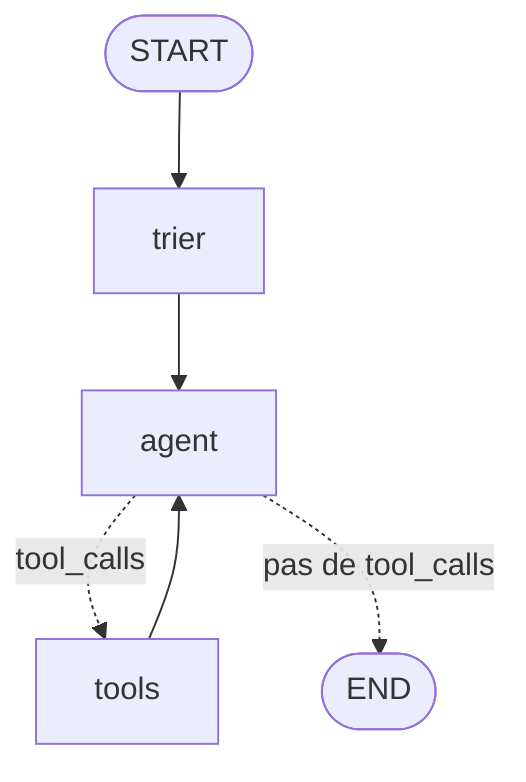
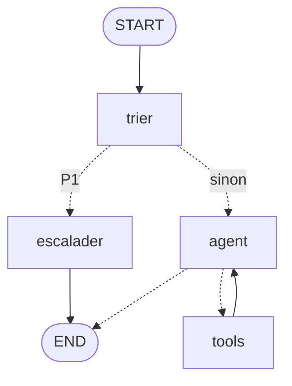

# Chapitre 2 · Fondations : chaîne LCEL, traçage Langfuse, agents et outils, StateGraph

> **Ce que vous saurez faire**
>
> - Écrire une chaîne LCEL `prompt | llm | parser` qui classe un ticket, et garder le dernier mot à une règle Python.
> - Tracer cette chaîne dans Langfuse (`CallbackHandler`), regrouper des traces en session (`propagate_attributes`) et tracer votre propre code (`@observe`).
> - Écrire un outil `@tool` que le modèle comprend, puis coder la boucle ReAct à la main et avec `create_agent`.
> - Construire un `StateGraph` : état, nœuds, arêtes, arêtes conditionnelles, reducers, `ToolNode` + `tools_condition`.
> - Borner une boucle avec `recursion_limit` et lire chaque nœud dans le dessin, dans le terminal et dans la trace.

> **Où le pratiquer**
>
> - Notebooks : `notebooks/J1_01_infra_et_tracing.ipynb`, `notebooks/J1_02_agents_fondamentaux.ipynb`, `notebooks/J1_03_stategraph.ipynb`.
> - Construction : `construction/etape_00_chaine_tri.py`, `etape_01_sessions_observe.py`, `etape_02_agent_outils.py`, `etape_03_stategraph.py`, `defi_03_escalade.py` (cherchez `# ═══ NOUVEAU` pour voir ce que chaque étape ajoute).
> - Animations (double-clic, dans le navigateur) : `comprendre/boucle_react.html` avant la section 7, `comprendre/stategraph_reducers.html` avant la section 9.
> - Exercices : `exercices/enonces/J1_01_defi.ipynb` (tracer `estimer_priorite`), `Ex1_1_stategraph_support.ipynb` (l'agent en graphe), `Ex1_2_garde_fou.ipynb` (un garde-fou avant l'agent). Corrigés dans `exercices/corriges/`, à n'ouvrir qu'après 20 minutes de blocage.

Lancer une étape depuis la racine, la stack démarrée : `uv run --project infrastructure python construction/etape_00_chaine_tri.py "Mon VPN ne marche plus"`.

> **Les API à ne PAS utiliser**, encore proposées par beaucoup de tutoriels et d'assistants IA : `initialize_agent`, `AgentExecutor`, `LLMChain`, `SequentialChain` (supprimés ou déplacés dans `langchain-classic`), `create_react_agent` de `langgraph.prebuilt` (plus la voie recommandée), `from langfuse.decorators import …` et `from langfuse.callback import CallbackHandler` (SDK v2). Ce chapitre n'utilise que : `langchain.agents.create_agent`, `langgraph.graph.StateGraph`, `langfuse.langchain.CallbackHandler`, `from langfuse import observe, propagate_attributes, get_client`.

---

## 1. Le modèle et les messages

**L'idée.** LangChain donne **une même interface** à tous les modèles. Ses briques sont des **Runnables**, qui s'appellent de trois façons : `invoke` (une entrée, une sortie), `stream` (au fil de l'eau), `batch` (plusieurs entrées). Un modèle de chat reçoit une **liste de messages**, chacun avec un rôle, et n'a **aucune mémoire** : on lui renvoie tout l'historique.

**Le code.** J1-01, sections 4.1 et 4.2 (`llm` vient de `creer_llm("agent")`, chapitre 1) :

```python
from langchain_core.messages import AIMessage, HumanMessage, SystemMessage

# invoke : une question, une réponse (un AIMessage)
reponse = llm.invoke("Donne en 5 mots maximum la cause la plus fréquente d'un VPN qui ne se connecte pas.")
print(type(reponse).__name__, "→", reponse.content)

# stream : la réponse arrive par morceaux (chunks)
for morceau in llm.stream("Écris une phrase d'accueil pour un help-desk informatique."):
    print(morceau.content, end="", flush=True)

conversation = [
    SystemMessage("Tu es l'agent support N1 de NordTech SA. Réponds en une phrase, en français."),
    HumanMessage("Mon imprimante du 2e étage n'imprime plus."),
    AIMessage("Pouvez-vous vérifier qu'elle est allumée et qu'elle affiche « prête » ?"),
    HumanMessage("Elle est allumée et affiche « bourrage papier »."),
]
reponse = llm.invoke(conversation)
print("tokens :", reponse.usage_metadata)   # entrée, sortie, total : on les retrouvera dans Langfuse
```

Le message **système** fixe le comportement ; humain et IA alternent.

**Ce qu'on observe.** La réponse tient compte du « bourrage papier » **et** de la question précédente : le contexte, c'est la liste. Retirez les deux derniers messages : la réponse change. `input_tokens` grossit avec l'historique, refacturé à chaque appel.

> ✅ **Bonne pratique :** surveillez `input_tokens` (compteurs normalisés, quel que soit le moteur) sur les conversations longues.

> ⚠️ **Piège :** croire que le modèle se souvient. Il ne voit que la liste envoyée. La mémoire automatique arrive en J2 avec un checkpointer.

---

## 2. Le prompt et la chaîne LCEL : le classifieur de tickets

**L'idée.** On n'écrit pas les messages à la main pour chaque ticket : on écrit **un modèle à trous** (`ChatPromptTemplate`), et LangChain remplit les `{variables}`. Le symbole `|` branche la sortie d'une brique sur l'entrée de la suivante : c'est **LCEL** (*LangChain Expression Language*). Analogie : une chaîne de montage. Dictionnaire → **prompt** → messages → **llm** → `AIMessage` → **parser** → texte.

**Le code.** `construction/etape_00_chaine_tri.py`, le point de départ de HelpDesk-Ops :

```python
from langchain_core.output_parsers import StrOutputParser
from langchain_core.prompts import ChatPromptTemplate

from helpdesk_ops.donnees import CATEGORIES          # ["reseau", "materiel", "logiciel", "acces", "autre"]
from helpdesk_ops.texte import normaliser            # sans accents, en minuscules, espaces nettoyés

PROMPT_TRI = ChatPromptTemplate.from_messages([
    ("system",
     "Tu es l'agent de tri N1 du help-desk de NordTech SA. "
     "Classe le ticket dans UNE catégorie parmi : {categories}. "
     "Réponds uniquement par le nom de la catégorie, en minuscules, sans ponctuation."),
    ("human", "Ticket : {ticket}"),
])
tri = PROMPT_TRI | llm | StrOutputParser()           # la chaîne LCEL


def normaliser_categorie(brute: str) -> str:
    """'Réseau.' ou 'catégorie : reseau' -> 'reseau' ; une réponse inattendue -> 'autre' (repli sûr)."""
    nettoyee = normaliser(brute).rstrip(".")
    return next((c for c in CATEGORIES if c in nettoyee), "autre")


def estimer_priorite(ticket: str) -> str:
    """P1 si un mot d'urgence apparaît, sinon P3 : simple, donc explicable."""
    texte = normaliser(ticket)
    return "P1" if any(m in texte for m in ("bloque", "urgent", "production", "tous les utilisateurs")) else "P3"
```

À décoder : `next((c for c in CATEGORIES if c in nettoyee), "autre")` renvoie la **première** catégorie contenue dans la réponse, sinon `"autre"`. `any(m in texte for m in (...))` est vrai si **au moins un** mot d'urgence est présent.

**Ce qu'on observe.** Réponse brute, puis catégorie normalisée, priorité et file. Mesuré le 27/10/2026 avec `granite4.1:8b` (J1-01) : `['matériel', 'accès', 'logiciel']`, **avec des accents**, alors que la consigne demande `materiel` et `acces`. Un LLM **suit** une consigne, il ne la **garantit** pas.

> ✅ **Bonne pratique :** les règles sur les **valeurs** (règles métier) restent en Python : simples, testables, explicables. La règle Python garde le dernier mot.

> ✅ **Bonne pratique :** un garde-fou se teste : `assert normaliser_categorie("Accès.") == "acces"`. Les accents sont le piège n°1 en français.

> ⚠️ **Piège :** comparer la réponse brute du modèle à une liste (`if brute in CATEGORIES`). Un point final, une majuscule ou un accent suffisent à tout faire tomber dans le mauvais cas.

> ⚠️ **Piège :** une chaîne exécute toujours les mêmes étapes, dans le même ordre. Elle ne sait ni boucler, ni décider de l'étape suivante, ni se souvenir. C'est le rôle des agents et des graphes (sections 6 à 12).

---

## 3. Tracer la chaîne : le `CallbackHandler`

**L'idée.** LangChain émet des **événements** à chaque étape d'une chaîne (début, fin, tokens, erreur). Le `CallbackHandler` de Langfuse les écoute et en fait des **observations**. On le passe dans le `config` de l'appel, **sans modifier la chaîne**. Vocabulaire Langfuse, avec l'analogie du ticket de caisse : la **trace** est le ticket entier (une requête de bout en bout) ; chaque **observation** est une ligne (un appel LLM, un outil, une étape de code) ; la **session** est la carte de fidélité qui relie les tickets d'un même client.

**Le code.** Étape 0 : le client et le handler viennent du socle, la chaîne ne change pas.

```python
from helpdesk_ops.config import creer_llm
from helpdesk_ops.observabilite import init_observabilite

llm = creer_llm("agent")                         # le modèle désigné par infrastructure/.env
langfuse, handler = init_observabilite()         # client Langfuse avec masque PII + CallbackHandler

brute = tri.invoke({"ticket": TICKET, "categories": ", ".join(CATEGORIES)},
                   config={"callbacks": [handler], "run_name": "tri-ticket"})   # run_name : nom lisible

langfuse.flush()                                 # l'envoi est asynchrone : sans flush, la trace peut se perdre
```

Sans le socle, la ligne équivalente est `from langfuse.langchain import CallbackHandler` puis `CallbackHandler()` : aucun argument en v4, les clés sont lues dans l'environnement.

**Ce qu'on observe.** Langfuse › Tracing : une trace `tri-ticket` avec trois enfants, `ChatPromptTemplate` → `ChatOpenAI` (`ChatOllama` sur un poste sans GPU) → `StrOutputParser`. Cliquez sur l'appel au modèle (une **generation**) : le prompt **réellement envoyé**, variables remplacées, la réponse, les tokens, la latence. C'est l'information la plus utile pour déboguer un LLM. L'adresse e-mail du ticket apparaît `<EMAIL>` : le masque est posé à la création du client.

| ❌ Ancienne API (à bannir) | ✅ SDK v4 (ce cours) |
|---|---|
| `from langfuse.callback import CallbackHandler` (v2) | `from langfuse.langchain import CallbackHandler` |
| `CallbackHandler(public_key=…, secret_key=…)` (v2) | `CallbackHandler()`, clés lues dans l'environnement |
| `CallbackHandler(update_trace=True)`, `langfuse.update_current_trace(session_id=…)` (v3) | `with propagate_attributes(session_id=…)` |
| `start_as_current_span` / `start_as_current_generation` (v3) | `start_as_current_observation(as_type=…)` |
| `LANGFUSE_HOST` | `LANGFUSE_BASE_URL` |

> ✅ **Bonne pratique :** passez le handler **à l'appel** (`config={"callbacks": [...]}`) plutôt qu'au constructeur du modèle : il suit alors toute la chaîne, sous-étapes comprises.

> ✅ **Bonne pratique :** « je ne comprends pas ce que fait mon agent » → j'ouvre la trace, pas mon code.

> ⚠️ **Piège :** rien n'apparaît ? Le SDK envoie **par lots** en arrière-plan. Attendez quelques secondes ou appelez `langfuse.flush()`. Dans une application (Streamlit, FastAPI), appelez `langfuse.shutdown()` à l'arrêt.

---

## 4. Sessions et code métier : `propagate_attributes` et `@observe`

**L'idée.** `with propagate_attributes(...)` pose les attributs de trace (session, utilisateur, tags, metadata, version) **une fois** : tout ce qui s'exécute dans le bloc en hérite. Analogie : le badge visiteur, reçu à l'accueil et enregistré à chaque porte. `@observe` transforme une fonction Python en observation ; les appels imbriqués forment un **arbre**. Pour une étape précise, `start_as_current_observation(as_type=…)` donne un contrôle plus fin.

**Le code.** `construction/etape_01_sessions_observe.py` :

```python
from langfuse import observe, propagate_attributes          # ═══ NOUVEAU (étape 1)


# ═══ NOUVEAU (étape 1) : une fonction métier tracée, qui devient la racine de la trace ═══
@observe(name="traiter-ticket")
def traiter_ticket(ticket: str) -> dict:
    brute = tri.invoke({"ticket": ticket, "categories": ", ".join(CATEGORIES)},
                       config={"callbacks": [handler], "run_name": "tri-ticket"})
    categorie = normaliser_categorie(brute)
    return {"categorie": categorie, "priorite": estimer_priorite(ticket), "file": file_attente(categorie)}


# ═══ NOUVEAU (étape 1) : session, utilisateur et tags posés UNE fois, hérités par tout ce qui est dedans ═══
with propagate_attributes(session_id="construction-etape-1", user_id="agent-n1-042",
                          tags=["construction", "etape-1"]):
    for ticket in TICKETS:
        decision = traiter_ticket(ticket)
```

Pour typer une étape de code métier (J1-01, section 8) : `with langfuse.start_as_current_observation(name="normalisation", as_type="guardrail", input=brute) as etape:`, puis `etape.update(output=categorie)`.

**Ce qu'on observe.** Langfuse › Tracing : deux traces `traiter-ticket`, chacune avec la chaîne `tri-ticket` **dedans**. Langfuse › Sessions : `construction-etape-1` regroupe les deux. Langfuse › Users : `agent-n1-042`. Le code Python prend quelques millisecondes, le LLM plusieurs centaines.

> ✅ **Bonne pratique :** typez vos observations (`as_type="tool"`, `"guardrail"`, `"retriever"`…). Filtres et icônes de l'interface suivent ce type : sur un système à quatre agents, c'est la différence entre une trace lisible et un mur d'étapes.

> ✅ **Bonne pratique :** `user_id` est un **pseudonyme** (`agent-n1-042`), jamais un nom ni un e-mail. Jamais de donnée personnelle dans un tag.

> ⚠️ **Piège :** en v4, `metadata` est un `dict[str, str]` (valeurs de 200 caractères au plus). Un entier ou un objet est une erreur fréquente : convertissez avec `str(...)`.

---

## 5. Masquer les données personnelles avant l'envoi

**L'idée.** Tout ce qui est tracé est stocké et consultable : au sens du RGPD, un traitement de données personnelles. On branche donc un masque **à la création du client** (protection dès la conception, art. 25), appliqué à chaque entrée, sortie et metadata avant l'envoi.

**Le code.** J1-01, section 5 (le socle range cette fonction dans `helpdesk_ops.pii`) :

```python
import re

from langfuse import Langfuse

MOTIFS_PII = {
    "EMAIL": re.compile(r"[\w.+-]+@[\w-]+\.[\w.-]+"),
    "TEL": re.compile(r"(?:\+32|0)\s?4\d{2}(?:[\s./]?\d{2}){3}"),   # mobiles belges : 04xx xx xx xx
    "IBAN": re.compile(r"\bBE\d{2}(?:\s?\d{4}){3}\b"),              # IBAN belge
}


def masquer_pii(*, data, **kwargs):
    if isinstance(data, str):
        for etiquette, motif in MOTIFS_PII.items():
            data = motif.sub(f"<{etiquette}>", data)
        return data
    if isinstance(data, dict):
        return {cle: masquer_pii(data=valeur) for cle, valeur in data.items()}
    if isinstance(data, (list, tuple)):
        # ⚠️ tuple indispensable : @observe transmet les arguments de fonction sous forme de tuple
        return type(data)(masquer_pii(data=element) for element in data)
    return data


assert masquer_pii(data=("BE71 0961 2345 6769",)) == ("<IBAN>",)   # un masque non testé est un masque qui fuit
langfuse = Langfuse(mask=masquer_pii)
```

La fonction s'appelle elle-même sur chaque élément d'un dictionnaire ou d'une liste : on « descend » dans la donnée jusqu'aux chaînes de caractères.

**Ce qu'on observe.** Dans l'interface : `<EMAIL>`, `<TEL>`, `<IBAN>`, alors que le modèle local a bien reçu le texte complet. Mais « Julie Martin » reste visible : une regex ne reconnaît pas les noms propres.

> ✅ **Bonne pratique :** le masque est une ceinture, pas un parachute : combinez regex, détection des noms (Presidio, `PIIMiddleware`), rétention courte et accès restreint.

> ⚠️ **Piège (vécu en préparant le notebook) :** la première version gérait `str`, `dict` et `list`, mais pas les `tuple`. Or `@observe` enregistre les arguments sous la forme `{"args": (…,), "kwargs": {…}}`. L'e-mail et l'IBAN partaient **en clair** dans la trace racine.

> ⚠️ **Piège :** le SDK v4 garde un client unique par clé publique : la **première** configuration gagne. Après une modification du masque, redémarrez le kernel.

---

## 6. Écrire un outil que le modèle comprend

**L'idée.** Le modèle ne voit **jamais** votre code. Il reçoit le **nom** de la fonction, sa **description** (la docstring) et le **schéma JSON** de ses arguments (déduit des annotations de type). Pour un outil, la docstring **est** la consigne.

**Le code.** `construction/etape_02_agent_outils.py` :

```python
from langchain_core.tools import tool                         # ═══ NOUVEAU (étape 2)

from helpdesk_ops.donnees import INVENTAIRE                   # {"srv-erp-02": "hors ligne", …}


@tool(parse_docstring=True)
def statut_serveur(nom: str) -> str:
    """Retourne le statut (en ligne, hors ligne, dégradé) d'un serveur de l'inventaire NordTech.

    Args:
        nom: nom d'hôte exact en minuscules, par exemple 'srv-vpn-01'
    """
    return INVENTAIRE.get(nom.strip().lower(), f"inconnu : '{nom}' n'est pas dans l'inventaire")
```

`parse_docstring=True` lit la section `Args:` et attache sa description à l'argument `nom`. `INVENTAIRE.get(cle, defaut)` renvoie la valeur, ou le message d'erreur si la clé n'existe pas. `.strip().lower()` corrige un `'SRV-ERP-02 '` écrit par le modèle.

Pour voir ce que le modèle reçoit (J1-02) : `convert_to_openai_tool(statut_serveur)`, importé de `langchain_core.utils.function_calling`. Un outil reste une fonction : on le teste sans modèle, `statut_serveur.invoke({"nom": "SRV-ERP-02"})`.

**Ce qu'on observe.** Avec `parse_docstring=True`, l'argument `nom` porte sa description dans le schéma JSON. Sans, il n'a qu'un type `string` : le modèle doit deviner le format attendu.

> ✅ **Bonne pratique :** renvoyez une **erreur explicite** plutôt que `None` (« file inconnue… files valides : N1, N2-infra… »). Le modèle se corrige souvent au tour suivant.

> ✅ **Bonne pratique (OWASP ASI02, Tool Misuse) :** chaque outil exposé est une surface d'attaque. Exposez le minimum, en **lecture seule** par défaut.

> ⚠️ **Piège :** au-delà d'une dizaine d'outils, le choix se dégrade : regroupez, ou déléguez (J3).

---

## 7. `bind_tools` et la boucle ReAct, à la main

**L'idée.** `llm.bind_tools([...])` attache les schémas à chaque requête. Le modèle peut alors répondre par un `AIMessage` contenant des `tool_calls` : « appelle `statut_serveur` avec `nom='srv-erp-02'` ». **C'est votre code qui exécute l'outil**, puis renvoie le résultat dans un `ToolMessage` lié par `tool_call_id`. Analogie : le chef dicte, le commis exécute. ReAct (*Reason + Act*) : on recommence jusqu'à ce que le modèle ne demande plus d'outil.



**Le code.** J1-02, section 5 :

```python
from langchain_core.messages import HumanMessage, SystemMessage, ToolMessage
from langfuse import observe

TOOLS = {t.name: t for t in (statut_serveur, tickets_ouverts)}   # nom -> outil
llm_outils = llm.bind_tools(list(TOOLS.values()))


@observe(name="react-manuel")   # une trace racine qui regroupe tous les tours
def agent_react_manuel(question: str, max_tours: int = 5) -> str:
    messages = [SystemMessage(PROMPT_SYSTEME), HumanMessage(question)]
    for tour in range(1, max_tours + 1):                 # garde-fou : jamais de boucle infinie
        reponse = llm_outils.invoke(messages, config={"callbacks": [langfuse_handler]})
        messages.append(reponse)
        if not reponse.tool_calls:                       # plus d'outil demandé -> réponse finale
            return reponse.content
        for appel in reponse.tool_calls:                 # exécuter chaque outil demandé
            resultat = TOOLS[appel["name"]].invoke(appel["args"], config={"callbacks": [langfuse_handler]})
            messages.append(ToolMessage(content=resultat, tool_call_id=appel["id"]))
    return "Je n'ai pas pu conclure : je transmets votre demande à un technicien."   # repli explicite
```

(Les `print` de suivi du notebook sont omis.)

**Ce qu'on observe.** Langfuse › Tracing › `react-manuel` : une generation par tour, les observations des outils avec leurs arguments, le diagramme de Gantt. Le nombre de generations, c'est le **nombre de tours**. L'animation `comprendre/boucle_react.html` montre la même boucle pas à pas.

> ✅ **Bonne pratique :** la condition d'arrêt se traite **dès le début** (`max_tours`), avec une réponse de repli polie. C'est la source n°1 des incidents d'agents en production.

> ⚠️ **Piège :** tout l'historique repart au modèle à chaque tour : coût et contexte augmentent. Au-delà de la taille de contexte, vLLM renvoie une erreur 400 et Ollama tronque en silence.

> ⚠️ **Piège :** pas de `tool_calls` ? Le modèle n'a pas la capacité « tools », la question est ambiguë, ou le serveur vLLM manque `--enable-auto-tool-choice` et le bon `--tool-call-parser` (chapitre 1).

---

## 8. La même chose en un appel : `create_agent`

**L'idée.** `create_agent` (LangChain 1.x) construit cette boucle pour vous. Sous le capot, c'est un **`StateGraph` LangGraph compilé**, avec deux nœuds : `model` et `tools`. Retenez le **concept** (la boucle), pas le nom de la fonction : il a changé plusieurs fois.

**Le code.** `construction/etape_02_agent_outils.py` :

```python
from langchain.agents import create_agent                     # ═══ NOUVEAU (étape 2)
from langchain_core.messages import HumanMessage              # ═══ NOUVEAU (étape 2)

agent = create_agent(model=llm, tools=OUTILS, system_prompt=SYSTEME)

# dans traiter_ticket : le tri passe sa décision à l'agent, en tête du message
resultat = agent.invoke(
    {"messages": [HumanMessage(f"[{decision['categorie']} · {decision['priorite']}] {ticket}")]},
    config={"callbacks": [handler], "run_name": "agent-support", "recursion_limit": 10})
decision["outils"] = [(a["name"], a["args"]) for m in resultat["messages"] for a in getattr(m, "tool_calls", [])]
decision["reponse"] = resultat["messages"][-1].content
```

Entrée et sortie sont des dictionnaires à clé `"messages"`. `[-1]` désigne le **dernier** élément d'une liste (ici la réponse finale). `getattr(m, "tool_calls", [])` lit l'attribut s'il existe, sinon renvoie `[]` : un `HumanMessage` n'a pas de `tool_calls`.

**Ce qu'on observe.** Le terminal liste les outils appelés avec leurs arguments, puis la réponse. Dans Langfuse, sous `traiter-ticket` : la chaîne `tri-ticket`, **puis** l'agent ; dans l'agent, une generation qui demande l'outil, l'outil (`TOOL`), une seconde generation qui répond. `type(agent).__name__` affiche `CompiledStateGraph` : un agent **est** un graphe.

> ✅ **Bonne pratique :** commencez par `create_agent` avec deux ou trois outils. Passez au graphe explicite quand une étape doit **toujours** avoir lieu (tri, garde-fou, validation).

> ⚠️ **Piège :** `AgentExecutor` et `initialize_agent`, d'un vieux tutoriel, n'existent plus en LangChain 1.x.

> ⚠️ **Piège :** oublier `recursion_limit` dans le `config`. Sans lui, la limite par défaut est très haute (section 13).

---

## 9. `StateGraph` : état, nœuds, arêtes

**L'idée.** Un graphe LangGraph est un **organigramme exécutable**. Le **state** est le dossier partagé (un `TypedDict`). Un **nœud** est une fonction `(state) -> dict` qui renvoie une **mise à jour partielle**. Une **arête** dit « a puis b ». Une **arête conditionnelle** appelle une fonction de routage qui renvoie le nom du nœud suivant. `START` et `END` marquent l'entrée et la sortie ; `compile()` valide le graphe et le rend exécutable.

**Le code.** J1-03, section 2 (règle Python volontairement simple, le LLM arrive ensuite) :

```python
from typing import Literal, TypedDict

from langgraph.graph import END, START, StateGraph

from helpdesk_ops.texte import sans_accents


class TicketState(TypedDict):          # le « dossier » : trois champs texte
    ticket: str
    categorie: str
    file: str


def classer(state: TicketState) -> dict:
    texte = sans_accents(state["ticket"]).lower()
    return {"categorie": "reseau" if "vpn" in texte or "reseau" in texte else "logiciel"}   # mise à jour PARTIELLE


def router(state: TicketState) -> Literal["n2_infra", "n1"]:   # Literal : sert au dessin du graphe
    return "n2_infra" if state["categorie"] == "reseau" else "n1"


def n2_infra(state: TicketState) -> dict:
    return {"file": "N2-infra"}


def n1(state: TicketState) -> dict:
    return {"file": "N1"}


builder = StateGraph(TicketState)
builder.add_node("classer", classer)
builder.add_node("n2_infra", n2_infra)
builder.add_node("n1", n1)
builder.add_edge(START, "classer")
builder.add_conditional_edges("classer", router)   # la décision
builder.add_edge("n2_infra", END)
builder.add_edge("n1", END)
graphe = builder.compile()

print(graphe.invoke({"ticket": "VPN coupé depuis ce matin"}))
```

`"reseau" if … else "logiciel"` est une **expression conditionnelle** : la valeur de gauche si la condition est vraie, sinon celle de droite.

**Ce qu'on observe.** `{'ticket': 'VPN coupé depuis ce matin', 'categorie': 'reseau', 'file': 'N2-infra'}`. Le dessin :



Les pointillés sont les arêtes conditionnelles. Remplacez la règle par le classifieur LCEL (J1-03, section 5) : seule la fonction du nœud change, et chaque trace `tri-ticket` reproduit l'arbre du graphe.

> ✅ **Bonne pratique :** un nœud renvoie **uniquement les clés qu'il modifie**. Jamais l'état complet, jamais `state["x"] = …` : LangGraph fusionne les mises à jour lui-même.

> ✅ **Bonne pratique :** annotez le retour d'une fonction de routage avec `Literal["a", "b"]`. Sans elle, LangGraph ne sait pas dessiner les branches.

> ⚠️ **Piège :** une faute de frappe dans `add_edge("classr", …)` donne « Node not found » à la compilation. Utilisez des constantes pour les noms de nœuds.

---

## 10. Exécuter et dessiner sans quitter la machine

**L'idée.** `invoke` renvoie l'**état final**. `invoke(..., version="v2")` (LangGraph 1.1 ou plus) renvoie un objet avec `.value` (l'état) et `.interrupts` (les pauses humaines, J2). `stream(..., stream_mode=...)` émet le graphe **étape par étape** : `"updates"` (la mise à jour de chaque nœud), `"values"` (l'état après chaque étape), `"messages"` (les tokens au fil de l'eau).

**Le code.** J1-03, sections 2 et 3 :

```python
from IPython.display import Markdown, display

display(Markdown(f"```mermaid\n{graphe.get_graph().draw_mermaid()}\n```"))
print(graphe.get_graph().draw_ascii())   # repli hors JupyterLab (nécessite grandalf, installé)

sortie = graphe.invoke({"ticket": "VPN coupé"}, version="v2")
print("v2      :", type(sortie).__name__, "| value =", sortie.value, "| interrupts =", sortie.interrupts)

for maj in graphe.stream({"ticket": "Excel plante"}, stream_mode="updates"):
    print("  ", maj)
```

**Ce qu'on observe.** `updates` montre **qui** a modifié **quoi** : `{'classer': {'categorie': 'logiciel'}}`, puis `{'n1': {'file': 'N1'}}`. `values` montre l'état qui se remplit.

> ✅ **Bonne pratique :** dessiner, exécuter, observer : `draw_ascii()` avant, la trace Langfuse après.

> ⚠️ **Piège :** `draw_mermaid_png()` appelle par défaut le service web `mermaid.ink` : un flux sortant, contraire au contrat 100 % local. Préférez `draw_mermaid()` (texte, affiché nativement par JupyterLab 4) ou `draw_ascii()`.

---

## 11. Les reducers : écraser, concaténer ou ajouter

**L'idée.** Par défaut, une clé de l'état est **écrasée** par la dernière mise à jour. Un **reducer**, déclaré avec `Annotated[type, reducer]`, change la règle de fusion. Analogie : sans reducer, chaque service **remplace** le classeur ; avec `operator.add`, il **ajoute sa feuille**.

| Déclaration | Effet | Exemple |
|---|---|---|
| `journal: list[str]` | **écrase** | l'historique disparaît |
| `journal: Annotated[list[str], operator.add]` | **concatène** | un journal d'audit |
| `messages: Annotated[list, add_messages]` | **ajoute**, ou **remplace** un message de même `id` | une conversation |

**Le code.** J1-03, section 4 :

```python
import operator
from typing import Annotated, TypedDict


class SansReducer(TypedDict):
    journal: list[str]


class AvecReducer(TypedDict):
    journal: Annotated[list[str], operator.add]     # operator.add sur deux listes = les mettre bout à bout


def etape_a(state) -> dict:
    return {"journal": ["A : ticket reçu"]}


def etape_b(state) -> dict:
    return {"journal": ["B : ticket classé"]}

# graphe START -> a -> b -> END construit avec chaque schéma, puis invoke({"journal": ["début"]})
```

**Ce qu'on observe.** Sans reducer : `['B : ticket classé']`. Avec `operator.add` : les trois entrées. Si `a` et `b` partent tous deux de `START` (même super-step), le schéma sans reducer lève `InvalidUpdateError` : LangGraph ne sait pas quelle valeur garder. L'animation `comprendre/stategraph_reducers.html` déroule cette fusion clé par clé.

> ✅ **Bonne pratique :** `MessagesState` est un `TypedDict` qui contient déjà `messages: Annotated[list, add_messages]`. C'est la base de tout agent conversationnel ; héritez-en pour ajouter vos champs.

> ⚠️ **Piège :** `messages: list` sans reducer. L'historique disparaît à chaque tour.

> ⚠️ **Piège :** une clé absente du `TypedDict` est ignorée **sans erreur**. Déclarez chaque champ que vos nœuds écrivent.

---

## 12. L'agent en graphe explicite : `ToolNode` + `tools_condition`

**L'idée.** On redessine la boucle ReAct de la section 7, et c'est **vous** qui câblez chaque étape : la liste `messages` devient `MessagesState`, l'appel au modèle le nœud `agent`, le test `if not reponse.tool_calls` l'arête `tools_condition`, la boucle sur les outils le nœud `ToolNode(OUTILS)`, `max_tours` la `recursion_limit`. Le tri devient un nœud `trier`, avant l'agent.

**Le code.** `construction/etape_03_stategraph.py` :

```python
from langchain_core.messages import HumanMessage, SystemMessage
from langgraph.graph import END, START, MessagesState, StateGraph      # ═══ NOUVEAU (étape 3)
from langgraph.prebuilt import ToolNode, tools_condition              # ═══ NOUVEAU (étape 3)

# tri, normaliser_categorie, estimer_priorite, file_attente, OUTILS : comme à l'étape 2
# SYSTEME = SystemMessage("Tu es l'agent support N1 du help-desk de NordTech SA. …")
llm_outils = llm.bind_tools(OUTILS)                  # ═══ NOUVEAU (étape 3) : le modèle connaît les outils


class EtatTicket(MessagesState):                     # hérite de messages + add_messages
    ticket: str
    categorie: str
    priorite: str
    file: str


def trier(state: EtatTicket) -> dict:
    brute = tri.invoke({"ticket": state["ticket"], "categories": ", ".join(CATEGORIES)})
    categorie = normaliser_categorie(brute)
    priorite = estimer_priorite(state["ticket"])
    return {"categorie": categorie, "priorite": priorite, "file": file_attente(categorie),
            "messages": [HumanMessage(f"[{categorie} · {priorite}] {state['ticket']}")]}


def agent(state: EtatTicket) -> dict:
    return {"messages": [llm_outils.invoke([SYSTEME] + state["messages"])]}


builder = StateGraph(EtatTicket)
builder.add_node("trier", trier)
builder.add_node("agent", agent)
builder.add_node("tools", ToolNode(OUTILS))
builder.add_edge(START, "trier")
builder.add_edge("trier", "agent")
builder.add_conditional_edges("agent", tools_condition)   # un appel d'outil → "tools", sinon → END
builder.add_edge("tools", "agent")                        # après l'outil, on revient à l'agent : la boucle
graphe = builder.compile()
```

`[SYSTEME] + state["messages"]` : le prompt système est ajouté **à l'appel**, pas stocké dans l'état.

**Ce qu'on observe.**



Le terminal affiche le graphe en ASCII, puis chaque nœud au moment où il s'exécute (`stream_mode="updates"`) : `▶ trier : <catégorie> · <priorité> · file <file>`, puis `▶ agent : demande statut_serveur({'nom': 'srv-erp-02'})`, `▶ tools : hors ligne`, enfin `▶ agent : répond « … »`. Le schéma Mermaid est écrit dans `construction/sortie/etape_03_graphe.md`. Dans Langfuse, la trace `helpdesk` a des enfants qui portent **les noms des nœuds** : `trier`, `agent`, `tools`.

> ✅ **Bonne pratique :** un agent choisit, un graphe garantit. Ce qui doit toujours avoir lieu (le tri) va dans le graphe ; ce qui varie (quel outil) reste à l'agent.

> ✅ **Bonne pratique :** le `CallbackHandler` se passe **une fois**, dans le `config` de l'appel au graphe : il suit chaque nœud et chaque appel LLM imbriqué.

> ⚠️ **Piège :** `tools_condition` renvoie `"tools"` ou `END`. Le nœud des outils doit donc s'appeler exactement `"tools"` dans `add_node`.

---

## 13. Défi 3 : le P1 part à l'astreinte, et `recursion_limit`

**L'idée.** Mini-défi du 09/11 : un ticket P1 ne passe pas par l'agent, il part à l'astreinte. L'arête fixe `trier → agent` devient **conditionnelle** ; rien d'autre ne change. Et la limite : chaque passage d'un nœud à l'autre compte pour une étape (un super-step) ; au-delà de `recursion_limit`, LangGraph lève `GraphRecursionError`.

**Le code.** `construction/defi_03_escalade.py`, seuls les blocs nouveaux :

```python
from typing import Literal                                             # ═══ NOUVEAU (défi 3)

from langchain_core.messages import AIMessage


def escalader(state: EtatTicket) -> dict:
    return {"messages": [AIMessage(f"Ticket {state['priorite']} transmis à l'astreinte {state['file']} : "
                                   "un technicien vous rappelle dans les 15 minutes.")]}


def apres_tri(state: EtatTicket) -> Literal["escalader", "agent"]:
    return "escalader" if state["priorite"] == "P1" else "agent"


builder.add_node("escalader", escalader)                  # ═══ NOUVEAU (défi 3)
builder.add_conditional_edges("trier", apres_tri)         # ═══ NOUVEAU (défi 3) : remplace add_edge("trier", "agent")
builder.add_edge("escalader", END)                        # ═══ NOUVEAU (défi 3)

config = {"callbacks": [handler], "run_name": "helpdesk", "recursion_limit": 10}
```

**Ce qu'on observe.**



« Le VPN est bloqué pour tout le service, urgent » suit `trier → escalader`, sans second appel au modèle : la trace n'a que deux enfants. Un P3 suit `trier → agent ⇄ tools`. À l'étape 5, `escalader` devient `valider`, avec une pause humaine.

Pour la limite : un graphe sans chemin vers `END`, lancé avec `config={"recursion_limit": 8}`, lève `GraphRecursionError` après 8 étapes (J1-03, section 7).

> ✅ **Bonne pratique (OWASP ASI08, Cascading Failures) :** fixez **toujours** `recursion_limit` (10 à 25 pour un agent de support), attrapez `GraphRecursionError` (`from langgraph.errors import GraphRecursionError`) et répondez poliment, en journalisant.

> ⚠️ **Piège :** dans LangGraph 1.2, la valeur par défaut de `recursion_limit` est **10 007**. Les tutoriels annoncent encore 25, et la documentation officielle affichait 1000 au 23/10/2026 : c'est le code (`langgraph/_internal/_config.py`) qui fait foi. Un agent qui boucle peut donc enchaîner des milliers d'appels.

> ⚠️ **Piège :** une fonction de routage qui ne renvoie jamais vers `END` (ou une arête oubliée) : le graphe tourne jusqu'à la limite. `tools_condition` et vos routeurs doivent prévoir une sortie.

---

## Fiche mémo

| Besoin | Syntaxe | Où revoir |
|---|---|---|
| Appeler un modèle | `llm.invoke(…)`, `llm.stream(…)`, `llm.batch([…])` | J1-01 §4.1 |
| Prompt à trous | `ChatPromptTemplate.from_messages([("system", "…{x}…"), ("human", "{y}")])` | J1-01 §4.3, étape 0 |
| Chaîne LCEL | `prompt \| llm \| StrOutputParser()` | J1-01 §4.4, étape 0 |
| Tracer une chaîne | `from langfuse.langchain import CallbackHandler` ; `config={"callbacks": [handler], "run_name": "…"}` | J1-01 §6, étape 0 |
| Session, user, tags | `with propagate_attributes(session_id=…, user_id=…, tags=[…], metadata={…}, version=…):` | J1-01 §7, étape 1 |
| Tracer une fonction | `from langfuse import observe` ; `@observe(name="…")` | J1-01 §8, étape 1 |
| Masquer les PII | `Langfuse(mask=masquer_pii)` | J1-01 §5 |
| Ne rien perdre | `langfuse.flush()` / `langfuse.shutdown()` | J1-01 §11 |
| Outil | `@tool(parse_docstring=True)` + docstring avec `Args:` | J1-02 §3, étape 2 |
| Demander un outil | `llm.bind_tools([...])` → `AIMessage.tool_calls` | J1-02 §4 |
| Rendre un résultat | `ToolMessage(content=…, tool_call_id=…)` | J1-02 §5 |
| Agent prêt à l'emploi | `from langchain.agents import create_agent` ; `create_agent(model=llm, tools=[…], system_prompt=…)` | J1-02 §6, étape 2 |
| Graphe | `StateGraph(Etat)`, `add_node`, `add_edge`, `add_conditional_edges`, `START`, `END`, `compile()` | J1-03 §2, étape 3 |
| Routage dessinable | `def router(state) -> Literal["a", "b"]:` | J1-03 §2, défi 3 |
| Reducers | `Annotated[list[str], operator.add]`, `MessagesState` (`add_messages`) | J1-03 §4 |
| Agent en graphe | `ToolNode(OUTILS)`, `add_conditional_edges("agent", tools_condition)` | J1-03 §6, étape 3 |
| Exécuter pas à pas | `graphe.stream(entree, config=…, stream_mode="updates")` | J1-03 §3, étape 3 |
| Dessiner hors ligne | `graphe.get_graph().draw_ascii()` / `.draw_mermaid()` | J1-03 §2 |
| Borner | `config={"recursion_limit": 10}` + `GraphRecursionError` | J1-03 §7 |

---

## Auto-évaluation

1. Dans `prompt | llm | StrOutputParser()`, que reçoit et que renvoie chaque brique ?
2. Vos trois appels doivent apparaître dans une même session Langfuse. Quelle syntaxe SDK v4 utilisez-vous, et laquelle est dépassée ?
3. Qu'est-ce que le modèle « voit » d'un outil, et qui exécute l'outil ?
4. Deux nœuds parallèles écrivent la clé `journal`, déclarée `journal: list[str]`. Que se passe-t-il, et comment corriger ?
5. Dans le défi 3, quelle ligne de l'étape 3 disparaît, par quoi est-elle remplacée, et pourquoi la fonction `apres_tri` est-elle annotée `Literal["escalader", "agent"]` ?

<details><summary>Réponses</summary>

1. Le prompt reçoit un dictionnaire (`{"ticket": …, "categories": …}`) et renvoie des messages ; le modèle renvoie un `AIMessage` ; le parser en extrait le texte (`str`).
2. `with propagate_attributes(session_id="…"):` autour des appels, avec le `CallbackHandler` dans le `config`. Dépassé : `langfuse.update_current_trace(session_id=…)` et `CallbackHandler(update_trace=True)` (v3), ou `from langfuse.callback import CallbackHandler` (v2).
3. Son nom, sa description (la docstring) et le schéma JSON de ses arguments, jamais son code. C'est votre code (ou `ToolNode`) qui l'exécute : le modèle ne produit qu'une demande (`tool_calls`).
4. `InvalidUpdateError` : sans reducer, LangGraph ne sait pas quelle valeur garder. On déclare un reducer : `journal: Annotated[list[str], operator.add]`.
5. `builder.add_edge("trier", "agent")` disparaît, remplacée par `builder.add_conditional_edges("trier", apres_tri)` (plus `add_node("escalader", …)` et `add_edge("escalader", END)`). L'annotation `Literal` déclare les destinations possibles : LangGraph peut dessiner (et valider) les deux branches en pointillés.

</details>
