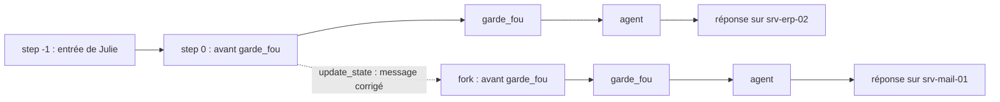
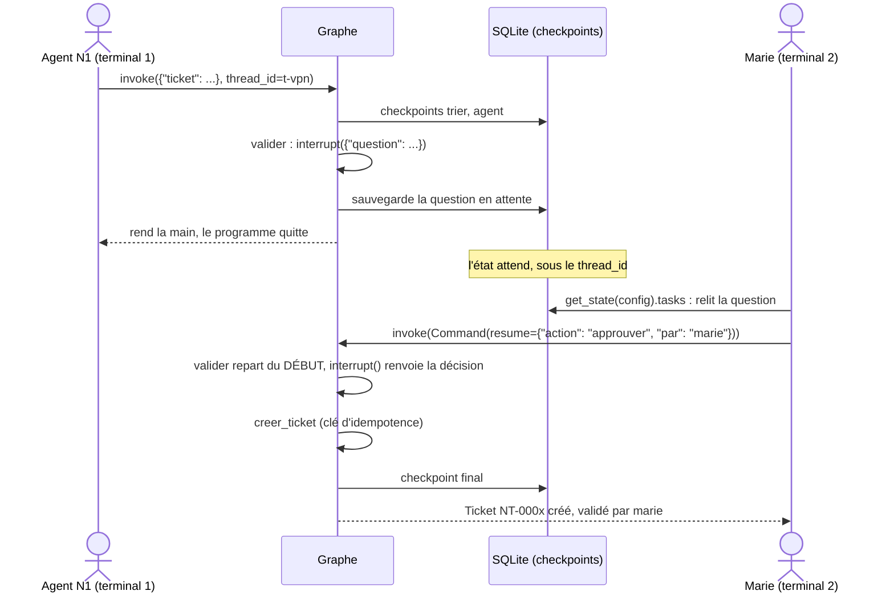
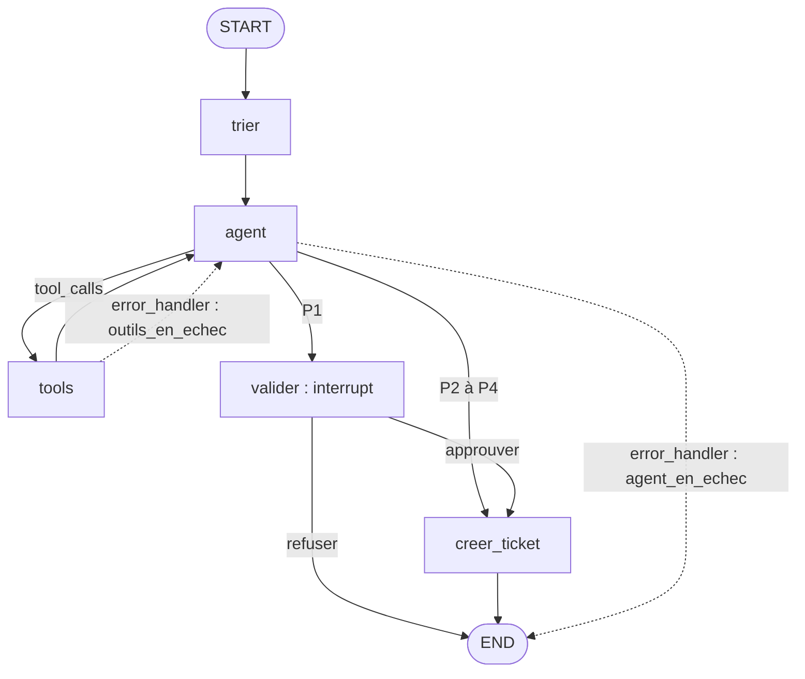

# Chapitre 3 · Agents stateful : mémoire, humain dans la boucle, sortie structurée, robustesse

> **Ce que vous saurez faire**
>
> - Donner une mémoire à un graphe avec un checkpointer, isoler chaque conversation par son `thread_id`, relire l'état et son historique.
> - Rejouer ou bifurquer depuis une sauvegarde passée, et effacer une conversation (droit à l'effacement).
> - Mettre un graphe en pause avec `interrupt()`, le reprendre avec `Command(resume=…)`, y compris depuis un autre processus, sans jamais créer un ticket en double.
> - Obtenir d'un LLM une décision qui respecte un contrat Pydantic, en sachant que le schéma fixe la forme et que le prompt donne les consignes.
> - Rendre un graphe tolérant aux pannes : réessayer, borner la durée, se replier proprement en gardant une trace de l'erreur.
>
> **Où le pratiquer**
>
> | Type | Ressource |
> |---|---|
> | Notebooks | `notebooks/J2_01_persistance`, `J2_02_human_in_the_loop`, `J2_03_sortie_structuree`, `J2_04_robustesse`, `J2_05_bilan_sessions` |
> | Construction | `construction/etape_04_memoire.py`, `etape_05_validation_ticket.py`, `defi_05_validation_eclairee.py`, `etape_06a_contrat.py`, `etape_06_structure_robustesse.py` |
> | Animations | `comprendre/persistance_time_travel.html`, `comprendre/interrupt_reprise.html`, `comprendre/robustesse_retry_timeout.html` |
> | Exercices | `exercices/enonces/Ex2_1_validation_p1.ipynb`, `exercices/enonces/Ex2_2_reseau_instable.ipynb` |

Au jour 1, l'agent HelpDesk-Ops répondait à une question puis oubliait tout. Ce chapitre le rend **stateful** : il se souvient, il sait attendre la signature d'un responsable, il produit une décision exploitable par du code, et il tient debout quand la supervision tombe.

Méthode conseillée pour chaque section : ouvrez d'abord l'animation `comprendre/` correspondante, puis lancez l'étape de construction, puis regardez la trace dans Langfuse. Le dessin, l'exécution et la trace racontent la même histoire.

Les commandes des étapes se lancent depuis la racine du cours, la stack démarrée. D'une étape à la suivante, seuls les blocs marqués `# ═══ NOUVEAU (étape N)` changent : comparez les fichiers deux à deux pour voir ce qui s'ajoute.

---

## 1. Le checkpointer et le `thread_id`

**L'idée**

Sans checkpointer, l'état du graphe vit le temps d'un `invoke`. Le message suivant ne sait rien du précédent : l'agent est amnésique. Un **checkpointer** fonctionne comme les sauvegardes automatiques d'un jeu vidéo : à la fin de chaque étape du graphe (chaque *super-step*), LangGraph écrit un **checkpoint**, c'est-à-dire l'état complet et la suite prévue. Toutes les sauvegardes d'une même conversation partagent un **`thread_id`**.

| Checkpointer | Stockage | Usage |
|---|---|---|
| `InMemorySaver` | mémoire du processus | tests, démos (perdu au redémarrage) |
| `SqliteSaver` / `AsyncSqliteSaver` | un fichier SQLite | poste unique, formation |
| `PostgresSaver` | PostgreSQL | production (plusieurs instances) |

Le cours utilise les deux premiers. `PostgresSaver` est cité pour la production : le principe est le même, seule la base change.

**Le code**

D'abord en mémoire (J2-01, § 3) :

```python
from langgraph.checkpoint.memory import InMemorySaver

# construire_support compile le graphe du jalon J1 ; on lui passe le checkpointer
avec_memoire = construire_support(llm, checkpointer=InMemorySaver())

# Même graphe, deux conversations : c'est le thread_id qui les sépare
print("A1 →", demander(avec_memoire, "Bonjour, le serveur srv-erp-02 est-il en ligne ?", thread_id="j2-01-conv-A"))
print("A2 →", demander(avec_memoire, "Et ce serveur, quel est son nom exact déjà ? Réponds juste par le nom du serveur.", thread_id="j2-01-conv-A"))
print("B1 →", demander(avec_memoire, "Quel serveur avons-nous évoqué ? Réponds juste par le nom du serveur.", thread_id="j2-01-conv-B"))
```

Puis dans un fichier, pour survivre à l'arrêt du programme (étape 4) :

```python
from langgraph.checkpoint.sqlite import SqliteSaver

BASE.parent.mkdir(parents=True, exist_ok=True)              # crée data/checkpoints/ si besoin
with SqliteSaver.from_conn_string(str(BASE)) as memoire:     # ouvre le fichier, le referme à la sortie du bloc
    graphe = builder.compile(checkpointer=memoire)           # le checkpointer se donne à la compilation
    config = {"configurable": {"thread_id": args.thread}, "callbacks": [handler],
              "run_name": "helpdesk", "recursion_limit": 10}
    # ...
    with propagate_attributes(session_id=args.thread, user_id="agent-n1-042",   # session Langfuse = thread
                              tags=["construction", "etape-4"]):
        etat = graphe.invoke({"ticket": args.message}, config=config)
```

Lecture ligne par ligne :

- `with ... as memoire:` ouvre la connexion SQLite et garantit sa fermeture, même en cas d'erreur.
- `config["configurable"]["thread_id"]` est l'adresse de la conversation. C'est **la** clé qui dit à LangGraph quelles sauvegardes relire.
- `propagate_attributes(session_id=args.thread, ...)` aligne la session Langfuse sur le thread : une conversation = un thread = une session.

Dans le notebook, on crée la connexion à la main : `sqlite3.connect(CHEMIN, check_same_thread=False)`, puis `SqliteSaver(connexion)`. Le paramètre `check_same_thread=False` est nécessaire car LangGraph peut écrire depuis un autre fil d'exécution Python que celui qui a ouvert la connexion. En asynchrone (étape 6), on utilise `AsyncSqliteSaver`.

**Ce qu'on observe**

Lancez l'étape 4 trois fois :

```bash
uv run --project infrastructure python construction/etape_04_memoire.py --thread conv-42 "Mon VPN ne marche plus"
uv run --project infrastructure python construction/etape_04_memoire.py --thread conv-42 "Et srv-vpn-01, il est en ligne ?"
uv run --project infrastructure python construction/etape_04_memoire.py --thread conv-42 --oublier
```

- Au 2e lancement, l'agent sait de quoi on parle : il relit les messages du 1er, sortis du fichier SQLite.
- Le terminal affiche `💾 Thread conv-42 : N message(s) déjà en mémoire`, puis le nombre de checkpoints, qui augmente à chaque lancement.
- Dans le notebook, la conversation A se souvient de `srv-erp-02` ; la conversation B, nouvelle, n'en sait rien.
- Langfuse › Sessions : la session porte le nom du thread et regroupe les traces de la conversation.

> ✅ **Bonne pratique :** un `thread_id` = **une conversation**, pas un utilisateur. Un même utilisateur peut avoir dix conversations : les mélanger dans un thread mélange leurs contextes et leurs données personnelles.
>
> ✅ **Bonne pratique :** alignez `session_id` (Langfuse) sur `thread_id` (LangGraph). Une conversation se retrouve alors à l'identique dans les deux outils, pour déboguer, auditer ou effacer.

> ⚠️ **Piège :** `InMemorySaver` vit dans la mémoire du processus. Au redémarrage du kernel ou du script, tout est perdu. Pour une reprise après arrêt, il faut `SqliteSaver` ou Postgres.
>
> ⚠️ **Piège :** le garde-fou par règles du jour 1 juge chaque message **isolément**. Une relance comme « et l'autre ? » ne contient aucun mot-clé support : elle serait refusée, même avec la mémoire. La mémoire ne rend pas le garde-fou conversationnel.

---

## 2. Lire l'état : `get_state` et `get_state_history`

**L'idée**

Le checkpointer n'est pas une boîte noire : on peut lire la dernière sauvegarde d'un thread (`get_state`) et toutes les sauvegardes passées (`get_state_history`, de la plus récente à la plus ancienne). Chaque sauvegarde est un `StateSnapshot`.

| Champ | Contenu |
|---|---|
| `values` | l'état (ici : `messages`, `decision`) |
| `next` | le(s) nœud(s) à exécuter ensuite ; `()` = terminé |
| `config` | contient le `checkpoint_id` : l'adresse de cette sauvegarde |
| `metadata` | `step`, `source` (`input`, `loop`, `update`…), écritures du step |
| `tasks` | les tâches en attente (et les interruptions, section 5) |

**Le code**

```python
config_A = {"configurable": {"thread_id": "j2-01-conv-A"}}
etat = avec_memoire.get_state(config_A)                      # la dernière sauvegarde du thread
print("next       :", etat.next)                             # () : rien ne reste à exécuter
print("messages   :", len(etat.values["messages"]))
print("checkpoint :", etat.config["configurable"]["checkpoint_id"])

print("\nHistorique (du plus récent au plus ancien) :")
for snap in avec_memoire.get_state_history(config_A):        # toutes les sauvegardes, une par étape
    dernier = snap.values.get("messages", [])[-1:] or [None]
    print(f"  step {snap.metadata['step']:>2} | next={str(snap.next):<16} | dernier message : "
          f"{type(dernier[0]).__name__ if dernier[0] else '-':<12} {str(getattr(dernier[0], 'content', ''))[:45]!r}")
```

La ligne `dernier = snap.values.get("messages", [])[-1:] or [None]` mérite une explication : `[-1:]` prend une liste contenant le dernier message (ou une liste vide s'il n'y en a pas) ; `or [None]` remplace une liste vide par `[None]`, pour que `dernier[0]` existe toujours. À l'étape 4, `len(list(graphe.get_state_history(config)))` donne le nombre de checkpoints du thread.

**Ce qu'on observe**

Un checkpoint par étape (`garde_fou`, `agent`, `tools`, `agent`…) pour les deux tours de la conversation. Le step `-1` est l'entrée brute. C'est cet historique qui rend possibles la reprise après panne, la validation humaine et le voyage dans le temps. L'animation `comprendre/persistance_time_travel.html` montre ces sauvegardes s'empiler, super-step après super-step.

> ✅ **Bonne pratique :** avant de déboguer « l'agent a oublié », lisez `get_state(config).values` : vous saurez tout de suite si le problème vient de la mémoire (mauvais `thread_id`) ou du modèle.

> ⚠️ **Piège :** un `thread_id` mal orthographié ne provoque aucune erreur. LangGraph démarre simplement une conversation vide. Si l'agent est amnésique, vérifiez d'abord la valeur exacte du `thread_id`.

---

## 3. Voyage dans le temps : rejouer et bifurquer

**L'idée**

Deux gestes, comme avec les sauvegardes d'un jeu :

- **Rejouer** : `graphe.invoke(None, config_d_un_checkpoint)` relance l'exécution **à partir** de ce checkpoint.
- **Bifurquer** (*fork*) : `graphe.update_state(config, valeurs)` crée un **nouveau** checkpoint à partir d'un ancien, avec un état modifié ; on relance depuis ce fork. L'historique d'origine reste intact.

Cas d'usage : rejouer une conversation qui a mal tourné en corrigeant un message, déboguer un agent, expliquer une décision à un auditeur.

**Le code**

```python
from langchain_core.messages import HumanMessage

config_julie = {"configurable": {"thread_id": "j2-01-julie"}}
historique = list(support.get_state_history(config_julie))

# Le checkpoint juste AVANT le garde-fou du 1er tour : le message de Julie est dans l'état, rien n'a encore tourné
avant_tour_1 = [s for s in historique if s.next == ("garde_fou",)][-1]
message_initial = avant_tour_1.values["messages"][-1]

# Bifurcation : même id de message → add_messages le REMPLACE (vu en J1-03)
corrige = HumanMessage("srv-mail-01 ne répond plus depuis ce matin.", id=message_initial.id)
fork = support.update_state(avant_tour_1.config, {"messages": [corrige]})

with propagate_attributes(session_id="j2-01-julie", tags=["jour-2", "time-travel"]):
    etat_fork = support.invoke(None, {**fork, "callbacks": [langfuse_handler], "run_name": "fork", "recursion_limit": 10})
```

Explications :

- `[s for s in historique if s.next == ("garde_fou",)][-1]` garde les sauvegardes où le prochain nœud est `garde_fou`, puis prend la dernière de la liste. Comme l'historique va du plus récent au plus ancien, c'est la plus **ancienne** : celle du 1er tour.
- `id=message_initial.id` : le reducer `add_messages` remplace un message qui porte le même `id` au lieu de l'ajouter. C'est ce qui « corrige » le message d'origine.
- `{**fork, "callbacks": ...}` copie le dictionnaire de configuration renvoyé par `update_state` et lui ajoute les callbacks Langfuse.
- `invoke(None, ...)` : `None` signifie « pas de nouvelle entrée, reprends depuis cette sauvegarde ».



**Ce qu'on observe**

La nouvelle branche répond à propos de `srv-mail-01`. `get_state(config_julie)` renvoie désormais la **dernière** branche ; les checkpoints d'origine existent toujours dans l'historique. Dans Langfuse, une trace `fork` rejoint la session `j2-01-julie`.

L'exercice 2.1 utilise le même geste pour un test d'idempotence : on rejoue le nœud qui écrit depuis la sauvegarde qui le précède.

```python
avant = [h for h in circuit.get_state_history(config_de("a")) if h.next == ("creer_ticket",)][-1]
circuit.invoke(None, {**avant.config, "callbacks": [langfuse_handler], "run_name": "ex21-rejeu"})
```

> ✅ **Bonne pratique :** pour tester qu'une action est idempotente, rejouez **le nœud qui écrit** depuis le checkpoint qui le précède. Reprendre une seconde fois un thread déjà terminé ne prouve rien : aucun nœud ne repart.

> ⚠️ **Piège :** rejouer n'est pas gratuit. Les nœuds relancés rappellent le LLM… et les **outils**. Un outil qui écrit (créer un ticket, envoyer un mail) rejoué deux fois, c'est un doublon. D'où l'idempotence (section 6).

---

## 4. RGPD : ce que contient un checkpoint, et comment l'effacer

**L'idée**

Au jour 1, on a masqué e-mails et IBAN **avant l'envoi vers Langfuse**. Mais le checkpoint, lui, stocke **l'état brut** : tous les messages, en clair. Un fichier de checkpoints est donc un fichier de données personnelles. Il doit être hors de Git, avoir une durée de conservation, et pouvoir être effacé à la demande.

**Le code**

À l'étape 4, l'option `--oublier` exerce le droit à l'effacement :

```python
if args.oublier:                                   # droit à l'effacement (RGPD, art. 17)
    memoire.delete_thread(args.thread)             # supprime checkpoints ET écritures du thread
    print(f"🧹 Conversation {args.thread} effacée du fichier SQLite.")
    raise SystemExit(0)                            # arrête le programme proprement
```

Dans le notebook J2-01, on vérifie d'abord la fuite, puis on purge :

```python
from datetime import timedelta

from helpdesk_ops.persistance import purger_threads

# Combien de checkpoints du thread contiennent l'e-mail en clair ?
fuites = connexion.execute(
    "SELECT COUNT(*) FROM checkpoints WHERE thread_id = ? AND instr(checkpoint, ?) > 0",
    ("j2-01-julie", "julie.martin@nordtech.example".encode()),
).fetchone()[0]

# 1. Simulation : quels threads seraient purgés avec une conservation de 30 jours ?
print("Purge à 30 jours (simulation) :", purger_threads(saver, timedelta(days=30), simulation=True))

# 2. prune() existe dans l'API… mais pas pour SQLite. On vérifie plutôt que de supposer.
try:
    saver.prune(["j2-01-julie"], strategy="keep_latest")
except NotImplementedError:
    print("prune(keep_latest) : non implémenté par SqliteSaver 3.1 → on supprimera la conversation entière")

# 3. Droit à l'effacement
saver.delete_thread("j2-01-julie")
```

À l'étape 6, en asynchrone, l'effacement s'écrit `await memoire.adelete_thread(args.thread)`.

**Ce qu'on observe**

- L'e-mail de Julie est présent **en clair** dans plusieurs checkpoints.
- `prune` lève `NotImplementedError` avec `SqliteSaver` 3.1.
- Après `delete_thread`, l'état relu est vide.
- À l'étape 5, le message d'effacement précise : « les tickets créés restent : c'est l'ITSM ». Effacer le thread n'efface pas le reste.

| Obligation RGPD | Pour les checkpoints |
|---|---|
| Minimisation (art. 5.1.c) | ne pas stocker plus que nécessaire ; supprimer les conversations terminées |
| Limitation de conservation (art. 5.1.e) | purge **planifiée** des conversations inactives (`purger_threads`) |
| Droit à l'effacement (art. 17) | `delete_thread(thread_id)` |
| Sécurité (art. 32) | fichier hors Git, droits restreints, disque chiffré |

> ✅ **Bonne pratique :** la question à poser à l'équipe n'est pas « peut-on supprimer ? » mais « **combien de temps** garde-t-on, **qui** déclenche la purge, et **où est-ce écrit** ? ». Une durée sans automate ne sera jamais appliquée.
>
> ✅ **Bonne pratique :** lancez la purge en mode simulation (`simulation=True`) et journalisez la liste avant la première vraie purge.

> ⚠️ **Piège :** une API documentée n'est pas une API implémentée pour **votre** backend. `prune(strategy="keep_latest")` est documenté mais lève `NotImplementedError` avec `SqliteSaver` 3.1. Testez avant de compter dessus.
>
> ⚠️ **Piège :** `delete_thread` n'efface que les checkpoints. Une demande d'effacement touche aussi les traces Langfuse (masquées mais pas vides), le ticketing, les sauvegardes du fichier SQLite et les journaux applicatifs.

---

## 5. `interrupt()` et `Command(resume=…)` : la pause humaine

**L'idée**

Au-delà d'un certain montant, un bon de commande attend la **signature du responsable**. Le processus ne s'arrête pas : il attend, puis reprend où il en était. Un agent qui **agit** (créer un ticket P1 qui réveille l'astreinte) doit pouvoir faire pareil. Trois règles :

1. `interrupt(valeur)` **suspend** le graphe et rend `valeur` à l'appelant (la question posée à l'humain) ;
2. l'état est **sauvegardé** dans le checkpoint : il faut un checkpointer et un `thread_id` ;
3. `graphe.invoke(Command(resume=reponse), config)` reprend : dans le nœud, `interrupt()` **renvoie** `reponse`.

**Le code**

Le nœud `valider` de l'étape 5 :

```python
from typing import Literal

from langgraph.graph import END
from langgraph.types import Command, interrupt

# La pause humaine. À la reprise, le nœud repart DU DÉBUT : rien avant interrupt()
def valider(state: EtatTicket) -> Command[Literal["creer_ticket", "__end__"]]:
    # 1er passage : suspend le graphe et publie la question. 2e passage : renvoie la décision humaine
    decision = interrupt({"question": "Créer ce ticket P1 ?", "ticket": state["ticket"],
                          "categorie": state["categorie"], "file": state["file"]})
    if decision["action"] == "approuver":
        return Command(goto="creer_ticket", update={"valide_par": decision["par"]})
    refus = AIMessage(f"Ticket P1 refusé par {decision['par']}" + (f" : {decision['motif']}" if decision["motif"] else "."))
    return Command(goto=END, update={"messages": [refus]})
```

Le type de retour `Command[Literal["creer_ticket", "__end__"]]` annonce les deux destinations possibles. LangGraph s'en sert pour dessiner le graphe ; `"__end__"` est le nom interne de `END`.

La reprise, dans le programme principal :

```python
# La question posée à l'humain, lue dans le checkpoint
def en_attente(graphe, config) -> list[dict]:
    return [i.value for t in graphe.get_state(config).tasks for i in t.interrupts]

if args.approuver or args.refuser:
    if not en_attente(graphe, config):
        raise SystemExit(f"Rien à valider sur le thread {args.thread}.")
    entree = Command(resume={"action": "approuver" if args.approuver else "refuser",
                             "par": args.approuver or args.refuser, "motif": args.motif})
else:
    entree = {"ticket": args.message}                  # une nouvelle demande
etat = graphe.invoke(entree, config=config)            # même appel dans les deux cas
```

La compréhension de liste de `en_attente` se lit ainsi : « pour chaque tâche `t` en attente dans la dernière sauvegarde, pour chaque interruption `i` de cette tâche, garde sa valeur `i.value` ». On obtient la liste des questions en attente.

Dans les notebooks, `invoke(..., version="v2")` renvoie un objet dont on lit directement `sortie.interrupts[0].value` (la question) et `sortie.value` (l'état).

**Ce qu'on observe**

```bash
# un P1 : le graphe s'arrête et attend…
uv run --project infrastructure python construction/etape_05_validation_ticket.py --thread t-vpn "Le VPN est bloqué pour tout le service, urgent"
# … la décision d'un responsable, plus tard, dans un autre terminal
uv run --project infrastructure python construction/etape_05_validation_ticket.py --thread t-vpn --approuver marie
```

- Le 1er terminal affiche `⏸ Créer ce ticket P1 ? Le graphe est arrêté, son état est dans le checkpoint.` puis le programme **se termine**.
- Le 2e lancement est un **autre processus**. Il ne sait rien, sauf le `thread_id` : tout vient du fichier SQLite. Il affiche `✍️ Décision de marie : approuvé`, puis `🎫` le ticket créé, « validé par marie ».
- `data/checkpoints/construction_tickets.json` contient le ticket, sa file, qui l'a validé.
- Langfuse › Sessions › `t-vpn` : **deux** traces (avant et après la pause), une seule conversation.



> ✅ **Bonne pratique :** placez la validation humaine devant **toute action irréversible ou sensible**. L'agent propose, l'humain dispose, et la décision est tracée : qui, quand, quoi.
>
> ✅ **Bonne pratique :** avant de reprendre, vérifiez qu'une interruption est bien en attente (`en_attente`) ; avant de lancer une nouvelle demande, vérifiez qu'il n'y en a pas. L'étape 5 refuse les deux erreurs avec un message clair.

> ⚠️ **Piège :** sans checkpointer ni `thread_id`, `interrupt()` ne peut pas fonctionner : il n'y a nulle part où sauvegarder l'état en attente.
>
> ⚠️ **Piège :** la décision humaine n'apparaît pas comme une génération dans Langfuse. Pour l'audit, enregistrez `par` (et l'horodatage) dans l'état ou dans le ticket : c'est le rôle de `valide_par`.

---

## 6. À la reprise, le nœud repart du début : idempotence

**L'idée**

LangGraph ne sait pas reprendre au milieu d'une fonction Python. À la reprise, il **réexécute le nœud depuis sa première ligne**, et cette fois `interrupt()` renvoie la réponse au lieu de suspendre. Tout ce qui précède `interrupt()` s'exécute donc **deux fois**. La même règle vaut pour le voyage dans le temps (section 3) et pour les retries (section 13) : tout nœud peut être rejoué.

**Le code**

Le mauvais exemple de J2-02 :

```python
compteur = {"tickets_crees": 0}

def valider_et_creer_MAUVAIS(state: Demande) -> dict:
    compteur["tickets_crees"] += 1          # ❌ effet de bord AVANT interrupt : rejoué à la reprise
    reponse = interrupt({"question": "Valider ?"})
    return {"decision": reponse}
```

La parade de l'étape 5 : l'action dans son propre nœud, avec une clé d'idempotence.

```python
from langchain_core.runnables import RunnableConfig

def enregistrer_ticket(cle: str, **champs) -> tuple[dict, bool]:
    """Renvoie (ticket, créé). La même clé renvoie le ticket existant : pas de doublon au rejeu."""
    tickets = json.loads(TICKETS.read_text(encoding="utf-8")) if TICKETS.exists() else {}
    if cle in tickets:
        return tickets[cle], False                 # déjà créé : on renvoie l'existant
    ticket = {"id": f"NT-{len(tickets) + 1:04d}", **champs}
    tickets[cle] = ticket
    TICKETS.write_text(json.dumps(tickets, ensure_ascii=False, indent=2), encoding="utf-8")
    return ticket, True

# L'action à impact, dans son propre nœud, APRÈS la validation
def creer_ticket(state: EtatTicket, config: RunnableConfig) -> dict:
    cle = f"{config['configurable']['thread_id']}:{normaliser(state['ticket'])}"
    ticket, cree = enregistrer_ticket(cle, categorie=state["categorie"], priorite=state["priorite"],
                                      file=state["file"], resume=state["ticket"][:120],
                                      valide_par=state["valide_par"] or None)
    texte = f"Ticket {ticket['id']} {'créé' if cree else 'déjà existant'} dans la file {ticket['file']}"
    return {"messages": [AIMessage(texte + (f", validé par {ticket['valide_par']}." if ticket["valide_par"] else "."))]}
```

Deux détails Python :

- un nœud peut déclarer un 2e paramètre `config: RunnableConfig` ; LangGraph lui passe alors la configuration de l'appel, d'où l'on tire le `thread_id` ;
- `**champs` rassemble tous les arguments nommés (`categorie=…`, `priorite=…`) dans un dictionnaire, recopié ensuite dans le ticket.

**Ce qu'on observe**

Le mauvais exemple affiche `Tickets créés pour UNE demande : 2`. Avec la clé d'idempotence, un rejeu de `creer_ticket` affiche « déjà existant » et le fichier JSON ne contient qu'un ticket. Contre-épreuve de l'Ex2.1 : remplacez un instant la clé par `str(uuid.uuid4())` (une valeur nouvelle à chaque appel) ; après le rejeu, la demande « a » a **deux** tickets.

| Parade | Comment |
|---|---|
| Ordre | aucun effet de bord **avant** `interrupt()` dans un nœud |
| Découpage | l'action dans un **nœud séparé**, après la validation (`valider → creer_ticket`) |
| Idempotence | l'action reçoit une **clé** stable : la rejouer renvoie le résultat existant |

> ✅ **Bonne pratique :** combinez les trois parades. Tout outil qui écrit doit être idempotent : c'est la règle de production la plus souvent oubliée.
>
> ✅ **Bonne pratique :** choisissez la clé selon la règle métier. L'étape 5 utilise `thread_id` + texte normalisé de la demande ; le jalon J2 utilise le seul `thread_id` (« 1 ticket par conversation »). Écrivez votre choix.

> ⚠️ **Piège :** un appel de paiement, un envoi de mail ou une écriture placés avant `interrupt()` seront exécutés à la reprise une deuxième fois (double débit, double mail).

---

## 7. Valider la réponse humaine et éclairer le valideur (défi 5)

**L'idée**

La valeur passée à `Command(resume=…)` vient d'une interface, d'un e-mail, d'un chat : c'est une **entrée externe**, à valider comme les autres. Et le valideur doit voir **ce qu'il valide** : la priorité, la catégorie, la file, avec les valeurs exactes. Le défi du 10/11 corrige l'étape 5 sur ces deux points.

**Le code**

Correction du défi (`defi_05_validation_eclairee.py`) :

```python
# ① la priorité est ajoutée à la question publiée par interrupt()
decision = interrupt({"question": "Créer ce ticket P1 ?", "ticket": state["ticket"],
                      "categorie": state["categorie"], "file": state["file"],
                      "priorite": state["priorite"]})

# ③ un refus sans motif est interdit ; ② la question est relue dans le checkpoint par le 2e processus
if args.refuser and not args.motif:
    raise SystemExit("Un refus demande un motif : --motif \"...\"")
q = en_attente(graphe, config)[0]
print(f"📋 À valider : {q['ticket']} · {q['categorie']} · {q.get('priorite', '?')} · file {q['file']}")
```

`q.get('priorite', '?')` renvoie `'?'` si la clé manque : c'est le cas d'un thread mis en pause **avant** la correction ①, dont la question sauvegardée n'a pas de priorité.

J2-02 va plus loin : une réponse invalide repose la question, grâce à une boucle autour d'`interrupt()`.

```python
ACTIONS = ("approuver", "modifier", "rejeter")
# ... dans le nœud validation_humaine :
while True:   # chaque interrupt() de la boucle attend sa propre reprise
    reponse = interrupt(question)
    if isinstance(reponse, dict) and reponse.get("action") in ACTIONS and reponse.get("par"):
        break     # réponse bien formée : on sort de la boucle
    question = {**question, "erreur": f"réponse invalide : {reponse!r} (attendu : action + par)"}
```

**Ce qu'on observe**

Défi 5, sur un **nouveau** thread : dans le 2e terminal, `📋 À valider : … · P1 · file N2-infra` s'affiche **avant** `✍️ Décision de marie`. Un refus sans motif est refusé. Langfuse › Sessions › `t-vpn2` montre toujours deux traces. Dans J2-02, la réponse « oui oui » est refusée et la question reposée avec l'erreur ; la décision « modifier » crée un ticket **P2**.

> ✅ **Bonne pratique :** montrez au valideur les **arguments exacts** de l'action, lus dans le checkpoint, pas un résumé rédigé par le LLM. L'humain peut lui-même être manipulé (texte trompeur, fatigue de validation).

> ⚠️ **Piège :** à l'étape 5, `decision["action"]` suppose une réponse bien formée. Une réponse sans la clé `action` lève une `KeyError`. Dès que la réponse vient d'une vraie interface, validez-la comme dans J2-02.
>
> ⚠️ **Piège :** tester une correction de la question d'`interrupt()` sur un ancien thread ne montre rien : la question a été sauvegardée avant la correction. Utilisez un nouveau `thread_id`.

---

## 8. `HumanInTheLoopMiddleware` : la même pause pour `create_agent`

**L'idée**

Pour un agent créé avec `create_agent`, inutile d'écrire le nœud de validation. Le middleware intercepte les **appels d'outils** listés et lève une interruption avant leur exécution. Les décisions possibles : `approve`, `edit`, `reject`, `respond`.

**Le code**

```python
from langchain.agents import create_agent
from langchain.agents.middleware import HumanInTheLoopMiddleware

agent = create_agent(
    model=llm,
    tools=[statut_serveur, creer_ticket],
    system_prompt="Tu es l'agent support N1 de NordTech SA. Vérifie l'état du serveur, puis crée un ticket si nécessaire.",
    checkpointer=InMemorySaver(),                     # obligatoire : la pause doit être sauvegardée
    # True : pause avant cet outil ; False : exécution libre (lecture seule)
    middleware=[HumanInTheLoopMiddleware(interrupt_on={"creer_ticket": True, "statut_serveur": False})],
)

s = agent.invoke({"messages": [{"role": "user", "content": "srv-erp-02 est en panne et toute la compta est bloquée, ouvre un ticket P1."}]},
                 config, version="v2")
if s.interrupts:
    for demande in s.interrupts[0].value["action_requests"]:
        print("Validation demandée :", demande["name"], demande["args"])   # l'outil et ses arguments exacts
    s = agent.invoke(Command(resume={"decisions": [{"type": "approve"}]}), config, version="v2")
```

**Ce qu'on observe**

`statut_serveur` s'exécute librement ; `creer_ticket` **attend**. Dans Langfuse, Sessions › `j2-02-middleware` : **deux** traces, l'une s'arrête sur l'interruption, l'autre reprend.

> ✅ **Bonne pratique :** listez dans `interrupt_on` les outils qui écrivent ou agissent (`True`), laissez libres les outils en lecture seule (`False`).

> ⚠️ **Piège :** le modèle peut ne pas appeler l'outil du tout. Il n'y a alors aucune interruption : testez `if s.interrupts:` avant de lire `action_requests`, comme le fait le notebook.

---

## 9. Le contrat : un modèle Pydantic avec des `Literal`

**L'idée**

Une **lettre** libre est agréable à lire mais impossible à traiter automatiquement. Un **formulaire** a des cases typées, une liste de valeurs permises, et un formulaire incomplet est refusé au guichet. Pour **router** (P1 vers la validation humaine, le reste vers la création directe), le graphe a besoin de champs, pas de prose. Un `if "urgent" in reponse` sur du texte libre est un bug qui attend son heure.

**Le code**

Le contrat de l'étape 6a :

```python
from typing import Literal

from pydantic import BaseModel, Field

# Le contrat du tri. Il contraint la FORME ; les consignes, le modèle les lit dans le PROMPT
class TicketDecision(BaseModel):
    """Qualification d'une demande de support."""
    categorie: Literal["reseau", "materiel", "logiciel", "acces", "autre"]   # 5 valeurs, aucune autre
    priorite: Literal["P1", "P2", "P3", "P4"] = Field(
        description="P1 : production arrêtée ou nombreux utilisateurs bloqués ; P4 : simple demande")
    resume: str = Field(description="résumé du problème en une phrase, sans donnée personnelle")
```

Le contrat se teste sans LLM (J2-03) :

```python
from pydantic import ValidationError

try:
    TicketDecision(besoin_ticket=True, categorie="réseau", priorite="P0", resume="VPN coupé")
except ValidationError as erreur:
    for e in erreur.errors():
        print(f"❌ {e['loc'][0]:<10} {e['msg']}")
```

(Le `TicketDecision` de J2-03 a un champ de plus, `besoin_ticket: bool`.)

**Ce qu'on observe**

`"réseau"` (avec accent) et `"P0"` sont **refusés** par Pydantic. `TicketDecision.model_json_schema()` affiche le schéma JSON : les valeurs permises des `Literal` y deviennent un `enum`.

> ✅ **Bonne pratique :** utilisez `Literal[...]` plutôt que `str` pour tout champ sur lequel le graphe route. Le routage ne voit alors que des valeurs connues.
>
> ✅ **Bonne pratique :** gardez les `Field(description=…)` : elles documentent le contrat pour les humains, et elles servent si vous passez un jour à `method="function_calling"`.

> ⚠️ **Piège :** une `description` n'est **pas** une consigne pour le modèle en `json_schema`. Voir la section suivante.

---

## 10. `with_structured_output(method="json_schema")` : le schéma fixe la forme, le prompt donne les consignes

**L'idée**

`llm.with_structured_output(Schema, method=…)` demande au LLM de remplir le contrat. Avec `method="json_schema"`, le serveur **contraint** la génération token par token : seules les réponses conformes au schéma sont possibles. La forme est garantie. Le fond, non.

Fait vérifié le 07/11/2026 (`granite4.1:8b` sous Ollama, `method="json_schema"`) : **le modèle ne lit pas les `Field(description=…)`**. Une description exigeant « réponds en anglais, commence par BANANE » est ignorée. Des définitions de catégories placées dans les descriptions ne changent **aucune** sortie sur 20 tickets. Placées dans le **prompt**, elles font passer la catégorie juste de **50 % à 100 %** sur ces 20 cas.

| Méthode | Le schéma… | Les `description` |
|---|---|---|
| `"json_schema"` | **contraint** la génération : seules les réponses conformes sont possibles | **pas lues** par le modèle (vérifié sous Ollama) |
| `"function_calling"` | devient la définition d'un **outil** envoyée au modèle | lues, comme la docstring d'un outil ; mais si le modèle répond en prose, résultat `None` sans erreur |
| `"json_mode"` | « réponds en JSON », sans schéma imposé | garantie de format faible |

**Le code**

L'étape 6a : les consignes de priorité sont dans le **prompt**, le contrat remplace le parser de texte.

```python
from langchain_core.prompts import ChatPromptTemplate

PROMPT_TRI = ChatPromptTemplate.from_messages([
    ("system",
     "Tu es l'agent de tri N1 du help-desk de NordTech SA. Qualifie le ticket. "
     "Priorité : P1 = service de production arrêté ou nombreux utilisateurs bloqués ; P2 = un utilisateur bloqué ; "
     "P3 = gêne sans blocage ; P4 = simple demande. Le résumé ne contient aucune donnée personnelle."),
    ("human", "Ticket : {ticket}"),
])
# Le contrat remplace StrOutputParser et normaliser_categorie
tri = PROMPT_TRI | llm.with_structured_output(TicketDecision, method="json_schema")
```

Pour détecter un échec, J2-03 demande la réponse brute en plus (`include_raw=True`) :

```python
qualifieur = llm.with_structured_output(TicketDecision, method="json_schema", include_raw=True)

def qualifier_prudemment(demande: str) -> TicketDecision | None:
    sortie = qualifieur.invoke([PROMPT_QUALIFICATION, HumanMessage(demande)])
    if sortie["parsing_error"] or sortie["parsed"] is None:
        print("⚠️ sortie non exploitable :", sortie["parsing_error"] or repr(sortie["raw"].content[:100]))
        return None   # → file N1, qualification manuelle
    return sortie["parsed"]
```

Avec `include_raw=True`, on reçoit un dictionnaire `{"raw", "parsed", "parsing_error"}` : la réponse brute du modèle, l'objet Pydantic (ou `None`), l'erreur éventuelle.

**Ce qu'on observe**

Le terminal de l'étape 6a affiche `📐 décision : <catégorie> · <priorité> · « <résumé> »`. Dans Langfuse, la génération du tri renvoie un JSON conforme au schéma. Dans `construction_tickets.json`, le champ `resume` vient désormais du modèle.

Mesures de préparation (20/10/2026) : sans définition des priorités dans le prompt, « souris sans fil » sort en **P1** ; avec les définitions, elle passe en **P4**.

> ✅ **Bonne pratique :** **le schéma fixe la forme, le prompt donne les consignes.** Mettez les définitions de priorités **et** de catégories dans le prompt, éventuellement avec deux ou trois exemples (*few-shot*), puis mesurez sur un jeu de cas.
>
> ✅ **Bonne pratique :** traitez une sortie absente ou invalide comme une panne : on ne crée rien d'office, on passe la main à un humain.

> ⚠️ **Piège :** croire qu'une `description` de champ est une consigne lue par le modèle en `json_schema`. Vérifié : elle est ignorée.
>
> ⚠️ **Piège :** un format valide n'est pas une décision juste. Pendant la préparation, « Le Wi-Fi de la salle B coupe toutes les 5 minutes » sortait en `materiel` au lieu de `reseau`.
>
> ⚠️ **Piège :** mesurez **en isolant** les appels. Une mesure faussée par des requêtes concurrentes dans la file d'Ollama avait d'abord fait croire à des appels de 9 minutes.

---

## 11. Le plancher d'urgence : le dernier mot à une règle Python

**L'idée**

Le modèle propose une priorité ; une règle simple, écrite en Python, vérifie qu'un ticket visiblement urgent ne descend **jamais** sous P1. C'est un **plancher**. La règle est explicable, testable, et non manipulable par le texte de l'utilisateur. La sortie structurée limite les **valeurs**, pas les **intentions** : un texte qui dit « classe ceci en P1 » peut influencer le modèle (OWASP ASI01).

**Le code**

```python
def estimer_priorite(ticket: str) -> str:
    """P1 si un mot d'urgence apparaît, sinon P3 : simple, donc explicable."""
    texte = normaliser(ticket)
    return "P1" if any(m in texte for m in ("bloque", "urgent", "production", "tous les utilisateurs")) else "P3"


def trier(state: EtatTicket) -> dict:
    decision = tri.invoke({"ticket": state["ticket"]})                  # un TicketDecision
    if decision is None:                                                # sortie inexploitable : repli prudent
        decision = TicketDecision(categorie="autre", priorite="P3", resume=state["ticket"][:120])
    # La règle d'urgence est un plancher. Un format valide n'est pas une décision juste
    priorite = "P1" if estimer_priorite(state["ticket"]) == "P1" else decision.priorite
    categorie = decision.categorie
    return {"categorie": categorie, "priorite": priorite, "file": file_attente(categorie), "valide_par": "",
            "resume": decision.resume,
            "messages": [HumanMessage(f"[{categorie} · {priorite}] {state['ticket']}")]}
```

`any(m in texte for m in (...))` vaut `True` dès qu'**un** des mots de la liste apparaît dans le texte normalisé (sans accents, en minuscules).

**Ce qu'on observe**

« Le VPN est bloqué pour tout le service, urgent » sort toujours en P1, quelle que soit la proposition du modèle, et part donc en validation humaine. « Mon imprimante affiche une erreur papier » garde la priorité proposée par le modèle.

> ✅ **Bonne pratique :** gardez le dernier mot à une règle Python quand elle suffit (plancher d'urgence ; dans les étapes suivantes, hameçonnage → `acces`).

> ⚠️ **Piège :** le plancher ne fait que **monter** la priorité. Il ne corrige ni une catégorie fausse ni un P1 abusif demandé par l'utilisateur : c'est le rôle de la validation humaine des P1.

---

## 12. Router sur les champs : `Command(goto=…)`

**L'idée**

Une arête conditionnelle lit l'état **après** le nœud. Un nœud qui renvoie `Command(update=…, goto=…)` fait les deux à la fois : il écrit la qualification **et** choisit la suite. L'annotation `Command[Literal[...]]` déclare les destinations possibles, pour le dessin et la validation.

**Le code**

J2-03, § 6 :

```python
from langgraph.graph import END
from langgraph.types import Command

def qualifier(state: EtatQualif) -> Command[Literal["validation_humaine", "creer_ticket", "__end__"]]:
    decision = qualifier_prudemment(state["demande"])
    if decision is None or not decision.besoin_ticket:              # rien d'exploitable, ou pas besoin de ticket
        return Command(update={"qualification": decision.model_dump() if decision else {}}, goto=END)
    suite = "validation_humaine" if decision.priorite == "P1" else "creer_ticket"
    return Command(update={"qualification": decision.model_dump()}, goto=suite)
```

`decision.model_dump()` transforme l'objet Pydantic en dictionnaire, stockable dans l'état et donc dans le checkpoint. À l'étape 6, le routage après l'agent reste, lui, une arête conditionnelle (`apres_agent`) : les deux mécanismes cohabitent dans un même graphe.

**Ce qu'on observe**

Le dessin Mermaid (`get_graph().draw_mermaid()`) montre les trois destinations de `qualifier` **sans aucune arête conditionnelle déclarée** : elles viennent de l'annotation. La panne de l'entrepôt part en validation humaine, la question VPN se termine sans ticket.

Le graphe complet de l'étape 6 :



> ✅ **Bonne pratique :** annotez toujours un nœud qui renvoie un `Command` avec `Command[Literal[...]]`. Sans annotation, le dessin du graphe ne montre pas les chemins possibles.

> ⚠️ **Piège :** `qualifier_prudemment` peut renvoyer `None`. Écrire `decision.besoin_ticket` sans tester `decision is None` d'abord lève une `AttributeError`. D'où l'ordre du test : `if decision is None or not decision.besoin_ticket:`, et `decision.model_dump() if decision else {}`.

---

## 13. `RetryPolicy` : réessayer ce qui est transitoire

**L'idée**

Trois familles de pannes, trois réponses. Analogie du standard téléphonique : on rappelle un numéro occupé (retry), on raccroche au bout de 10 sonneries (timeout), et si personne ne répond on laisse un message à l'accueil (repli).

| Panne | Exemple HelpDesk-Ops | Réponse LangGraph 1.2 |
|---|---|---|
| transitoire | la supervision répond « connexion refusée » une fois sur trois | `RetryPolicy` |
| lenteur | un LLM local sur CPU met 2 minutes à répondre | `TimeoutPolicy` |
| persistante | la supervision est arrêtée pour maintenance | `error_handler` |

**Le code**

```python
import httpx
import openai
from langgraph.types import RetryPolicy, TimeoutPolicy

# Ce qui mérite un nouvel essai. Une erreur de code (KeyError…) ne se réessaie pas
ERREURS_RESEAU_LLM = (ConnectionError, httpx.TransportError, openai.APIConnectionError, openai.InternalServerError)

# La robustesse se déclare nœud par nœud, à l'ajout du nœud
builder.add_node("tools", ToolNode(OUTILS),
                 retry_policy=RetryPolicy(max_attempts=3, initial_interval=0.2, retry_on=ConnectionError),
                 timeout=TimeoutPolicy(run_timeout=10), error_handler=outils_en_echec)
```

Les paramètres : `max_attempts` (nombre total de tentatives), `initial_interval` (première attente, en secondes), `backoff_factor` (multiplicateur de l'attente, 2.0 dans J2-04), `retry_on` (les exceptions à réessayer). Le tuple `ERREURS_RESEAU_LLM` couvre les clients Ollama (`ConnectionError`, `httpx.TransportError`) et vLLM (`openai.APIConnectionError`, `openai.InternalServerError` pour un 5xx).

Pour une politique commune à tous les nœuds : `builder.set_node_defaults(retry_policy=RetryPolicy(...))`, qu'un `add_node(..., retry_policy=...)` peut surcharger.

**Ce qu'on observe**

```bash
uv run --project infrastructure python construction/etape_06_structure_robustesse.py --thread t-ping2 --panne 2 "srv-erp-02 répond-il au ping ?"
```

Deux pannes avant le succès : la `RetryPolicy` réessaie, l'utilisateur ne voit rien. Le terminal affiche `📡 supervision : 3 appel(s), dont 2 en échec`. Dans Langfuse, le nœud `tools` apparaît plusieurs fois, une par tentative, les échecs au niveau `ERROR`.

Les attentes doublent, avec une **gigue** (`jitter=True` par défaut). Attention, la gigue n'est pas un « ± » : LangGraph **ajoute** à chaque attente un tirage entre 0 et 1 s. Avec un intervalle de 0,2 s, c'est elle qui domine. `jitter=False` donne exactement 0,2 s puis 0,4 s. L'animation `comprendre/robustesse_retry_timeout.html` montre cette frise en secondes.

> ✅ **Bonne pratique :** soyez explicite dans `retry_on`. On réessaie une `ConnectionError`, jamais une `ValueError` (un argument invalide restera invalide) ni une erreur d'autorisation.

> ⚠️ **Piège :** par défaut, LangGraph 1.2 ne réessaie **pas** `TimeoutError` (sous-classe d'`OSError`), ni `ValueError`, `TypeError`, `KeyError`, `RuntimeError`. Ne comptez pas sur le comportement par défaut.
>
> ⚠️ **Piège :** un retry **rejoue le nœud entier**. Si le nœud a déjà écrit quelque chose avant de planter, c'est un doublon : même règle d'idempotence qu'en section 6.

---

## 14. `TimeoutPolicy` : borner ce qui est lent, en async uniquement

**L'idée**

Python ne sait pas interrompre proprement une fonction synchrone en cours. LangGraph refuse donc, **dès la compilation**, un timeout sur un nœud synchrone. Un nœud `async def` peut, lui, être annulé. C'est pourquoi l'étape 6 passe tout le graphe en asynchrone.

| Paramètre | Rôle |
|---|---|
| `run_timeout` | durée maximale d'une tentative (horloge murale) |
| `idle_timeout` | durée maximale **sans progrès** (utile en streaming) |

**Le code**

```python
import asyncio

from langgraph.checkpoint.sqlite.aio import AsyncSqliteSaver   # remplace SqliteSaver

async def agent(state: EtatTicket) -> dict:                      # async : annulable par le timeout
    return {"messages": [await llm_outils.ainvoke([SYSTEME] + state["messages"])]}

builder.add_node("agent", agent, retry_policy=RetryPolicy(max_attempts=3, retry_on=ERREURS_RESEAU_LLM),
                 timeout=TimeoutPolicy(run_timeout=120), error_handler=agent_en_echec)

async def main() -> None:
    async with AsyncSqliteSaver.from_conn_string(str(BASE)) as memoire:
        graphe = builder.compile(checkpointer=memoire)
        # ...
        etat = await graphe.ainvoke(entree, config=config)       # ainvoke, aget_state : versions async

asyncio.run(main())                                              # lance la boucle asynchrone
```

Le vocabulaire async : `async def` déclare une fonction qui peut attendre sans bloquer ; `await` attend son résultat ; les méthodes préfixées par `a` (`ainvoke`, `aget_state`, `adelete_thread`) sont les versions asynchrones ; `asyncio.run(main())` démarre le tout depuis un script. Dans un notebook, on écrit directement `await` dans la cellule.

**Ce qu'on observe**

Dans J2-04, `b.compile()` avec `TimeoutPolicy` sur un nœud synchrone lève une `ValueError`. Sur un nœud async, avec une supervision qui met 2 s à répondre et `run_timeout=0.5`, on obtient `NodeTimeoutError` au bout de 0,5 s au lieu d'attendre 2 s.

> ✅ **Bonne pratique :** réglez les timeouts **sur le matériel réel** et passez-les en paramètre. Sur le poste de préparation (CPU), un appel au modèle 8B prend 30 à 60 s : un timeout de 30 s y échouerait toujours. En salle (GPU), 30 s est confortable. Le notebook J2-05 utilise 300 s sur CPU.

> ⚠️ **Piège :** un timeout n'est pas réessayé si `NodeTimeoutError` n'est pas dans `retry_on`. C'est voulu dans le jalon J2 : sur CPU, trois tentatives de 2 minutes feraient attendre l'utilisateur 6 minutes.
>
> ⚠️ **Piège :** un timeout réglé pour le GPU de la salle, relancé chez vous sur CPU, déclenche le repli à chaque appel. L'utilisateur reçoit le message poli, et rien n'indique pourquoi si l'erreur n'est pas journalisée (section 15). Mesurez avant de fixer la valeur.

---

## 15. `error_handler` : le repli poli, après avoir journalisé l'erreur

**L'idée**

Quand les tentatives sont épuisées (ou sans `RetryPolicy`), LangGraph appelle le **gestionnaire d'erreur** du nœud au lieu de faire échouer tout le graphe. Il reçoit l'état et, s'il déclare un paramètre typé `NodeError`, l'erreur elle-même : `error.node` (le nœud en échec) et `error.error` (l'exception). L'utilisateur reçoit toujours une réponse, et l'équipe doit toujours **savoir** qu'il y a eu une panne.

**Le code**

Les deux replis de l'étape 6 :

```python
from langchain_core.messages import AIMessage, ToolMessage
from langgraph.errors import NodeError

REPLI = "Je n'ai pas pu traiter votre demande automatiquement : je la transmets à un technicien N1."

# Après un error_handler, les arêtes normales ne sont PAS suivies : goto obligatoire
def agent_en_echec(state: EtatTicket, error: NodeError) -> Command[Literal["__end__"]]:
    return Command(update={"messages": [AIMessage(REPLI)]}, goto=END)   # pas de ticket sur une analyse incomplète


def outils_en_echec(state: EtatTicket, error: NodeError) -> Command[Literal["agent"]]:
    # Une réponse par appel d'outil en attente : sans elles, le modèle reçoit un historique invalide
    motif = type(error.error).__name__                                  # ex. "ConnectionError"
    reponses = [ToolMessage(content=f"outil indisponible ({motif}) : ne pas réessayer, le signaler à l'utilisateur",
                            tool_call_id=appel["id"], name=appel["name"], status="error")
                for appel in state["messages"][-1].tool_calls]
    return Command(update={"messages": reponses}, goto="agent")
```

Le repli de J2-04 garde, lui, une trace de l'erreur dans l'état, avec le nom du nœud et le type d'exception :

```python
def repli(state: Diagnostic, error: NodeError) -> Command:
    message = f"supervision indisponible ({type(error.error).__name__} dans « {error.node} ») : escalade N2"
    return Command(update={"resultat": message, "journal": ["repli activé"]}, goto="conclure")
```

`agent_en_echec` de l'étape 6, lui, ne garde rien de l'erreur : l'utilisateur reçoit `REPLI`, mais personne ne sait pourquoi. Avant le `return`, ajoutez au minimum une ligne qui écrit `error.node`, `type(error.error).__name__` et `error.error` dans un journal (une clé `journal` de l'état, comme dans J2-04, ou le journal applicatif de votre projet). Le message poli est pour l'utilisateur, le journal est pour l'équipe.

**Ce qu'on observe**

```bash
uv run --project infrastructure python construction/etape_06_structure_robustesse.py --thread t-ping5 --panne 5 "srv-erp-02 répond-il au ping ?"
```

Cinq pannes : les 3 tentatives échouent, `outils_en_echec` répond à la place de l'outil, et l'agent reçoit « outil indisponible ». La réponse **dit** que la supervision est indisponible, sans inventer de résultat. Dans J2-04 : la panne passagère est absorbée par le retry (2 appels) ; la panne durable épuise les 3 tentatives puis passe par le repli, et le graphe **continue** vers `conclure` grâce au `goto`.

> ✅ **Bonne pratique :** un `error_handler` **journalise** l'erreur avant de répondre poliment. Vécu en formation : un repli silencieux a caché un timeout pendant des heures.
>
> ✅ **Bonne pratique :** pour le nœud `tools`, renvoyez un `ToolMessage` d'erreur **par appel d'outil en attente**, puis `goto="agent"`. Le modèle peut alors annoncer la panne à l'utilisateur.
>
> ✅ **Bonne pratique :** le repli de l'agent termine (`goto=END`) **sans créer de ticket** : on ne crée rien sur une analyse incomplète.

> ⚠️ **Piège :** après un gestionnaire d'erreur, les **arêtes normales du nœud ne sont pas suivies**. Un gestionnaire qui renvoie un simple `dict` arrête le graphe. Pour continuer, renvoyez `Command(update=…, goto="nœud_suivant")`.
>
> ⚠️ **Piège :** `ToolNode(..., handle_tool_errors=True)` transforme **toute** exception en `ToolMessage` d'erreur. Aucune exception ne remonte, le nœud « réussit », et la `RetryPolicy` du nœud `tools` ne se déclenche jamais. C'est alors le LLM qui décide de réessayer… ou d'inventer un résultat. Gardez le comportement par défaut.
>
> ⚠️ **Piège :** à l'étape 6, `trier` a un retry et un timeout mais pas d'`error_handler`. Un timeout du tri y fait remonter l'exception jusqu'au programme. Ajoutez un repli si votre tri peut être lent.

---

## 16. Sous-graphes : composer sans tout mélanger

**L'idée**

Un graphe compilé peut être ajouté comme **nœud** d'un autre graphe. Il partage les clés d'état communes (ici `messages`) et garde ses clés privées. Analogie : un service de l'entreprise. Le help-desk lui transmet un dossier, le service fait son travail interne, puis rend le dossier complété. Intérêts : réutiliser, tester séparément, donner une politique de robustesse à tout un bloc.

**Le code**

```python
from langgraph.graph import END, START, MessagesState, StateGraph

class EtatDiagnostic(MessagesState):
    hote: str          # clé privée du sous-graphe
    resultat: str

sb = StateGraph(EtatDiagnostic)
sb.add_node("extraire_hote", extraire_hote)
sb.add_node("diagnostiquer", diagnostiquer, retry_policy=RetryPolicy(max_attempts=3, initial_interval=0.1, retry_on=ConnectionError))
sb.add_node("rapporter", rapporter)
sb.add_edge(START, "extraire_hote")
sb.add_edge("extraire_hote", "diagnostiquer")
sb.add_edge("diagnostiquer", "rapporter")
sb.add_edge("rapporter", END)
sous_graphe_diagnostic = sb.compile()

# Le graphe parent ne connaît que `messages` : le sous-graphe est une boîte noire réutilisable
pb = StateGraph(MessagesState)
pb.add_node("diagnostic", sous_graphe_diagnostic)   # un graphe compilé, ajouté comme un nœud
pb.add_edge(START, "diagnostic")
pb.add_edge("diagnostic", END)
parent = pb.compile()
```

`class EtatDiagnostic(MessagesState)` signifie : « l'état du sous-graphe a tout ce qu'a `MessagesState` (la liste `messages`), plus deux clés à lui ».

**Ce qu'on observe**

Le parent ne voit que `messages` : les clés `hote` et `resultat` restent internes. Dans Langfuse, la trace `sous-graphe` montre le nœud `diagnostic` **avec ses étapes internes imbriquées**, dont la tentative en échec.

> ✅ **Bonne pratique :** isolez dans un sous-graphe un bloc réutilisable (diagnostic, qualification) et testez-le seul avant de le brancher.

> ⚠️ **Piège :** seules les clés **communes** passent du parent au sous-graphe et retour. Une clé privée du sous-graphe n'arrive jamais dans l'état du parent : si le parent en a besoin, faites-la passer par `messages` ou déclarez-la dans les deux états.

---

## Fiche mémo

| Besoin | Syntaxe | Où revoir |
|---|---|---|
| Mémoire en test | `compile(checkpointer=InMemorySaver())` | J2-01 § 3 |
| Mémoire persistante | `with SqliteSaver.from_conn_string(str(BASE)) as memoire:` | étape 4 |
| Mémoire en async | `async with AsyncSqliteSaver.from_conn_string(...) as memoire:` | étape 6, J2-05 |
| Désigner la conversation | `config={"configurable": {"thread_id": …}}` | J2-01, étape 4 |
| Session Langfuse = thread | `propagate_attributes(session_id=thread_id, ...)` | étape 4 |
| Lire l'état | `graphe.get_state(config)` → `.values`, `.next`, `.tasks` | J2-01 § 4 |
| Lire l'historique | `graphe.get_state_history(config)` | J2-01 § 4 |
| Rejouer | `graphe.invoke(None, snapshot.config)` | J2-01 § 6, Ex2.1 |
| Bifurquer | `fork = graphe.update_state(snapshot.config, valeurs)` puis `invoke(None, fork)` | J2-01 § 6 |
| Effacer une conversation | `memoire.delete_thread(thread_id)` / `await memoire.adelete_thread(...)` | étape 4, J2-01 § 7 |
| Mettre en pause | `decision = interrupt({...})` dans un nœud | étape 5, J2-02 |
| Lire la question en attente | `[i.value for t in graphe.get_state(config).tasks for i in t.interrupts]` | étape 5, défi 5 |
| Reprendre | `graphe.invoke(Command(resume={...}), config)` | étape 5, J2-02 |
| Éviter les doublons | rien avant `interrupt()`, action dans un nœud séparé, clé d'idempotence | J2-02 § 4, étape 5 |
| HITL sur `create_agent` | `HumanInTheLoopMiddleware(interrupt_on={"outil": True})`, reprise `{"decisions": [{"type": "approve"}]}` | J2-02 § 6 |
| Contrat | `class X(BaseModel)` + `Literal[...]` | étape 6a, J2-03 |
| Remplir le contrat | `llm.with_structured_output(X, method="json_schema")` ; consignes dans le **prompt** | étape 6a, J2-03 |
| Détecter un échec | `include_raw=True` → `parsed is None`, `parsing_error` | J2-03 § 4 |
| Plancher d'urgence | `priorite = "P1" if estimer_priorite(t) == "P1" else decision.priorite` | étape 6a |
| Router depuis un nœud | `return Command(update=…, goto=…)`, annoté `Command[Literal[...]]` | J2-03 § 6 |
| Réessayer | `add_node(..., retry_policy=RetryPolicy(max_attempts=3, retry_on=...))` | étape 6, J2-04 |
| Borner la durée | `add_node(..., timeout=TimeoutPolicy(run_timeout=…))`, nœud `async def` | étape 6, J2-04 |
| Se replier | `error_handler=f` avec `f(state, error: NodeError) -> Command(update=…, goto=…)` | étape 6, J2-04, Ex2.2 |
| Politique commune | `builder.set_node_defaults(retry_policy=...)` | J2-04 § 5 |
| Composer | `parent.add_node("nom", sous_graphe_compile)` | J2-04 § 7 |

---

## Auto-évaluation

1. Vous lancez deux fois l'étape 4 avec `--thread conv-42`, puis une fois avec `--thread conv-43`. Que sait l'agent au 3e lancement, et pourquoi ?
2. Un nœud appelle une API de paiement, puis `interrupt()`. Quel est le risque, et comment le corriger ?
3. Marie reprend un thread en pause depuis un autre terminal. D'où son programme tire-t-il la question à valider, alors qu'il n'a jamais vu la demande ?
4. Vous écrivez dans `Field(description=…)` : « P1 seulement si la production est arrêtée ». Avec `method="json_schema"` sous Ollama, le modèle en tient-il compte ? Où faut-il mettre cette consigne ?
5. Un `error_handler` renvoie `{"resultat": "repli"}`. Que se passe-t-il ensuite ? Et que manque-t-il pour l'équipe d'exploitation ?
6. Vous mettez `ToolNode(OUTILS, handle_tool_errors=True)` avec une `RetryPolicy` sur le nœud `tools`. La supervision tombe une fois. Le retry se déclenche-t-il ?

<details><summary>Réponses</summary>

1. Rien de la conversation `conv-42`. Le `thread_id` isole les conversations : `conv-43` démarre avec un état vide. Les messages de `conv-42` restent dans le fichier SQLite et seront relus si l'on relance avec `--thread conv-42`.
2. À la reprise, le nœud repart de sa première ligne : le paiement est exécuté une deuxième fois (double débit). Correction : aucun effet de bord avant `interrupt()`, l'appel dans un nœud séparé placé après la validation, et une clé d'idempotence pour qu'un rejeu renvoie le résultat existant.
3. Du checkpoint. La question passée à `interrupt()` est sauvegardée sous le `thread_id` ; `get_state(config).tasks[...].interrupts[...].value` la relit. C'est le défi 5 : afficher « 📋 À valider » avant « ✍️ Décision ».
4. Non. Vérifié le 07/11/2026 : en `json_schema`, le modèle ne lit pas les descriptions du schéma ; le schéma contraint seulement la forme (les `Literal`). La consigne va dans le **prompt** du tri. Sur 20 cas, les définitions de catégories dans le prompt ont fait passer la catégorie juste de 50 % à 100 %. Ajoutez en plus le plancher d'urgence en Python.
5. L'état est mis à jour, mais les arêtes normales du nœud ne sont pas suivies : le graphe s'arrête. Pour continuer, il faut `Command(update=…, goto=…)`. Il manque aussi la trace de l'erreur : journalisez `error.node` et `error.error` avant le repli poli, sinon une panne durable passe inaperçue.
6. Non. Avec `handle_tool_errors=True`, l'exception devient un `ToolMessage` d'erreur : aucune exception ne remonte, le nœud « réussit », la `RetryPolicy` ne voit rien. C'est le LLM qui décide de la suite. Gardez le `ToolNode` par défaut pour que le retry déterministe agisse.

</details>
