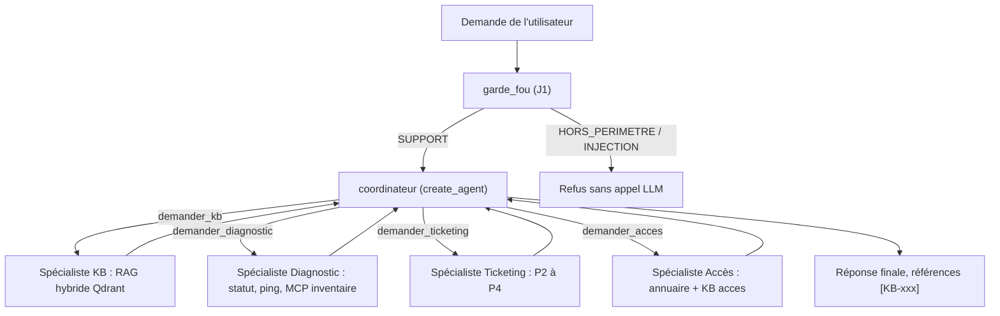
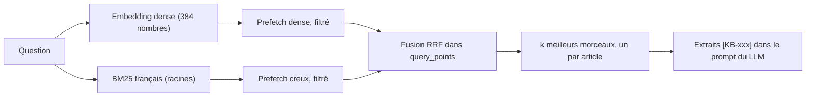
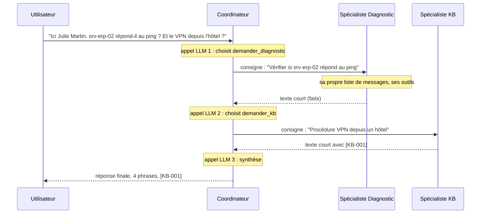
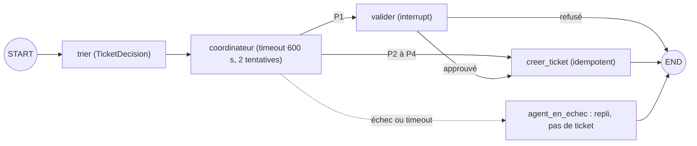
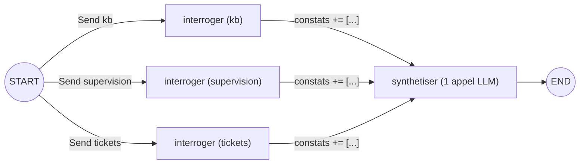

# Chapitre 4 · Multi-agents et connaissances : patterns, RAG hybride, spécialistes, Send, Deep Agents

> **Ce que vous saurez faire**
>
> - Choisir entre les cinq patterns multi-agents (sous-agents, handoffs, skills, routeur, workflow sur mesure) en vous posant une seule question : qui décide de la suite, et qui voit quel contexte ?
> - Indexer une base de connaissances dans Qdrant en recherche **hybride** (dense + BM25 français) et filtrer par payload.
> - Construire un spécialiste RAG qui **cite ses sources** `[KB-xxx]`.
> - Exposer des spécialistes **comme des outils** d'un coordinateur, avec isolation du contexte, et en ajouter un nouveau.
> - Lancer des branches en parallèle avec `Send`, les agréger avec un reducer et borner le parallélisme.
> - Reconnaître dans Deep Agents ce que vous avez construit à la main, et savoir quand ne pas l'utiliser.

> **Où le pratiquer**
>
> - Notebooks : `notebooks/J3_01_patterns_multi_agents.ipynb`, `J3_02_rag_et_sous_agents.ipynb`, `J3_03_parallelisme_send.ipynb`, `J3_05_deep_agents_bilan.ipynb`.
> - Construction dirigée : `construction/etape_07_rag_specialistes_mcp.py` (RAG, spécialistes, coordinateur) et `construction/defi_08a_ticketing.py` (un spécialiste de plus).
> - Code du fil rouge : `src/helpdesk_ops/kb.py` (Qdrant), `src/helpdesk_ops/multi_agents.py` (spécialistes, coordinateur, routeur).
> - Animations (double-clic, sans connexion) : `comprendre/coordinateur_specialistes.html`, `comprendre/rag_hybride.html`, `comprendre/send_map_reduce.html`.
> - Exercice : `exercices/enonces/Ex3_1_quatrieme_specialiste.ipynb` (corrigé dans `exercices/corriges/`).
> - MCP (le serveur d'inventaire branché sur le spécialiste Diagnostic) : voir le **chapitre 5**.

---

## 1. Pourquoi plusieurs agents ?

### L'idée

Pensez à un help-desk au téléphone. L'agent N1 n'est pas expert réseau, expert ERP **et** expert comptes. Il qualifie la demande, puis il transmet au bon expert. Cet expert ne reçoit que **le dossier utile**, pas toute la conversation. Un agent unique avec 25 outils et un prompt de trois pages se dégrade : il choisit mal ses outils, son contexte déborde, et chaque nouveau besoin modifie un prompt dont tout dépend.

Découper en plusieurs agents apporte quatre bénéfices :

| Bénéfice | Concrètement |
|---|---|
| Isolation du contexte | chaque spécialiste ne voit que sa tâche : prompt court, moins de confusion, moins de données personnelles qui circulent |
| Moindre privilège | un outil n'est exposé qu'au spécialiste qui en a besoin (OWASP ASI02) |
| Évolution | ajouter un spécialiste sans réécrire les autres (Ex3.1) |
| Observabilité | une trace par spécialiste, imbriquée : on voit qui a fait quoi |

### Le code

Le module `helpdesk_ops.multi_agents` fournit trois spécialistes. Chacun est un `create_agent` avec **ses** outils et **sa** consigne.

```python
from langchain.agents import create_agent

# Extrait de src/helpdesk_ops/multi_agents.py
def construire_specialistes(llm, *, recherche=recherche_qdrant, outils_mcp=(), ticketing=TICKETING):
    """Les trois spécialistes du cours : KB-RAG, Diagnostic, Ticketing (chacun un create_agent avec SES outils)."""
    return {
        "kb": create_agent(llm, outils_kb(recherche), system_prompt=CONSIGNES["kb"], name="specialiste_kb"),
        "diagnostic": create_agent(llm, [statut_serveur, ping_serveur, *outils_mcp], system_prompt=CONSIGNES["diagnostic"],
                                   name="specialiste_diagnostic"),
        "ticketing": create_agent(llm, outils_ticketing(ticketing), system_prompt=CONSIGNES["ticketing"],
                                  name="specialiste_ticketing"),
    }
```

Dans le notebook J3-01, on les construit une fois :

```python
from helpdesk_ops.multi_agents import CONSIGNES, construire_routeur, construire_specialistes

specialistes = construire_specialistes(llm)
for nom in specialistes:
    print(f"{nom:<11} → {CONSIGNES[nom][:90]}…")
```

### Ce qu'on observe

Trois lignes, une par spécialiste, avec le début de sa consigne. Chaque consigne est courte et parle d'un seul métier. Le spécialiste Diagnostic, par exemple, « établit les FAITS » et « n'agit jamais sur un serveur ou un poste ».

> ✅ **Bonne pratique :** avant de découper, comparez avec le tableau de J3-01. Moins d'une dizaine d'outils d'un même domaine, un contexte court, quelques secondes de latence acceptables : un agent unique (ou un workflow) suffit. Plusieurs domaines, des outils sensibles à isoler, plusieurs équipes : le multi-agents se justifie.

> ⚠️ **Piège :** le coût est réel. Chaque délégation ajoute des appels LLM. Mesuré pendant la préparation sur CPU : **4 à 8 minutes** pour une question à deux sujets avec un coordinateur, contre 20 à 90 secondes avec un routeur. Sur GPU, l'écart reste du même ordre en proportion.

---

## 2. Les cinq patterns de la documentation LangChain

### L'idée

La documentation LangChain (page *Multi-agent*) distingue cinq patterns. Pour les reconnaître, posez-vous toujours la même question : **qui décide de la prochaine étape, et qui voit quel contexte ?**

| Pattern | Principe | Qui décide de la suite ? | Exemple HelpDesk-Ops |
|---|---|---|---|
| Sous-agents | un coordinateur appelle des spécialistes **comme des outils** et garde la main | le coordinateur | « srv-erp-02 répond-il, et comment configurer le VPN ? » → Diagnostic **et** KB |
| Handoffs | un agent **passe la main** à un autre, qui poursuit la conversation | l'agent qui transmet | l'accueil transfère l'utilisateur au spécialiste Comptes |
| Skills | un seul agent charge **à la demande** des instructions spécialisées | l'agent lui-même | l'agent charge la « fiche réflexe ERP » quand la question en parle |
| Routeur | une décision (règle ou LLM) envoie la demande à **un** spécialiste | le routeur, une seule fois | tri d'entrée : procédure, diagnostic ou ticket |
| Workflow sur mesure | un graphe explicite, avec des étapes déterministes et des agents là où il faut | le développeur | le jalon J2 : garde-fou → agent → qualification → validation |

### Le code

Ces patterns se combinent. Le schéma ci-dessous montre le jalon J3 : un workflow sur mesure (le garde-fou de J1) qui contient un coordinateur à sous-agents.



### Ce qu'on observe

Le garde-fou et l'enchaînement sont décidés par **le développeur** (workflow). À l'intérieur, c'est **le coordinateur** qui décide quels spécialistes appeler (sous-agents). Les spécialistes ne voient que leur consigne.

> ✅ **Bonne pratique :** décrivez votre architecture avec ces cinq mots. Dire « un workflow qui contient un coordinateur à sous-agents » est plus précis que « un système multi-agents ».

> ⚠️ **Piège :** plus d'agents, c'est plus de points de défaillance (OWASP **ASI08**, *Cascading Failures*). Un spécialiste qui tombe ne doit pas faire tomber le coordinateur : les protections de J2 (timeout, repli) s'appliquent **à chaque délégation**.

---

## 3. Le routeur : une décision, un spécialiste

### L'idée

Le routeur est le pattern le plus économique. Une sortie structurée (vue en J2-03) choisit **un** spécialiste. Le graphe y va avec `Command(goto=…)`. Un appel LLM de décision, puis le spécialiste. C'est parfait… tant que la demande n'a qu'un sujet.

### Le code

```python
from typing import Literal
from langgraph.graph import END, START, MessagesState, StateGraph
from langgraph.types import Command
from pydantic import Field, create_model

# Extrait de construire_routeur (src/helpdesk_ops/multi_agents.py)
destinations = tuple(specialistes)
# Schéma construit à la volée : les valeurs permises sont exactement les spécialistes présents
Aiguillage = create_model("Aiguillage", specialiste=(Literal[destinations], Field(
    description=" ; ".join(f"{n} : {descriptions[n]}" for n in destinations))))
choix = llm.with_structured_output(Aiguillage, method="json_schema")

async def router(state: MessagesState) -> Command:
    decision = await choix.ainvoke([("system", "Choisis le spécialiste du help-desk NordTech qui doit traiter la demande."),
                                    state["messages"][-1]])
    cible = decision.specialiste if decision is not None else destinations[0]   # repli prudent
    return Command(goto=cible)

b = StateGraph(MessagesState)
b.add_node("router", router, destinations=destinations)
for nom, agent in specialistes.items():
    b.add_node(nom, agent)        # un create_agent compilé est un nœud comme un autre
    b.add_edge(nom, END)
b.add_edge(START, "router")
```

### Ce qu'on observe

Dans Langfuse, chaque trace `routeur` montre le nœud `router` puis **un seul** spécialiste. La troisième demande du notebook (« srv-erp-02 répond-il au ping ? Et comment je configure le VPN depuis l'hôtel ? ») n'est traitée qu'à moitié : le routeur n'a qu'un choix. C'est la limite structurelle du pattern.

> ✅ **Bonne pratique :** gardez un repli prudent quand la sortie structurée est inexploitable (`decision is None`). Le graphe ne doit jamais rester sans destination.

> ⚠️ **Piège :** un routeur se trompe aussi. Pendant la préparation, « Outlook plante… » est parti chez le **Diagnostic** (qui a vérifié `srv-mail-01`) au lieu de la KB. Et la réponse à la question double affirmait « aucun historique d'alerte dans les 24 h », une information qu'aucun outil n'avait fournie. Ces erreurs se **mesurent** au chapitre consacré à l'évaluation (justesse du routage, fidélité aux sources).

---

## 4. Le handoff : passer la main

### L'idée

Dans un handoff, un agent **transfère** la conversation à un autre, qui continue directement avec l'utilisateur. Techniquement, un nœud renvoie un `Command` qui désigne le prochain agent. Différence avec les sous-agents : l'agent qui transfère **ne reprend pas** la main pour synthétiser.

### Le code

Le notebook J3-01 l'illustre sans LLM : la mécanique compte plus que le contenu.

```python
from langchain_core.messages import AIMessage
from langgraph.graph import END, START, MessagesState, StateGraph
from langgraph.types import Command


def accueil(state: MessagesState) -> Command:
    demande = state["messages"][-1].content.lower()
    if "compte" in demande:   # l'accueil reconnaît un sujet qui n'est pas le sien : il passe la main
        return Command(goto="comptes", update={"messages": [AIMessage("Je vous transfère au spécialiste Comptes.")]})
    return Command(goto=END, update={"messages": [AIMessage("Je m'en occupe.")]})


def comptes(state: MessagesState) -> dict:
    return {"messages": [AIMessage("Spécialiste Comptes : votre compte est verrouillé, il se débloque dans 15 min.")]}


b = StateGraph(MessagesState)
b.add_node("accueil", accueil, destinations=("comptes", END))
b.add_node("comptes", comptes)
b.add_edge(START, "accueil")
b.add_edge("comptes", END)
handoff = b.compile()
```

### Ce qu'on observe

```
HumanMessage   Mon compte est bloqué
AIMessage      Je vous transfère au spécialiste Comptes.
AIMessage      Spécialiste Comptes : votre compte est verrouillé, il se débloque dans 15 min.
```

L'accueil ne répond pas sur le fond. Le spécialiste Comptes prend la suite **dans la même conversation**.

> ✅ **Bonne pratique :** déclarez `destinations=(…)` sur un nœud qui renvoie un `Command`. Le dessin du graphe montre alors les arêtes possibles.

> ⚠️ **Piège :** quand l'agent qui transfère est lui-même un sous-graphe (un `create_agent` dans un graphe plus large), `Command(goto="comptes")` cherche le nœud dans **son** graphe. Il faut écrire `Command(graph=Command.PARENT, goto="comptes")` pour désigner un nœud du graphe **parent**.

---

## 5. Le RAG en trois briques

### L'idée

Un LLM ne connaît pas les procédures de NordTech : elles ne figuraient pas dans ses données d'entraînement. Le **RAG** (*Retrieval-Augmented Generation*) consiste à **chercher** les bons passages, puis à les **donner** au LLM dans le prompt. Analogie : un bibliothécaire trouve les trois fiches utiles ; un rapporteur rédige la réponse **à partir de ces fiches seulement**.

| Brique | Rôle | Classe LangChain |
|---|---|---|
| Embeddings | transformer un texte en vecteur : deux textes de sens proche ont des vecteurs proches | `HuggingFaceEmbeddings` (MiniLM multilingue, local) |
| Vector store | ranger les vecteurs et retrouver les plus proches d'une question | `InMemoryVectorStore`, puis `QdrantVectorStore` |
| Retriever | l'interface « question → documents », branchable dans une chaîne LCEL | `store.as_retriever(search_kwargs={"k": …})` |

### Le code

```python
from langchain_core.documents import Document
from langchain_core.output_parsers import StrOutputParser
from langchain_core.prompts import ChatPromptTemplate
from langchain_core.runnables import RunnablePassthrough
from langchain_core.vectorstores import InMemoryVectorStore

from helpdesk_ops import kb

embeddings = kb.embeddings_denses()          # brique 1 : modèle local, sur CPU
fiches = [
    Document("VPN : redémarrer le client GlobalProtect, puis vérifier la connexion Wi-Fi.", metadata={"id": "F-1"}),
    Document("Imprimante : en cas de bourrage, ouvrir le capot avant et retirer la feuille.", metadata={"id": "F-2"}),
    # ... F-3 (mot de passe), F-4 (Teams)
]
store = InMemoryVectorStore.from_documents(fiches, embeddings)     # brique 2
retriever = store.as_retriever(search_kwargs={"k": 2})             # brique 3

prompt_rag = ChatPromptTemplate.from_messages([
    ("system", "Tu es l'agent support N1 de NordTech. Réponds en une phrase, UNIQUEMENT à partir des fiches "
               "fournies, et cite l'identifiant [F-x]. Si les fiches ne répondent pas, dis-le."),
    ("human", "Fiches :\n{contexte}\n\nQuestion : {question}"),
])

def formater_fiches(docs):
    return "\n".join(f"[{d.metadata['id']}] {d.page_content}" for d in docs)

rag = {"contexte": retriever | formater_fiches, "question": RunnablePassthrough()} | prompt_rag | llm | StrOutputParser()
```

### Ce qu'on observe

- « VPN » et « tunnel sécurisé » n'ont **aucun mot en commun**, et pourtant leurs vecteurs sont plus proches que ceux du VPN et de l'imprimante. C'est la recherche **par le sens**.
- La réponse à « Mon imprimante est coincée » cite **[F-2]**.
- Dans Langfuse (session `j3-02-rag-3-briques`), la trace montre une étape **retriever** (les 2 fiches remontées), puis la **generation** avec les fiches **dans le prompt**.

> ✅ **Bonne pratique :** le réflexe de débogage d'un RAG. Ouvrez la trace et demandez-vous : *la bonne fiche est-elle remontée ?* Si non, le problème est la recherche, pas le LLM.

> ⚠️ **Piège :** la recherche par le sens se trompe aussi. Pour « je n'arrive plus à me connecter au tunnel de l'entreprise », **F-3** (mot de passe, 0,54) est passée **devant** F-1 (0,16), sans doute à cause de « me connecter ». Affichez les scores, gardez `k` > 1, et passez à la recherche hybride.

---

## 6. Indexer la KB dans Qdrant : trois choix vérifiés

### L'idée

La vraie base de connaissances compte 20 articles Markdown fictifs (`data/kb/`). Chaque en-tête porte des métadonnées qui deviennent le **payload** Qdrant : `categorie`, `equipe`, `visibilite` (`public` pour l'assistant N1, `interne` pour les procédures N2) et `maj`. Les articles sont découpés par section `##`. Trois choix ont été vérifiés en préparant le cours :

1. **la collection est créée par notre code**, avec `Modifier.IDF` sur le vecteur creux. Celle que crée `QdrantVectorStore.from_documents` n'a pas de modificateur, et BM25 perd sa pondération IDF ;
2. **BM25 en français** (`language="french"`). Par défaut, fastembed racinise en anglais : « les imprimantes sont bloquées » gardait « les » et « sont » ;
3. **identifiants stables** (`uuid5` de l'article et du morceau) : réindexer **remplace** au lieu de dupliquer.

### Le code

```python
from qdrant_client import QdrantClient, models

# Extrait de src/helpdesk_ops/kb.py
VECTEUR_CREUX = "langchain-sparse"   # nom attendu par QdrantVectorStore

def creer_collection(client: QdrantClient, nom: str, dimension: int, *, recreer: bool = False) -> None:
    if client.collection_exists(nom):
        if not recreer:
            return
        client.delete_collection(nom)
    client.create_collection(
        nom,
        vectors_config=models.VectorParams(size=dimension, distance=models.Distance.COSINE),
        sparse_vectors_config={VECTEUR_CREUX: models.SparseVectorParams(modifier=models.Modifier.IDF)},
    )
    # Index de payload : filtres rapides (et indispensables à grande échelle)
    for champ in ("categorie", "visibilite", "equipe", "id"):
        client.create_payload_index(nom, f"metadata.{champ}", models.PayloadSchemaType.KEYWORD)


def embeddings_creux():
    from langchain_qdrant import FastEmbedSparse
    return FastEmbedSparse(model_name="Qdrant/bm25", language="french")   # BM25 en français
```

Et l'indexation proprement dite :

```python
ids = [str(uuid.uuid5(ESPACE_IDS, f"{m.metadata['id']}#{m.metadata['morceau']}#{m.metadata['section']}")) for m in morceaux]
QdrantVectorStore(client=client, collection_name=nom, embedding=dense, sparse_embedding=embeddings_creux(),
                  retrieval_mode=RetrievalMode.HYBRID).add_documents(morceaux, ids=ids)
```

Pour indexer depuis la construction dirigée :

```bash
uv run --project infrastructure python construction/etape_07_rag_specialistes_mcp.py --indexer
```

### Ce qu'on observe

37 morceaux (un par section `##`). La configuration de la collection montre `modifier=<Modifier.IDF>` sur le vecteur creux. Après une réindexation, le nombre de points **ne change pas**. Le dashboard Qdrant (`http://localhost:6333/dashboard`, clé `QDRANT_API_KEY` du `.env`) montre la collection `kb_nordtech` et le payload de chaque point.

> ✅ **Bonne pratique :** préchargez les modèles d'embeddings (HF multilingue, BM25) **la veille**. Ils se téléchargent une fois, puis tout tourne hors ligne. Pendant la préparation, le premier chargement a pris 4 minutes, avec des coupures réseau.

> ⚠️ **Piège :** sous Windows, `QDRANT_URL` en `localhost` coûtait **2 s par requête** (résolution IPv6 d'abord, puis repli sur IPv4). Écrivez `127.0.0.1`. Autre point : la clé API Qdrant est obligatoire même en local ; le client affiche `UserWarning: Api key is used with an insecure connection`, ce qui est attendu en HTTP local.

---

## 7. Dense, BM25, hybride : comparer avant de choisir

### L'idée

| Recherche | Ce qu'elle capte | Ce qu'elle rate |
|---|---|---|
| dense (embeddings) | le **sens** : « tunnel sécurisé » ≈ « VPN » | les termes exacts rares : `srv-fichiers-03` |
| lexicale (BM25) | les **mots exacts**, les codes d'erreur | les reformulations, les synonymes |
| hybride | les deux, **fusionnés** (Reciprocal Rank Fusion, RRF) | rien, au prix de deux index |

La fusion RRF ne compare pas les scores bruts. Chaque morceau reçoit `1 / (position + 2)` dans chaque liste où il apparaît, et on additionne. Un cosinus de 0,4 et un score BM25 de 17 deviennent comparables.

### Le code

Côté cours, une seule fonction : `kb.rechercher(question, k=3, mode=…)`.

```python
QUESTIONS = [
    "mon tunnel sécurisé ne fonctionne plus depuis l'hôtel",   # reformulation : le sens compte
    "impossible d'enregistrer sur srv-fichiers-03",            # nom exact : le mot compte
    "mon PC rame énormément",                                  # aucun mot de la KB : seul le sens aide
    "0x80070005",                                              # code exact, mais présent dans un titre
]
for q in QUESTIONS:
    res = {mode: [d.metadata["id"] for d in kb.rechercher(q, k=3, mode=mode)] for mode in ("dense", "sparse", "hybrid")}
    print(q[:50], res)
```

Sous le capot, `QdrantVectorStore` envoie **une seule** requête `query_points` à Qdrant (extrait montré dans l'animation `rag_hybride.html`) :

```python
results = self.client.query_points(prefetch=[
    models.Prefetch(using=self.vector_name, query=query_dense_embedding, filter=filter, limit=k),
    models.Prefetch(using=self.sparse_vector_name, query=models.SparseVector(…), filter=filter, limit=k)],
    query=hybrid_fusion or models.FusionQuery(fusion=models.Fusion.RRF),
    query_filter=filter, limit=k, with_payload=True)
```



### Ce qu'on observe

Mesuré le 09/11/2026 sur la KB du cours :

- reformulation : le dense trouve KB-001 (VPN) sans que le mot « VPN » soit écrit ;
- `srv-fichiers-03` : le dense **rate** KB-015 (5ᵉ seulement) ; BM25 le met en tête, l'hybride aussi ;
- « mon PC rame énormément » : BM25 ne renvoie **rien**, le dense trouve KB-011 (poste lent) ;
- `0x80070005` : les trois modes trouvent KB-010, car le code est dans le **titre** de l'article.

L'hybride place le bon article en tête dans tous les cas.

> ✅ **Bonne pratique :** utilisez `query_points`, l'API actuelle de Qdrant. `search()` et `recommend()` sont dépréciés côté serveur depuis la v1.19 : ne les utilisez pas dans du code neuf.

> ⚠️ **Piège :** un terme rare n'est pas toujours raté par le dense (voir `0x80070005`). Ne supposez pas : **mesurez** sur vos propres questions. Autre piège traité par `kb.rechercher` : sans `un_par_article=True`, les sections d'un même article occupent toutes les places et masquent les autres.

---

## 8. Filtres de payload : confidentialité et périmètre

### L'idée

Un filtre Qdrant restreint les points candidats **avant** le classement. Deux usages :

- **confidentialité** : l'assistant N1 ne doit **jamais** recevoir les procédures internes N2 (redémarrer un serveur de production…). Ce n'est pas au LLM de « ne pas les citer » : elles ne doivent pas lui parvenir ;
- **périmètre** : un spécialiste Accès ne cherche que dans la catégorie `acces`.

Via LangChain, le payload est rangé sous `metadata`. On filtre donc sur `metadata.visibilite` ou `metadata.categorie`.

### Le code

```python
from qdrant_client import models

# Extrait de src/helpdesk_ops/kb.py
def filtre(*, public_seulement: bool = True, categorie: str | None = None) -> models.Filter | None:
    conditions = []
    if public_seulement:   # l'assistant N1 ne voit jamais les procédures internes N2
        conditions.append(models.FieldCondition(key="metadata.visibilite", match=models.MatchValue(value="public")))
    if categorie:
        conditions.append(models.FieldCondition(key="metadata.categorie", match=models.MatchValue(value=categorie)))
    return models.Filter(must=conditions) if conditions else None
```

Utilisation :

```python
kb.rechercher("procédure pour redémarrer un serveur de production", k=3, public_seulement=True)
kb.rechercher("je n'arrive plus à me connecter", categorie="acces")
```

### Ce qu'on observe

Avec le filtre (comportement par défaut), KB-019 et KB-018, procédures internes, n'apparaissent **jamais**. Sans filtre, elles arrivent en tête. Avec `categorie="acces"`, la question vague « je n'arrive plus à me connecter » trouve les procédures de comptes au lieu du VPN.

> ✅ **Bonne pratique :** posez le filtre dans **le code de l'outil**, jamais dans le prompt. Un modèle se laisse convaincre ; un filtre, non.

> ⚠️ **Piège :** la clé du filtre est `metadata.categorie`, pas `categorie`. Sans le préfixe `metadata.`, le filtre ne trouve rien, car LangChain range le payload sous `metadata`.

---

## 9. Un spécialiste RAG qui cite ses sources

### L'idée

Le spécialiste Procédures a **un** outil, `rechercher_procedures`. Cet outil renvoie des extraits préfixés de leur référence `[KB-xxx]`. La consigne exige de citer les références, et de dire quand aucun extrait ne répond.

### Le code

```python
from langchain.agents import create_agent
from langchain_core.tools import tool

from helpdesk_ops import kb


@tool(parse_docstring=True)
def rechercher_procedures(question: str) -> str:
    """Cherche les procédures du help-desk NordTech les plus pertinentes pour un problème.

    Args:
        question: le problème décrit en une phrase, par exemple 'le VPN ne se connecte pas depuis l'hôtel'
    """
    return kb.formater(kb.rechercher(question, k=3))   # public seulement, par défaut


specialiste_kb = create_agent(
    llm, [rechercher_procedures], name="specialiste_kb",
    system_prompt="Tu es le spécialiste Procédures du help-desk NordTech. Utilise rechercher_procedures, puis réponds en "
                  "3 phrases maximum EN CITANT les références [KB-xxx] utilisées. Si aucun extrait ne répond, dis-le : n'invente rien.",
)
```

`kb.formater` produit le texte que lit le modèle :

```python
def formater(documents):
    if not documents:
        return "Aucun article pertinent dans la base de connaissances."
    return "\n\n".join(f"[{d.metadata['id']}] {d.page_content}" for d in documents)
```

### Ce qu'on observe

Pour « Teams ne détecte plus mon micro », la réponse cite `[KB-009]`. Dans Langfuse, l'observation de l'outil `rechercher_procedures` montre les **extraits exacts** reçus par le modèle : c'est là qu'on vérifie qu'il n'a rien ajouté.

> ✅ **Bonne pratique :** soignez la docstring de l'outil (`parse_docstring=True`). Le modèle ne lit que le nom, la description et la description de chaque argument. Un exemple concret (`'le VPN ne se connecte pas depuis l'hôtel'`) l'aide à formuler sa requête.

> ⚠️ **Piège :** citer une source ne prouve pas qu'on lui est fidèle. Pendant la préparation, la réponse citait bien `[KB-009]`… et ajoutait un chemin Windows détaillé qui n'est **pas** dans l'article. Plus grave (J3-05) : pour le PC-0203, la réponse attribuait à `[KB-010]` des commandes `takeown` et `icacls` « en tant qu'administrateur », alors que KB-010 dit exactement l'inverse. La fidélité aux sources se **mesure** (évaluation, juge LLM).

---

## 10. Les sous-agents comme outils : le coordinateur

### L'idée

Vu du coordinateur, un spécialiste n'est qu'**un outil**. On enveloppe chaque spécialiste dans un outil `demander_<nom>(consigne)`. Le coordinateur décide **quoi** demander à **qui**, avec une consigne précise. Le spécialiste ne reçoit **que** cette consigne (pas la conversation, pas le nom de l'utilisateur) et rend un texte court. Le paramètre `config: RunnableConfig` propage les callbacks : les traces des spécialistes s'**imbriquent** dans celle du coordinateur.

### Le code

```python
from langchain.agents import create_agent
from langchain_core.messages import HumanMessage
from langchain_core.runnables import RunnableConfig
from langchain_core.tools import tool

from helpdesk_ops.multi_agents import DESCRIPTIONS, PROMPT_COORDINATEUR, construire_specialistes


def comme_outil(nom: str, agent):
    async def deleguer(consigne: str, config: RunnableConfig) -> str:
        resultat = await agent.ainvoke({"messages": [HumanMessage(consigne)]},   # ← SEULE la consigne
                                       config={**config, "run_name": f"specialiste-{nom}"})
        return resultat["messages"][-1].content                                # seule la réponse finale remonte

    deleguer.__doc__ = f"""{DESCRIPTIONS[nom]}

        Args:
            consigne: la tâche précise confiée au spécialiste, avec les identifiants utiles (serveur, poste, compte)
        """
    return tool(f"demander_{nom}", parse_docstring=True)(deleguer)


specialistes = construire_specialistes(llm)
coordinateur = create_agent(llm, [comme_outil(nom, agent) for nom, agent in specialistes.items()],
                            system_prompt=PROMPT_COORDINATEUR, name="coordinateur")
```

Le prompt du coordinateur (extrait de `multi_agents.py`) lui interdit de répondre de mémoire :

```python
PROMPT_COORDINATEUR = (
    "Tu es le coordinateur du help-desk N1 de NordTech SA. Tu ne réponds jamais de mémoire : tu délègues à tes "
    "spécialistes (un appel par sujet, avec une consigne précise), puis tu rédiges une réponse finale en français, "
    "en 4 phrases maximum. Reprends telles quelles les références [KB-xxx] citées par les spécialistes. "
    "Ne mentionne un numéro de ticket QUE s'il figure mot pour mot dans la réponse d'un spécialiste : n'en invente jamais."
)
```



### Ce qu'on observe

- **Deux** délégations (Diagnostic **et** KB), là où le routeur n'en faisait qu'une.
- Les consignes rédigées par le coordinateur ne contiennent **pas** « Julie Martin » : l'isolation du contexte limite aussi la circulation des données personnelles.
- Dans Langfuse, la trace `coordinateur` contient les traces `specialiste-diagnostic` et `specialiste-kb` **imbriquées**, chacune avec ses propres outils.
- Coût (animation `coordinateur_specialistes.html`) : 3 appels LLM pour le coordinateur, 2 par spécialiste.

> ✅ **Bonne pratique :** propagez **toujours** `config` dans `deleguer`. Sans `config={**config, …}`, les callbacks Langfuse ne suivent pas et les spécialistes apparaissent comme des traces orphelines.

> ⚠️ **Piège :** avec une consigne qui demandait de « conserver les numéros de ticket », le coordinateur a **inventé** « Ticket : TKT-2025-0012 » alors qu'aucun ticket n'existait. Le prompt actuel l'interdit explicitement. Un prompt ne prouve rien pour autant : il faut **mesurer** les hallucinations sur un dataset.

---

## 11. Ajouter un spécialiste : c'est la description qui route

### L'idée

Ajouter un spécialiste ne touche pas aux autres. Il faut trois choses : **ses** outils, **sa** consigne, et **sa description**. C'est la description de l'outil `demander_<nom>` qui décide du routage, pas son code. Le coordinateur ne connaît rien d'autre des spécialistes : ni leurs outils, ni leur consigne.

### Le code

Exercice 3.1, corrigé : le spécialiste Accès. Le filtre `categorie="acces"` est posé **dans l'outil**.

```python
@tool(parse_docstring=True)
def procedures_acces(question: str) -> str:
    """Cherche les procédures du help-desk NordTech sur les comptes, mots de passe, MFA et droits d'accès.

    Args:
        question: le problème d'accès en une phrase, par exemple 'compte verrouillé après plusieurs échecs'
    """
    return kb.formater(kb.rechercher(question, k=3, categorie="acces"))


specialiste_acces = create_agent(
    llm, [etat_compte, procedures_acces], name="specialiste_acces",
    system_prompt="Tu es le spécialiste Accès du help-desk NordTech. Vérifie l'état du compte avec etat_compte, puis indique "
                  "la procédure à suivre en citant [KB-xxx]. Tu ne réinitialises jamais un mot de passe toi-même.",
)

DESCRIPTION_ACCES = "Vérifie l'état du compte d'un collaborateur (verrouillé, expiré, désactivé) et donne la procédure d'accès."
coordinateur = construire_coordinateur(llm, {**specialistes, "acces": specialiste_acces}, {"acces": DESCRIPTION_ACCES})
```

Même démarche dans la construction dirigée, défi A du 10/11 (`defi_08a_ticketing.py`) :

```python
from helpdesk_ops.outils import tickets_ouverts                       # ═══ NOUVEAU (défi A)

SPECIALISTES = {
    # ... kb, diagnostic, acces
    # ═══ NOUVEAU (défi A) : un spécialiste = un create_agent avec SES outils et SA consigne ═══
    "ticketing": create_agent(llm, [tickets_ouverts], name="specialiste_ticketing", system_prompt=(
        "Tu es le spécialiste Ticketing du help-desk NordTech. Tu consultes les files avec tickets_ouverts "
        "(files : N1, N2-infra, N2-applicatif). Tu n'ouvres pas de ticket : le graphe s'en charge. Réponds en 2 phrases.")),
}
DESCRIPTIONS_SPECIALISTES = {"kb": DESCRIPTIONS["kb"], "diagnostic": DESCRIPTIONS["diagnostic"], "acces": DESCRIPTION_ACCES,
                             # ═══ NOUVEAU (défi A) : la description décide du routage ═══
                             "ticketing": "Donne le nombre de tickets ouverts dans une file du help-desk (N1, N2-infra, N2-applicatif)."}
```

```bash
uv run --project infrastructure python construction/defi_08a_ticketing.py --thread t-files "Combien de tickets attendent dans la file N2-infra ?"
```

### Ce qu'on observe

- Ex3.1 : « Mon compte collab-8b20d4 est bloqué » appelle `demander_acces` seul ; « Outlook plante… » appelle `demander_kb` seul ; la question mixte appelle Accès **et** Diagnostic.
- Défi A : le terminal affiche « délégué à : demander_ticketing », la réponse donne 6 tickets, et Langfuse montre `specialiste-ticketing` avec son appel `tickets_ouverts`.

> ✅ **Bonne pratique :** pour garantir qu'un spécialiste ne fait pas une action (réinitialiser un mot de passe), **ne lui donnez pas l'outil**. C'est le moindre privilège. Le prompt (« tu ne réinitialises jamais ») n'est qu'une demande.

> ⚠️ **Piège :** une description vague (« gère les accès ») fait appeler le spécialiste « au cas où ». Comparez les traces avec une description vague puis précise. Et n'oubliez pas le coût : un spécialiste de plus, c'est un appel de décision un peu plus long à **chaque** question, et deux appels de plus quand il est sollicité.

---

## 12. Le coordinateur dans le graphe de production (étape 7)

### L'idée

Dans la construction dirigée, l'étape 7 remplace le couple `agent ⇄ tools` de l'étape 6 par le coordinateur. Le tri, la validation humaine des P1 et la création du ticket ne changent pas. Le coordinateur devient un **nœud** du graphe, protégé par une `RetryPolicy`, une `TimeoutPolicy` et un `error_handler`.

### Le code

```python
from langgraph.types import RetryPolicy, TimeoutPolicy

# Extrait de construction/etape_07_rag_specialistes_mcp.py
async def coordonner(state: EtatTicket) -> dict:
    resultat = await coordinateur.ainvoke({"messages": state["messages"]})
    return {"messages": resultat["messages"][len(state["messages"]):]}   # seulement les messages nouveaux


def apres_coordinateur(state: EtatTicket) -> Literal["valider", "creer_ticket"]:
    return "valider" if state["priorite"] == "P1" else "creer_ticket"


builder.add_node("coordinateur", coordonner, retry_policy=RetryPolicy(max_attempts=2, retry_on=ERREURS_RESEAU_LLM),
                 timeout=TimeoutPolicy(run_timeout=600), error_handler=agent_en_echec)   # CPU : jusqu'à 6 min mesurées le 07/11
builder.add_edge("trier", "coordinateur")
builder.add_conditional_edges("coordinateur", apres_coordinateur)
```

Et la configuration d'exécution :

```python
config = {"configurable": {"thread_id": args.thread}, "callbacks": [handler],
          "run_name": "helpdesk", "recursion_limit": 25}           # délégations = plus d'étapes
```



```bash
uv run --project infrastructure python construction/etape_07_rag_specialistes_mcp.py --thread t-outlook "Outlook plante dès que j'ouvre une pièce jointe"
```

### Ce qu'on observe

Le terminal affiche la décision de tri, puis les délégations (`🧭 délégué à : demander_kb(...)`), la réponse avec ses références `[KB-xxx]`, et le ticket. Dans Langfuse, l'arbre multi-agents : sous le coordinateur, un outil `demander_…` par délégation, et **dedans** la trace complète du spécialiste (ses générations, ses outils, la recherche Qdrant).

> ✅ **Bonne pratique :** ne renvoyez que les messages **nouveaux** du coordinateur (`resultat["messages"][len(state["messages"]):]`). Sinon le reducer `add_messages` du graphe reçoit des doublons.

> ⚠️ **Piège :** sur un portable sans GPU, un coordinateur dépasse facilement 300 s. À l'étape 6, le timeout de l'agent était de 120 s ; à l'étape 7, il est porté à **`TimeoutPolicy(run_timeout=600)`** (jusqu'à 6 minutes mesurées le 07/11 sur CPU). Pensez aussi à monter `recursion_limit` (25 ici) : chaque délégation ajoute des étapes.

---

## 13. Le parallélisme avec `Send` : le map-reduce

### L'idée

Analogie : le chef de chantier ne sait qu'au matin combien de corps de métier il lui faut. Il envoie chacun sur sa tâche **en même temps**, puis fait le point à midi.

- Une fonction de routage renvoie une **liste** de `Send("noeud", charge_utile)`. LangGraph lance une exécution du nœud **par** `Send`, dans le même super-step, donc **en parallèle**.
- Chaque branche reçoit **sa** charge utile, pas l'état complet.
- Les résultats reviennent dans une clé avec **reducer** (`operator.add`).

| | Arête conditionnelle | `Send` |
|---|---|---|
| Nombre de branches | fixé au dessin du graphe | décidé **à l'exécution** |
| Entrée de la branche | l'état complet | une charge utile choisie |
| Usage | aiguiller | répartir (map), puis agréger (reduce) |

### Le code

```python
import operator
import time
from typing import Annotated, TypedDict

from langgraph.graph import END, START, StateGraph
from langgraph.types import Send


class EtatEnquete(TypedDict):
    question: str
    constats: Annotated[list[str], operator.add]   # reducer : chaque branche AJOUTE son constat


class EtatDiagnostic(EtatEnquete):
    synthese: str


def repartir(state: EtatEnquete) -> list[Send]:
    return [Send("interroger", {"source": nom, "question": state["question"]}) for nom in SOURCES]


class Mission(TypedDict):                           # charge utile d'une branche
    source: str
    question: str


async def interroger(mission: Mission) -> dict:
    debut = time.perf_counter()
    resultat = await SOURCES[mission["source"]](mission["question"])
    return {"constats": [f"[{mission['source']} · {time.perf_counter() - debut:.1f} s] {resultat}"]}


b = StateGraph(EtatDiagnostic)
b.add_node("interroger", interroger)
b.add_node("synthetiser", synthetiser)                     # un seul appel LLM, à la fin
b.add_conditional_edges(START, repartir, ["interroger"])
b.add_edge("interroger", "synthetiser")   # le nœud de synthèse attend TOUTES les branches
b.add_edge("synthetiser", END)
diagnostic = b.compile()
```

Une source synchrone dans un nœud async doit partir dans un thread :

```python
async def source_kb(question: str) -> str:
    await asyncio.sleep(1.0)
    # kb.rechercher est SYNCHRONE (calcul des embeddings) : dans un nœud async, on l'envoie dans un thread
    return await asyncio.to_thread(lambda: kb.formater(kb.rechercher(question, k=2)))
```



### Ce qu'on observe

- Trois sources de 1 s : environ **1 s en parallèle** contre 3 s en séquentiel. Les attentes réseau se recouvrent.
- Trois résumés LLM sur le même serveur local : gain de **×1,5 à ×1,7** seulement (CPU, Ollama), car les requêtes se partagent le même serveur.
- Dans Langfuse, la trace `map-reduce` montre les trois `interroger` **côte à côte** dans le Gantt, puis **une** generation de synthèse.

> ✅ **Bonne pratique :** sur un GPU local unique, parallélisez les **sources** (outils, recherches), et gardez **un** appel LLM de synthèse à la fin. vLLM regroupe les requêtes simultanées (*continuous batching*) ; Ollama les met en file selon `OLLAMA_NUM_PARALLEL`.

> ⚠️ **Piège :** trois pièges rencontrés en préparation. 1) Sans reducer sur `constats`, `InvalidUpdateError` : plusieurs branches écrivent la même clé dans le même super-step. 2) Un appel synchrone dans un nœud `async` gèle la boucle d'événements et toutes les branches avec lui : `asyncio.to_thread(...)`. 3) Sans préchauffage, la première mesure compte le chargement des embeddings, et le « parallèle » sortait **plus lent** que le séquentiel.

---

## 14. Borner le parallélisme : `max_concurrency`

### L'idée

Cent tickets à analyser, c'est cent branches. Sans limite, vous saturez la supervision (et vous vous faites bloquer) ou le serveur de modèles. `config={"max_concurrency": n}` plafonne le nombre de branches simultanées.

### Le code

```python
SERVEURS = ["srv-mail-01", "srv-erp-02", "srv-vpn-01", "srv-fichiers-03"] * 2   # 8 vérifications

b = StateGraph(EtatPing)
b.add_node("pinger", pinger)
b.add_conditional_edges(START, lambda s: [Send("pinger", {"hote": h}) for h in SERVEURS], ["pinger"])
b.add_edge("pinger", END)
balayage = b.compile()

for limite in (None, 2):
    await balayage.ainvoke({"resultats": []}, config={"max_concurrency": limite} if limite else {})
```

### Ce qu'on observe

Environ 0,5 s sans limite (tout en même temps), environ 2 s avec `max_concurrency=2` (4 vagues de 2). L'animation `send_map_reduce.html` le montre pas à pas : la branche la plus lente fixe la durée de la vague.

> ✅ **Bonne pratique :** choisissez la limite selon ce que la **cible** supporte (supervision, serveur LLM), pas selon ce que le graphe permet.

> ⚠️ **Piège :** un fan-out non borné transforme une demande en tempête de requêtes (OWASP ASI08). Bornez, et appliquez les protections de J2 (timeout, repli) **dans** chaque branche : une source lente ne doit pas bloquer la synthèse.

---

## 15. Deep Agents : le harnais tout fait

### L'idée

`create_deep_agent` (paquet `deepagents`) renvoie un graphe LangGraph compilé, comme `create_agent`, mais avec des capacités **déjà branchées**. Vous les avez presque toutes construites à la main :

| Capacité Deep Agents | Ce que vous avez fait à la main |
|---|---|
| outil `task` : des sous-agents au contexte isolé | `comme_outil` + `demander_<nom>` |
| outils `ls`, `read_file`, `write_file`, `edit_file`, `delete`, `glob`, `grep` : un système de fichiers virtuel dans l'état | l'état LangGraph et ses checkpoints |
| outil `execute` : commandes shell | rien, et c'est voulu : sans backend bac à sable, il renvoie une erreur |
| un plan tenu à jour (`write_todos`) | le coordinateur qui décompose ; optionnel depuis la 0.7.0, absent par défaut en 0.7.19 |

### Le code

```python
from deepagents import create_deep_agent

from helpdesk_ops.multi_agents import outils_kb, recherche_qdrant
from helpdesk_ops.outils import statut_serveur
from helpdesk_ops.reseau import ping_serveur

profond = create_deep_agent(
    model=llm,                                              # ← explicite, toujours
    tools=outils_kb(recherche_qdrant),
    system_prompt="Tu es l'assistant support N1 de NordTech SA. Réponds en français, en citant les références [KB-xxx].",
    subagents=[{
        "name": "diagnostic",
        "description": "Établit les faits sur un serveur : statut et joignabilité réseau.",
        "system_prompt": "Tu es le spécialiste Diagnostic. Utilise tes outils et rends les faits en 2 phrases.",
        "tools": [statut_serveur, ping_serveur],
    }],
    name="deep-helpdesk",
)
print("Outils vus par le modèle :", sorted(profond.nodes["tools"].bound.tools_by_name))
```

### Ce qu'on observe

Mesuré pendant la préparation sur un poste CPU :

- **15 à 20 minutes** pour une question à deux sujets, contre environ 4 minutes pour le coordinateur fait main ;
- **2 500 à 3 400 jetons d'entrée** par appel au modèle principal : le harnais envoie ses consignes et la description de dix outils avant même votre question ;
- l'agent a délégué au sous-agent `diagnostic`… puis a répondu qu'il « n'avait pas de moyen direct de tester un ping » : le résultat du sous-agent n'a pas été exploité.

> ✅ **Bonne pratique :** choisissez le harnais pour des tâches **longues et ouvertes** (recherche, rédaction de rapports, analyse de dossiers) avec un modèle capable. Pour un help-desk aux tâches courtes et cadrées, sur un modèle local, le graphe fait main reste plus prévisible, plus rapide et plus lisible.

> ⚠️ **Piège :** sans `model=`, Deep Agents utilise par défaut un **modèle cloud**. C'est fatal pour le contrat 100 % local : passez **toujours** le modèle explicitement.

---

## 16. Le jalon J3 et le pont vers MCP

### L'idée

Le jalon J3 (`helpdesk_ops.jalons.j3`) assemble tout : garde-fou de J1, coordinateur, quatre spécialistes. Le spécialiste Diagnostic reçoit en plus des outils venus d'un **serveur MCP** d'inventaire du parc, filtrés par une liste blanche. Le fonctionnement de MCP, la liste blanche et la sécurité sont détaillés au **chapitre 5**.

### Le code

```python
from langchain.mcp import MCPAdapter

import helpdesk_ops.mcp_inventaire as inventaire
from helpdesk_ops.jalons.j3 import construire_helpdesk_j3
from helpdesk_ops.ticketing import Ticketing

outils_mcp = inventaire.filtrer_outils(await MCPAdapter(inventaire.mcp).list_tools(),
                                       autorises={"detail_poste", "historique_interventions"})   # voir chapitre 5
helpdesk = construire_helpdesk_j3(llm, outils_mcp=outils_mcp, ticketing=Ticketing())

with propagate_attributes(session_id="j3-05-jalon", user_id="collab-5aa3b8", tags=["jour-3", "jalon-j3"]):
    etat = await helpdesk.ainvoke({"messages": [("user", question)]},
                                  config={"callbacks": [langfuse_handler], "run_name": "helpdesk-ops-j3", "recursion_limit": 30})
```

### Ce qu'on observe

- « Le PC-0203 est très lent… » mobilise le Diagnostic (outils MCP) et la KB (KB-010, KB-011).
- « Quelle est la recette de la tarte au sucre ? » est refusée par le garde-fou **sans aucun appel LLM**.
- « Écris-moi un poème sur les serveurs » passe le garde-fou par mots-clés : contournement par reformulation, traité au red-team.
- Langfuse, **Sessions → `j3-05-jalon`** : le coordinateur, puis les spécialistes imbriqués.

> ✅ **Bonne pratique :** pour une question à plusieurs sujets, choisissez les sous-agents ; pour une question à un sujet et une latence serrée, le routeur.

> ⚠️ **Piège :** la même question ne donne pas toujours la même réponse. Pour le PC-0203, une exécution conseillait des commandes dangereuses, la suivante non, mais conseillait toujours de « corriger les droits d'accès », que KB-010 déconseille. Une erreur qui n'apparaît qu'une fois sur deux reste une erreur.

---

## Fiche mémo

| Besoin | Syntaxe | Où revoir |
|---|---|---|
| Créer un spécialiste | `create_agent(llm, [outils], system_prompt=..., name="specialiste_x")` | J3-01, `multi_agents.py` |
| Router vers un seul spécialiste | `with_structured_output(Aiguillage, method="json_schema")` puis `Command(goto=cible)` | J3-01, `construire_routeur` |
| Passer la main (handoff) | `Command(goto="comptes", update={...})` ; depuis un sous-graphe : `graph=Command.PARENT` | J3-01 §6 |
| Embeddings locaux | `kb.embeddings_denses()` (`HuggingFaceEmbeddings`) | J3-02 §1 bis |
| BM25 français | `FastEmbedSparse(model_name="Qdrant/bm25", language="french")` | `kb.py` |
| Collection hybride correcte | `sparse_vectors_config={...: models.SparseVectorParams(modifier=models.Modifier.IDF)}` | J3-02 §3, `kb.creer_collection` |
| Index de payload | `client.create_payload_index(nom, "metadata.categorie", models.PayloadSchemaType.KEYWORD)` | `kb.py` |
| Recherche hybride | `QdrantVectorStore(..., retrieval_mode=RetrievalMode.HYBRID)` (qui appelle `query_points`) | J3-02, `rag_hybride.html` |
| Filtrer par payload | `models.FieldCondition(key="metadata.categorie", match=models.MatchValue(value="acces"))` | J3-02 §5, `kb.filtre` |
| Outil RAG avec références | `kb.formater(kb.rechercher(question, k=3))` | J3-02 §6 |
| Spécialiste comme outil | `tool(f"demander_{nom}", parse_docstring=True)(deleguer)` avec `config: RunnableConfig` | J3-02 §7, étape 7 |
| Coordinateur | `create_agent(llm, [comme_outil(...)...], system_prompt=PROMPT_COORDINATEUR)` | `multi_agents.py` |
| Ajouter un spécialiste | ses outils + sa consigne + **sa description** | Ex3.1, `defi_08a_ticketing.py` |
| Timeout du coordinateur (CPU) | `TimeoutPolicy(run_timeout=600)` | étape 7 |
| Branches parallèles | `[Send("noeud", charge), ...]` + `add_conditional_edges(START, f, ["noeud"])` | J3-03, `send_map_reduce.html` |
| Agréger | `Annotated[list[str], operator.add]` | J3-03 |
| Borner | `config={"max_concurrency": n}` | J3-03 §6 |
| Appel synchrone dans un nœud async | `await asyncio.to_thread(fonction)` | J3-03 |
| Deep Agent local | `create_deep_agent(model=llm, tools=..., subagents=[...])` | J3-05 |

## Auto-évaluation

1. Une demande porte sur deux sujets (un serveur et une procédure VPN). Routeur ou sous-agents ? Pourquoi ?
2. Pourquoi la recherche dense rate-t-elle KB-015 pour « impossible d'enregistrer sur srv-fichiers-03 », alors que BM25 le trouve ?
3. Pourquoi créer soi-même la collection Qdrant plutôt que laisser `from_documents` le faire ?
4. Les procédures internes N2 ne doivent jamais atteindre l'assistant N1. Où le garantir, et avec quelle clé de filtre ?
5. Que reçoit exactement un spécialiste appelé comme outil, et qu'est-ce qui remonte au coordinateur ?
6. Trois branches `Send` appellent le même serveur de modèles local. À quoi faut-il s'attendre, et quelle architecture en déduire ?

<details><summary>Réponses</summary>

1. Sous-agents : le coordinateur délègue à chaque spécialiste concerné puis synthétise. Le routeur ne prend qu'une décision et n'envoie la demande qu'à un spécialiste : il ne traite qu'un sujet sur deux.
2. Un nom de serveur n'a pas de « sens » que l'embedding saurait rapprocher. BM25 compare les mots exacts (racines). L'hybride fusionne les deux classements (RRF) et place KB-015 en tête. Attention : le dense a tout de même trouvé `0x80070005`, présent dans un titre. On mesure au lieu de supposer.
3. Pour poser `Modifier.IDF` sur le vecteur creux (sans lui, BM25 perd sa pondération IDF) et pour créer les index de payload. On y ajoute des identifiants stables `uuid5` pour que la réindexation remplace au lieu de dupliquer.
4. Dans le code de recherche, par un filtre de payload posé avant le classement : `models.FieldCondition(key="metadata.visibilite", match=models.MatchValue(value="public"))`. Jamais dans le prompt : un LLM peut être convaincu, un filtre non. Le préfixe `metadata.` est obligatoire avec LangChain.
5. Uniquement la consigne rédigée par le coordinateur (`HumanMessage(consigne)`), pas la conversation ni le nom de l'utilisateur. Seule sa réponse finale (`resultat["messages"][-1].content`) remonte, sous forme de résultat d'outil.
6. Un gain inférieur à ×3 (×1,5 à ×1,7 mesuré sur CPU avec Ollama) : les requêtes partagent le même serveur, regroupées en lots (vLLM) ou mises en file (Ollama). On parallélise les sources (outils, recherches) et on garde un seul appel LLM de synthèse à la fin.

</details>
